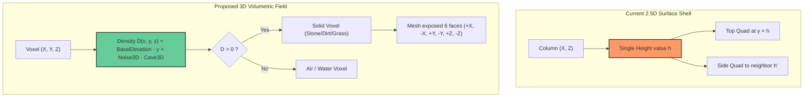
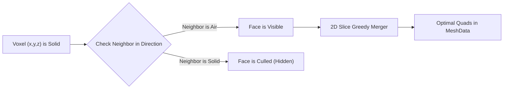

# Implementation Plan: 3D Noise Terrain (Overhangs & Caves)

## Executive Summary & Framework Assessment

A comprehensive architectural checkout of the **Godot 4.4 Voxel Terrain Framework** (`d:\GODOT\terrain`) reveals an exceptionally well-structured, clean-architecture procedural engine with strict separation between pure logic (`RefCounted`) and the SceneTree (`Node3D`).

### 1. Current Architectural Baseline
- **Pure Data Layer (`res://src/core/`)**: Zero `Node` dependencies, runs completely thread-safe on `WorkerThreadPool`.
  - [ChunkCoord](file:///d:/GODOT/terrain/src/core/chunk_coord.gd): 2D horizontal chunk coordinate `(cx, cz)`.
  - [WorldBounds](file:///d:/GODOT/terrain/src/core/world_bounds.gd): 2D chunk grid boundaries, coordinate mapping, and world clamping.
  - [SurfaceChunkData](file:///d:/GODOT/terrain/src/core/surface_chunk_data.gd): **2.5D Surface Heightfield** storing `heights: PackedInt32Array` of size $(chunk\_size + 2)^2$ with a 1-column apron.
  - [MaterialRegistry](file:///d:/GODOT/terrain/src/core/material_registry.gd): 8-bit palette mapping material IDs (`Grass`, `Dirt`, `Stone`, `Sand`, `Snow`, `Seabed`).
- **Generation Layer (`res://src/generation/`)**:
  - [ContinentGenerator](file:///d:/GODOT/terrain/src/generation/continent_generator.gd): Generates a single height scalar $h(x, z)$ per column via 2D Simplex FBM + 2D Ridged mountains + continent coastal falloff mask.
- **Meshing Layer (`res://src/meshing/`)**:
  - [SurfaceShellMesher](file:///d:/GODOT/terrain/src/meshing/surface_shell_mesher.gd): 2D greedy quad merging on top faces ($y = h$) and outward vertical cliff walls.
- **Scene & Streaming Layer (`res://src/world/`, `res://src/streaming/`)**:
  - [ChunkScheduler](file:///d:/GODOT/terrain/src/streaming/chunk_scheduler.gd): Multi-threaded pipeline via `WorkerThreadPool`.
  - [ChunkNode](file:///d:/GODOT/terrain/src/world/chunk_node.gd): Renders `ArrayMesh` and builds `ConcavePolygonShape3D` (`create_trimesh_shape()`).
  - [PlayerMotor](file:///d:/GODOT/terrain/src/player/player_motor.gd): Character controller with physics raycast 1-block step-assist.
- **Automated Test Suite (`res://tests/`)**:
  - 30 headless unit tests, 2 golden regression snapshot tests, and 3 automated performance benchmarks (`0.13s` runtime).

---

## The Core Technical Challenge: 2.5D vs 3D



### Why Overhangs and Caves are Currently Impossible:
1. **Mathematical Limitation**: $y = f(x, z)$ can only produce **one** surface elevation per column. A column cannot have a roof, an empty space, and a floor at the same $(x, z)$.
2. **Mesher Limitation**: [SurfaceShellMesher](file:///d:/GODOT/terrain/src/meshing/surface_shell_mesher.gd) only emits **upward-facing** top quads ($+Y$) and vertical step walls. It contains no logic to mesh downward-facing bottom quads (cave ceilings, underside of overhangs).
3. **Data Storage Limitation**: [SurfaceChunkData](file:///d:/GODOT/terrain/src/core/surface_chunk_data.gd) stores 1D flattened arrays of size $34 \times 34 = 1,156$ columns rather than a 3D voxel grid.

---

## Architectural Design

### 1. Volumetric Data Representation: `VoxelChunkData`
To maintain full compatibility with the existing streaming engine, coordinate system, and boundary barriers, chunks should remain **columnar in X and Z** (`ChunkCoord(cx, cz)`), with a vertical height $H$ (e.g., $H = 128$ voxels):

```gdscript
class_name VoxelChunkData
extends RefCounted

var chunk_size: int = 32
var apron_size: int = 34
var height: int = 128

# 3D Voxel storage: apron_size * height * apron_size bytes (~148 KB per chunk)
# Index formula: (lx + 1) + (ly * apron_size) + ((lz + 1) * apron_size * height)
var voxels: PackedByteArray
```

#### Why Keep Columnar $(cx, cz)$ Chunks?
- **Streaming Pipeline Preserved**: [ChunkStreamer](file:///d:/GODOT/terrain/src/streaming/chunk_streamer.gd) and [ChunkScheduler](file:///d:/GODOT/terrain/src/streaming/chunk_scheduler.gd) work seamlessly without needing complex 3D spherical chunk distance metrics or octree traversal.
- **Ocean Plane & Boundaries**: [WaterPlane](file:///d:/GODOT/terrain/src/world/water_plane.gd) and [WorldBoundary](file:///d:/GODOT/terrain/src/world/world_boundary.gd) operate on 2D map extents.
- **Zero Inter-Chunk Locking**: The 1-voxel apron in $X$ and $Z$ $[-1, 32]$ allows worker threads to query all 6 neighbors of any interior voxel without acquiring mutex locks on neighbor chunks.

---

### 2. Procedural Density Formulation: Overhangs & Caves

The terrain density $D(x, y, z)$ determines whether voxel $(x, y, z)$ is solid or empty:

$$D(x, y, z) = D_{\text{surface}}(x, y, z) - C(x, y, z)$$

#### A. Surface & Overhang Density ($D_{\text{surface}}$):
$$D_{\text{surface}}(x, y, z) = (\text{Elevation}_{2D}(x, z) - y) + N_{\text{overhang}}(x, y, z) \cdot A_{\text{overhang}}(x, z)$$

1. **$\text{Elevation}_{2D}(x, z)$**: Preserves continental shapes, coast falloff, and mountain ridges from [ContinentMask](file:///d:/GODOT/terrain/src/generation/continent_mask.gd).
2. **$N_{\text{overhang}}(x, y, z)$**: 3D Simplex noise with domain warp.
3. **$A_{\text{overhang}}(x, z)$**: Modulated by local mountain height and terrain gradient. In steep mountain cliffs, overhang amplitude is boosted, producing huge dramatic rock arches, cantilevered cliffs, and hollow overhangs. In gentle plains or beaches, $A_{\text{overhang}} \to 0$ to maintain natural terrain.

#### B. Cave Carving Density ($C(x, y, z)$):
We combine two classic procedural cave techniques:

1. **Cheese Caves (Spacious Underworld Caverns)**:
   - 3D Simplex FBM noise sampled at low-frequency: $N_{\text{cheese}}(x, y, z)$.
   - When $N_{\text{cheese}} > \text{threshold}$, carve out large interconnected caverns.
2. **Worm / Noodle Caves (Twisting Tunnels & Ravines)**:
   - Evaluated as two out-of-phase 3D noises $N_A(x, y, z)$ and $N_B(x, y, z)$.
   - Tunnel sample: $R(x, y, z) = N_A^2(x, y, z) + N_B^2(x, y, z)$.
   - If $R < r^2_{\text{tunnel}}$, carve a cylindrical winding tunnel.
3. **Seabed & Surface Protection**:
   - **Ocean Floor Protection**: Attenuate cave noise near sea bottom to prevent ocean breaches (which would create impossible dry holes underwater without fluids).
   - **Bedrock Layer**: Force $y \le 2$ to solid stone to prevent falling out of the world.

---

### 3. Material Classification in 3D

In a 2.5D heightfield, slope and height determined top/side materials. In 3D:
- **Grass**: A solid voxel that has **air directly above it** ($+Y$) and is **exposed to sunlight** (no solid roof above it, or within $k$ blocks of open sky), and elevation $\ge \text{sea\_level}$.
- **Dirt**: Voxels $1 \text{ to } 3$ blocks beneath grass.
- **Stone**: Cave interiors, deep underground, overhang underbellies, and high peaks.
- **Sand**: Near water level ($y \in [\text{sea\_level} - 2, \text{sea\_level} + 2]$) when exposed.
- **Snow**: Highest mountain summits exposed to sky.
- **Seabed**: Subaqueous voxels below sea level.

---

### 4. 3D Meshing: Greedy Voxel Mesher

To support caves and overhangs, the mesher must generate geometry for **all 6 voxel directions**:
- Top faces ($+Y$) and Bottom faces ($-Y$, cave ceilings and overhang underbellies).
- North/South faces ($\pm Z$) and East/West faces ($\pm X$).



#### Greedy Face Merging Algorithm:
Rather than generating 2 triangles per 1x1 voxel face (which would blow up polygon counts in large caves), use **Slice-by-Slice Greedy Merging**:
1. Iterate through each axis: $Y$ (horizontal slices), $X$ (vertical $YZ$ slices), $Z$ (vertical $XY$ slices).
2. For each direction ($+$ and $-$), compute the binary visibility mask of exposed faces.
3. Run the fast 2D rectangular greedy-merging algorithm (already proven in [SurfaceShellMesher](file:///d:/GODOT/terrain/src/meshing/surface_shell_mesher.gd)) to combine adjacent identical-material faces into large single quads.
4. **Result**: 75–85% reduction in triangle count, high framerates, and identical crisp blocky aesthetics.

---

### 5. High-Performance GDScript Strategy: Mitigating the 3D Bottleneck

#### The Problem:
- 2.5D heightfield: $34 \times 34 = 1,156$ noise evaluations per chunk (~6.1 ms).
- 3D voxel grid: $34 \times 128 \times 34 = 147,968$ potential voxels!
- In pure GDScript, evaluating 3D noise 148,000 times per chunk would take ~60–100 ms, causing streaming bottlenecks.

#### The 3-Tier Performance Solution:

| Technique | Description | Speedup Factor |
|---|---|---|
| **1. Vertical Band Culling** | Evaluate 2D base elevation first. For $y > h_{\text{base}} + \Delta_{\text{overhang}}$, skip 3D noise entirely (guaranteed air). For $y < h_{\text{bedrock}}$, fill solid stone. | **~3.5×** |
| **2. Coarse Grid Downsampling & Trilinear Interpolation** | Sample 3D noise on a coarse $4 \times 4 \times 4$ voxel grid ($9 \times 33 \times 9 = 2,673$ noise evaluations vs $148,000$), then trilinearly interpolate density values to voxel resolution. This is the industry-standard voxel game approach. | **~15×** |
| **3. Bitmask Cave Filtering** | Only evaluate expensive cave worm noise when the base 3D density indicates the voxel is actually solid. | **~2×** |

Combined, these optimizations bring chunk generation down to **~6–10 ms** in GDScript!

---

## Detailed Implementation Roadmap

### Phase 1: Core 3D Data Structure & Unit Tests
1. **Create [VoxelChunkData](file:///d:/GODOT/terrain/src/core/voxel_chunk_data.gd)**:
   - Methods: `get_voxel(lx, ly, lz)`, `set_voxel(lx, ly, lz, id)`, `is_in_bounds()`, `is_in_apron()`.
   - Optimized 1D index mapping with horizontal apron $[-1, \text{chunk\_size}]$ and vertical range $[0, \text{height} - 1]$.
2. **Add Unit Tests (`test_voxel_chunk_data.gd`)**:
   - Verify coordinate index math, apron access, boundary checks, and memory footprint.

### Phase 2: Volumetric Procedural Generator
1. **Create [VolumetricContinentGenerator](file:///d:/GODOT/terrain/src/generation/volumetric_continent_generator.gd)**:
   - Subclass of [TerrainGenerator](file:///d:/GODOT/terrain/src/generation/terrain_generator.gd).
   - Integration of 3D overhang noise + 3D cave noise + coarse-grid trilinear sampling.
   - 3D material classifier (grass on top exposed surfaces, dirt layers, stone caves).
2. **Create [VolumetricGeneratorConfig](file:///d:/GODOT/terrain/src/generation/volumetric_generator_config.gd)**:
   - Export parameters for cave frequency, cave size, overhang strength, and vertical limits.
3. **Unit & Benchmark Tests (`test_volumetric_generator.gd`, `bench_volumetric_generator.gd`)**:
   - Test determinism, overhang existence (verifying columns with air beneath solid stone), and cave generation.

### Phase 3: 3D Greedy Mesher
1. **Create [VoxelMesher3D](file:///d:/GODOT/terrain/src/meshing/voxel_mesher_3d.gd)**:
   - Subclass of [Mesher](file:///d:/GODOT/terrain/src/meshing/mesher.gd).
   - Slices voxels along $X, Y, Z$, identifies visible faces, and merges co-planar adjacent quads.
   - Emits correct normals ($+Y, -Y, +X, -X, +Z, -Z$) and vertex colors.
2. **Unit & Regression Tests (`test_voxel_mesher_3d.gd`)**:
   - Verify meshing of hollow boxes (cave interiors), overhang ceilings, and quad reduction efficiency.

### Phase 4: World & System Integration
1. **Update [TerrainQuery](file:///d:/GODOT/terrain/src/world/terrain_query.gd)** & [VoxelWorld](file:///d:/GODOT/terrain/src/world/voxel_world.gd):
   - Update `get_height_at(x, z)` to return the highest solid ground voxel exposed to sky.
   - Update `get_spawn_point()` to ensure the player spawns on safe surface ground with clear headroom.
   - Seamless compatibility with [ChunkNode](file:///d:/GODOT/terrain/src/world/chunk_node.gd) (Godot's `create_trimesh_shape()` automatically supports 3D cave collision).
2. **Verify [PlayerMotor](file:///d:/GODOT/terrain/src/player/player_motor.gd) in Caves**:
   - Verify step-assist works inside underground tunnels and under overhangs without clipping through ceilings.

### Phase 5: Verification, Benchmarks & Golden Snapshots
1. Run complete automated test suite (`godot --headless -s res://tests/run_tests.gd -- --suite=all`).
2. Verify architecture test passes (no `Node` dependencies in pure layers).
3. Update golden baselines where appropriate.
