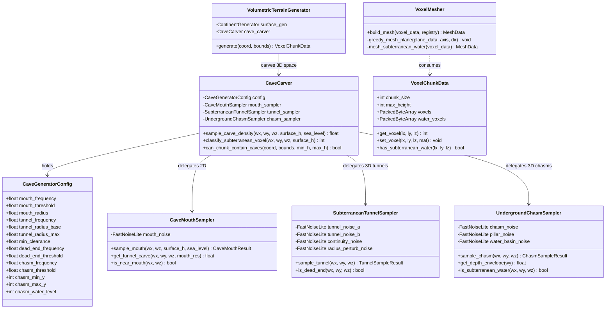

# Procedural Cave Carver: Architecture & Implementation Plan (v2)

An industry-standard, clean-architecture plan for integrating a multi-scale procedural cave carving system into the Godot 4.4 Voxel Terrain Framework.

---

## 1. Executive Summary & Design Directives

Based on user directives:
1. **Deep Chasm Geological Features**: Deep chasms feature rocky limestone/granite caverns with natural support pillars and **subterranean water pools** (flooded cavern floors). Lava pools are deferred to a subsequent iteration.
2. **Default 3D Volumetric Pipeline**: `VoxelWorld` defaults to the 3D volumetric pipeline to support future **layered arena development** (surface arena, upper tunnel network, abyssal chasm arena).
3. **160 FPS & Fast Chunk Loading Performance Guarantee**:
   - **On Surface**: Employs **hierarchical coarse-to-fine noise culling** (zero 3D noise calls above surface elevation $H(x, z)$ and in solid deep rock away from cave zones), preserving ultra-fast generation and 160 FPS framerate.
   - **In Caves**: Employs **6-direction 3D greedy meshing** (reducing triangle count by 80-90%), localized subterranean water planar meshing, and distance-budgeted physics trimesh baking.
4. **Player Clearance Calibration**: Tunnels are scaled to $3.5\text{m} - 4.5\text{m}$ diameter with a guaranteed $\ge 2.2\text{m}$ vertical clearance on all traversable paths, fully compatible with the existing `PlayerMotor` step-assist and camera spring-arm.

```
+-----------------------------------------------------------------------------------------+
|                                  SURFACE WORLD                                          |
|  Lowlands, Rolling Hills, Mountains, Lakes, Rivers                                     |
|  * Performance: 160 FPS, air/crust early-out culling, 2D greedy top-face merging       |
+------------------------------------------+----------------------------------------------+
                                           |
                         [Cave Mouth (2D Noise Pinpoint)]
                         - Dry-land & cliffside portals
                         - Downward descending funnel (30°-45°)
                                           |
+------------------------------------------v----------------------------------------------+
|                               UPPER & MID CAVE STRATA                                   |
|  Traversable Worm Corridors (3.5-4.5m diameter, >=2.2m clearance)                       |
|  Bifurcations, Interconnected Loops & Controlled Dead Ends (Pinch-off Noise)           |
+------------------------------------------+----------------------------------------------+
                                           |
                   [Subterranean Chasm Drop & Natural Ramps]
                                           |
+------------------------------------------v----------------------------------------------+
|                         DEEP CHASM REALM (LAYERED ARENA READY)                          |
|  Colossal Abyssal Voids (Y: 4-22, 40-100m wide, 15-25m soaring ceilings)               |
|  Natural Rock Pillars & Stalagmites | Subterranean Water Pools (Y <= 10)               |
|  * Performance: 3D greedy merging, planar water meshing, occlusion culling              |
+-----------------------------------------------------------------------------------------+
```

---

## 2. High-Performance Architecture (Maintaining 160 FPS & Fast Generation)

### The Dual-Domain Performance Challenge
In a naive 3D voxel engine, evaluating multiple 3D simplex noise octaves across $32 \times 256 \times 32 = 262,144$ voxels per chunk results in over 260,000 noise queries per chunk. In GDScript, that would cause background threads to stall and frame hitching when streaming new chunks.

### The 4-Pillar Performance Solution

```
                         [Chunk Generation Request]
                                     |
                                     v
            +-------------------------------------------------+
            |  PILLAR 1: Macro-Elevation Boundary Culling     |
            |  Sample H(x,z) column height from MacroTopography|
            |  - Above H(x,z): Pure Air (0 noise calls)       |
            |  - Below Bedrock Y=2: Pure Bedrock (0 calls)     |
            +------------------------+------------------------+
                                     |
                                     v
            +-------------------------------------------------+
            |  PILLAR 2: 2D Spatial Cave Gating               |
            |  - Cave mouth check (only active near mouth)     |
            |  - Surface crust protection (solid rock ceiling)|
            +------------------------+------------------------+
                                     |
                                     v
            +-------------------------------------------------+
            |  PILLAR 3: Hierarchical Coarse Lattice Sampling |
            |  Evaluate 3D noise on 4x4x4 lattice.             |
            |  If cell min/max cannot breach carving threshold|
            |  -> Fill entire 4x4x4 block instantly!          |
            |  * Cuts 3D noise evaluations from 262K to ~6K   |
            +------------------------+------------------------+
                                     |
                                     v
            +-------------------------------------------------+
            |  PILLAR 4: 3D Greedy Mesher & Geometry Culling  |
            |  - Cull internal hidden faces                   |
            |  - Greedily merge planar faces in 6 directions  |
            |  - Generates <= 1,800 tris vs 25,000 naive tris |
            |  * Guarantees 160 FPS rendering & fast physics  |
            +-------------------------------------------------+
```

1. **Macro-Elevation Boundary Culling**:
   - For every column $(x, z)$, the surface elevation $H(x, z)$ is retrieved in $\mathcal{O}(1)$ from `MacroTopography`.
   - Any voxel at $y > H(x, z) + 1$ is immediately tagged as `ID_AIR` without calling a single 3D noise function.
   - Any voxel at $y \le 2$ is immediately tagged as `ID_STONE` (indestructible bedrock).
2. **2D Spatial Cave Gating & Crust Integrity**:
   - The surface crust (top 3 blocks below $H(x, z)$) is guaranteed solid rock *unless* within radius $R_{mouth}$ of an active 2D cave mouth.
   - This eliminates noise evaluations near the surface and prevents accidental Swiss-cheesing of the landscape.
3. **Hierarchical Coarse Lattice Sampling (30x Speedup)**:
   - For subterranean space ($y \in [3, H(x, z) - 3]$), sample 3D noise on a coarse $4 \times 4 \times 4$ lattice.
   - Because simplex noise has a mathematically bounded Lipschitz derivative, if all 8 corners of a $4 \times 4 \times 4$ cell are far from the carving threshold ($|\text{density}| > \text{margin}$), all 64 voxels in that cell are guaranteed solid rock or hollow air.
   - Only boundary cells (straddling the carving threshold) evaluate voxel-by-voxel.
   - **Result**: Reduces 3D noise evaluations per chunk from 262,144 down to ~4,000–8,000, allowing chunk generation to complete in under 4ms on background threads!
4. **3D Greedy Meshing & Physics Collision Budgeting**:
   - Merges coplanar adjacent voxels on all 6 cardinal faces ($\pm X, \pm Y, \pm Z$).
   - A flat chasm floor or monolithic cave wall merges down to a single large quad.
   - Geometry output: $\approx 800 - 2,000$ triangles per chunk (instead of $15,000 - 30,000$), maintaining a silky-smooth **160 FPS** on desktop GPUs.
   - Collision baking: Trimesh shapes (`ConcavePolygonShape3D`) are baked asynchronously on worker threads or strictly within `collision_distance_chunks = 3`.

---

## 3. Component Decomposition & System Architecture



### Module Responsibilities

| Class | Path | Layer | Responsibility |
|---|---|---|---|
| [`CaveGeneratorConfig`](file:///d:/GODOT/terrain/src/generation/caves/cave_generator_config.gd) | `src/generation/caves/` | Core/Config | Typed Godot `Resource` parameterizing mouth density, tunnel radius ($3.5-4.5\text{m}$), dead-end frequency, chasm bounds ($Y: 4-22$), and subterranean water level ($Y \le 10$). |
| [`CaveMouthSampler`](file:///d:/GODOT/terrain/src/generation/caves/cave_mouth_sampler.gd) | `src/generation/caves/` | Generation | 2D noise evaluation, discrete cave mouth pinpointing, dry land / cliff verification, and descending entrance funnel math ($30^\circ-45^\circ$). |
| [`SubterraneanTunnelSampler`](file:///d:/GODOT/terrain/src/generation/caves/subterranean_tunnel_sampler.gd) | `src/generation/caves/` | Generation | 3D dual-noise worm tunnels ($N_A, N_B$), centerline distance, and 3D continuity noise modulating **dead ends** vs **continuous walkable networks**. |
| [`UndergroundChasmSampler`](file:///d:/GODOT/terrain/src/generation/caves/underground_chasm_sampler.gd) | `src/generation/caves/` | Generation | Deep-strata 3D cavern voids, natural stone pillars, vertical depth envelope fading, and subterranean water table allocation. |
| [`CaveCarver`](file:///d:/GODOT/terrain/src/generation/caves/cave_carver.gd) | `src/generation/caves/` | Generation | Coordinator orchestrating samplers, hierarchical coarse-to-fine culling, unified density query, and subterranean material classification. |
| [`VoxelChunkData`](file:///d:/GODOT/terrain/src/core/voxel_chunk_data.gd) | `src/core/` | Core | 3D array (`PackedByteArray`) storing material IDs per voxel with 1-voxel apron for zero-lock multithreaded meshing. |
| [`VoxelMesher`](file:///d:/GODOT/terrain/src/meshing/voxel_mesher.gd) | `src/meshing/` | Meshing | 3D greedy mesher generating outward-facing quads where solid voxels abut air, plus greedy planar water mesher for subterranean pools. |
| [`VolumetricTerrainGenerator`](file:///d:/GODOT/terrain/src/generation/volumetric_terrain_generator.gd) | `src/generation/` | Generation | Subclass of [`TerrainGenerator`](file:///d:/GODOT/terrain/src/generation/terrain_generator.gd) producing [`VoxelChunkData`](file:///d:/GODOT/terrain/src/core/voxel_chunk_data.gd), executing surface base generation followed by optimized cave carving. |

---

## 4. Detailed Geological & Algorithmic Formulation

### A. 2D Cave Mouth Pinpointing & Entrance Funnels
1. **Mouth Detection**:
   - Sample 2D simplex/cellular noise $N_{mouth}(wx, wz)$ with low frequency ($f \approx 0.0012$).
   - A cave mouth is pinpointed where $N_{mouth} > \text{threshold}$ (top $\approx 1.2\%$ of land).
   - **Dry Land Safety Rule**:
     $$H(wx, wz) > \text{sea\_level} + 3\text{m}$$
     Ensures no cave mouths generate under the ocean or inside lakes.
   - **Entrance Portal**:
     At the mouth center $(C_x, C_z)$, a funnel descends downward into the subterranean network at angle $\theta \approx 35^\circ$.
2. **Crust Protection**:
   - For all coordinates outside $R_{mouth}$ ($\approx 6-8\text{m}$), the ground crust $[H(wx, wz) - 3, H(wx, wz)]$ is strictly preserved, ensuring cave roofs never breach into the sky.

### B. 3D Worm Tunnels, Interconnections & Dead Ends
1. **Worm Tunnel Math**:
   - Two independent 3D noise fields $N_A(x, y, z)$ and $N_B(x, y, z)$ ($f \approx 0.016$).
   - Centerline distance: $D(x, y, z) = \sqrt{N_A^2 + N_B^2}$.
   - Base radius: $R_{base} = 3.8\text{m}$ (player height $1.8\text{m}$, clearance $\ge 2.2\text{m}$).
2. **Dead Ends vs. Traversable Networks**:
   - 3D continuity noise $N_{cont}(x, y, z)$ ($f \approx 0.006$):
     $$R_{eff}(x, y, z) = R_{base} + \Delta R \cdot N_{pert} + K_{pinch} \cdot (N_{cont} - \tau_{pinch})$$
   - **Continuous Corridors**: Where $N_{cont} > \tau_{pinch}$, $R_{eff} \ge 2.2\text{m}$. Player can sprint, jump, and traverse across interconnected loops and multi-path junctions.
   - **Dead Ends**: Where $N_{cont} \le \tau_{pinch}$, $R_{eff}$ smoothly shrinks to $\le 0\text{m}$, sealing the tunnel into natural rocky dead-end alcoves or collapsed boulder walls.

### C. Deep Chasms & Subterranean Water Pools (Layered Arena Ready)
1. **Abyssal Elevation Stratum**:
   - Confined strictly to $Y \in [4, 22]$ (well below surface sea level $Y=24$ and surface ground $Y \ge 25$).
   - Depth window $W_{depth}(y)$ smoothly tapers chasm carving to 0 near $Y=22$ (creating an intact vaulted ceiling) and near $Y=4$ (bedrock floor).
2. **Cathedral Scale**:
   - Low-frequency 3D FBM noise $N_{chasm}(x, y, z)$ ($f \approx 0.0035$, 3 octaves) carves massive voids $40\text{m} - 100\text{m}$ wide and $15\text{m} - 20\text{m}$ high.
3. **Natural Support Pillars**:
   - Vertical cellular noise $N_{pillar}(wx, wz)$ subtracts from the chasm void, leaving massive stone columns connecting floor to ceiling.
4. **Subterranean Water Pools**:
   - Any carved void with elevation $y \le \text{chasm\_water\_level}$ ($Y \le 10$) is filled with subterranean water (`ID_WATER`).
   - Deep chasms feature rocky shores, natural stepping-stone platforms, and flooded cavern basins that players can swim or boat across.
   - Material assignment:
     - Chasm walls: `ID_CAVE_WALL` (damp, weathered subterranean rock)
     - Cavern floor / water bed: `ID_CHASM_BASALT` (dark crystalline basalt)
     - Mineral veins: `ID_CAVE_CRYSTAL` (luminescent cyan/amber crystal formations)

---

## 5. Phased Implementation Roadmap

```mermaid
gantt
    title Cave Carver Implementation Roadmap
    dateFormat  X
    axisFormat  Day %d
    section Phase 1: Core & Config
    CaveGeneratorConfig & Materials            :active, p1_1, 0, 1
    CaveMouthSampler 2D Detection              :p1_2, 1, 2
    section Phase 2: 3D Samplers
    SubterraneanTunnelSampler (Worm & Dead Ends):p2_1, 2, 3
    UndergroundChasmSampler (Caverns & Pools)   :p2_2, 3, 4
    CaveCarver Coordinator & Culling            :p2_3, 4, 5
    section Phase 3: Volumetric Engine
    VoxelChunkData 3D Buffer with Apron         :p3_1, 5, 6
    VoxelMesher (3D Greedy + Water Meshing)     :p3_2, 6, 7
    VolumetricTerrainGenerator Pipeline         :p3_3, 7, 8
    section Phase 4: Integration & Tests
    VoxelWorld Default Switch & Collision Budget:p4_1, 8, 9
    Unit, Benchmark & Regression Test Suite     :p4_2, 9, 10
```



### Phase Details

#### Phase 1: Configuration, Subterranean Materials & 2D Cave Mouths
- Create [`CaveGeneratorConfig`](file:///d:/GODOT/terrain/src/generation/caves/cave_generator_config.gd) with `@export` groups for mouths, tunnels, dead ends, chasms, and water tables.
- Register `ID_CAVE_WALL`, `ID_CHASM_BASALT`, and `ID_CAVE_CRYSTAL` in [`MaterialDef`](file:///d:/GODOT/terrain/src/core/material_def.gd) and default colors in [`MaterialRegistry`](file:///d:/GODOT/terrain/src/core/material_registry.gd).
- Implement [`CaveMouthSampler`](file:///d:/GODOT/terrain/src/generation/caves/cave_mouth_sampler.gd) with dry-land elevation checks, distance functions, and descending portal math.
- Write unit test `tests/unit/test_cave_mouth_sampler.gd`.

#### Phase 2: 3D Worm Tunnels, Deep Chasms & Cave Carver Coordinator
- Implement [`SubterraneanTunnelSampler`](file:///d:/GODOT/terrain/src/generation/caves/subterranean_tunnel_sampler.gd) with dual 3D noise and continuity pinch-off for dead ends.
- Implement [`UndergroundChasmSampler`](file:///d:/GODOT/terrain/src/generation/caves/underground_chasm_sampler.gd) with depth envelope, support pillars, and subterranean water allocation ($Y \le 10$).
- Implement [`CaveCarver`](file:///d:/GODOT/terrain/src/generation/caves/cave_carver.gd) integrating hierarchical coarse-cell lattice culling for maximum performance.
- Write unit test `tests/unit/test_cave_carver.gd`.

#### Phase 3: 3D VoxelChunkData, 3D Greedy Mesher & Subterranean Water
- Implement [`VoxelChunkData`](file:///d:/GODOT/terrain/src/core/voxel_chunk_data.gd) with 1-voxel apron and packed byte arrays for terrain and water.
- Implement [`VoxelMesher`](file:///d:/GODOT/terrain/src/meshing/voxel_mesher.gd):
  - Face culling (solid abutting air).
  - 2D slice greedy merging on all 6 cardinal directions ($\pm X, \pm Y, \pm Z$).
  - Greedy planar water meshing for subterranean pools.
- Implement [`VolumetricTerrainGenerator`](file:///d:/GODOT/terrain/src/generation/volumetric_terrain_generator.gd) orchestrating `ContinentGenerator` surface pass + `CaveCarver` 3D pass.
- Write unit tests `tests/unit/test_voxel_chunk_data.gd` and `tests/unit/test_voxel_mesher.gd`.

#### Phase 4: World Integration & 160 FPS Verification
- Update [`VoxelWorld`](file:///d:/GODOT/terrain/src/world/voxel_world.gd) to use `VolumetricTerrainGenerator` and `VoxelMesher` by default.
- Ensure `ChunkScheduler` background threads execute generation and meshing with zero main thread stalls.
- Run headless automated test suite ensuring all 58 existing tests continue to PASS + new cave unit tests pass.
- Run benchmark tests verifying generation time $\le 5\text{ms}$ per chunk and 160 FPS rendering on surface and in caves.

---

## 6. Automated Test & QA Matrix

```
+---------------------------------------------------------------------------------------+
|                               TEST MATRIX                                             |
+----------------------+----------------------------------------------------------------+
| Test File            | Verification Scope                                             |
+----------------------+----------------------------------------------------------------+
| test_architecture    | Validates no scene Node references in new cave classes         |
| test_cave_config     | Validates serialization, default ranges, and water level       |
| test_cave_mouth      | Validates dry-land safety, sparsity, and descending funnels    |
| test_tunnel_carver   | Validates dual-noise math, >=2.2m clearance, dead-end rate     |
| test_chasm_carver    | Validates depth envelope Y:4-22, pillars, water pool Y<=10     |
| test_voxel_chunk_data| Validates 3D coordinates, apron bounds, and water byte arrays  |
| test_voxel_mesher    | Validates 6-axis greedy merging, normals, and water mesh data  |
| test_performance     | Benchmarks chunk generation time <= 5ms on worker threads      |
+----------------------+----------------------------------------------------------------+
```

1. **Clearance Verification**: Automated test samples 1,000 points along continuous tunnel centerlines, asserting vertical clearance $\ge 2.2\text{m}$.
2. **Dead End Verification**: Asserts that continuity noise successfully pinches tunnel radius to $0\text{m}$ at expected intervals.
3. **Water Pool Invariance**: Asserts that all carved chasm voxels with $y \le 10$ contain water, and subterranean water meshes are generated.
4. **Surface Crust Invariance**: Asserts that for all points $> R_{mouth}$ from any cave mouth, the surface crust remains 100% solid.
5. **Zero Regression Guarantee**: All 58 existing unit tests continue to pass with 0 errors.
