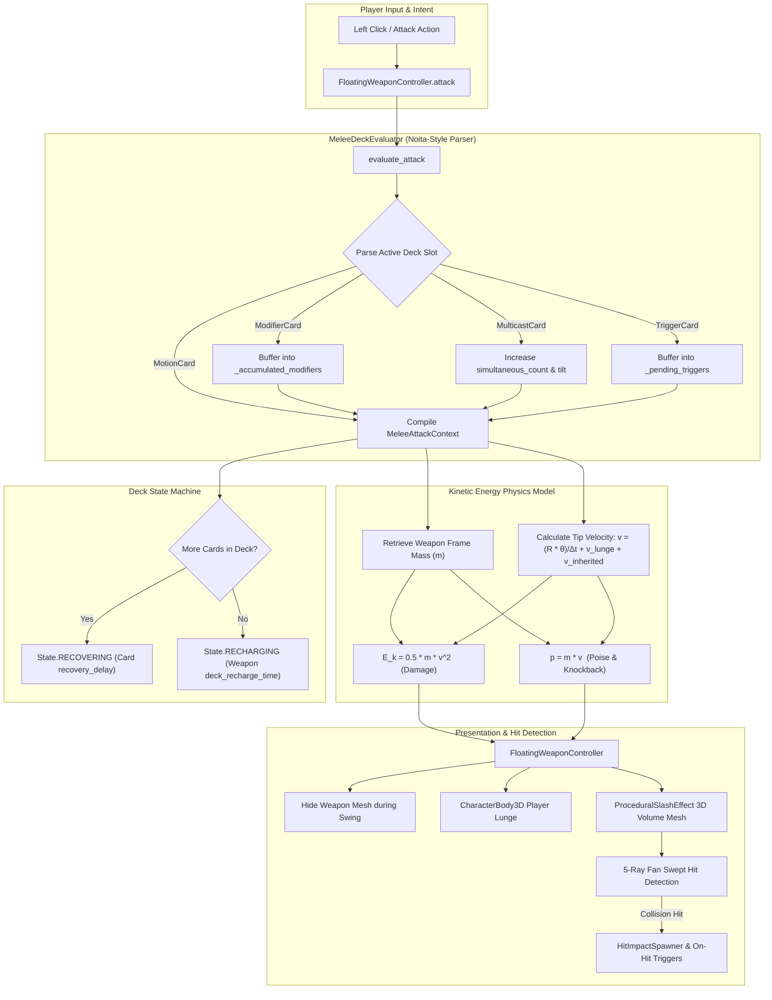
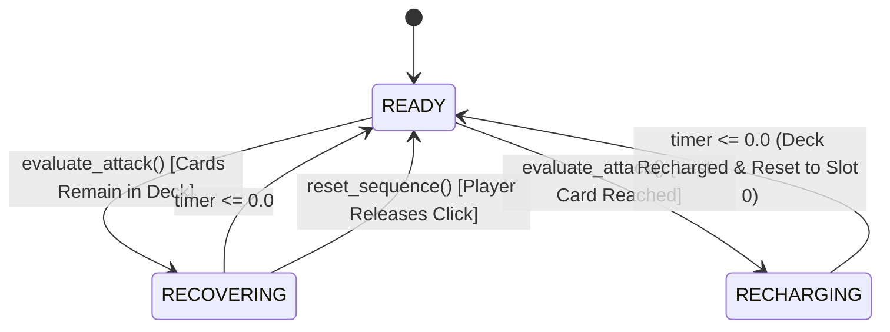
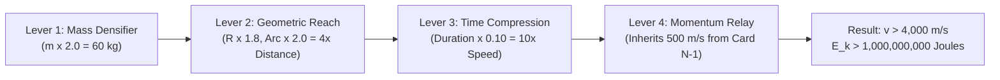

# Procedural Attack & Kinetic Combat System Architecture

The procedural attack system in this codebase is a decoupled, physics-derived combat engine written in GDScript for Godot 4. Inspired by the modular deck-building and wand-crafting mechanics of *Noita*, the system abandons hardcoded animation rigs and static damage numbers. Instead, attacks are synthesized dynamically at runtime through slotted technique cards, physical frame mass, swept 3D volumetric meshes, and **Kinetic Energy ($E_k = \frac{1}{2} m v^2$)**.

---

## 1. High-Level Architecture & Execution Flow



---

## 2. Core Design Principles

1. **Decoupled Combat Mechanics**:
   The 3D weapon definition ([`MeleeWeaponDef`](file:///d:/GODOT/terrain/src/combat/core/melee_weapon_def.gd)) does **not** contain animation data, attack combos, or hardcoded damage numbers. A weapon is a physical frame characterized by its **mass (kg)**, **socket capacity**, **recharge cooldown**, and **mount offsets**.
2. **Emergent, Non-Hardcoded Damage**:
   Damage is **never hardcoded** on cards (e.g. `base_damage = 25`). Instead, damage is a physical quantity derived from the kinetic energy of the swing:
   $$E_k = \frac{1}{2} m v^2$$
3. **Card-Driven Execution Timing & Frequency**:
   Every visual, kinematic, and temporal aspect of an attack—how fast it sweeps, how large the 3D arc is, how far the player lunges, and how long before the next swing can execute—is dictated strictly by slotted [`TechniqueCard`](file:///d:/GODOT/terrain/src/combat/core/technique_card.gd)s.
4. **Analytical Volumetric Hitboxes (Zero Tunneling)**:
   High-speed attacks do not use continuous physics colliders that suffer from tunneling at high velocities. Slashes are evaluated via multi-ray fan casts that sweep the entire 3D arc volume instantaneously.

---

## 3. Kinetic Energy & Momentum Physics Model

When a motion executes, [`MeleeAttackContext.compute_kinetic_metrics()`](file:///d:/GODOT/terrain/src/combat/core/melee_attack_context.gd) calculates the physical quantities of the strike:

### 3.1 Mathematical Derivation

| Quantity | Formula | Description |
| :--- | :--- | :--- |
| **Frame Mass ($m$)** | $m = \text{weapon.mass} \times \text{ctx.mass\_multiplier}$ | Participating physical mass in kg. |
| **Angular Velocity ($\omega$)** | $\omega = \frac{\theta}{\Delta t}$ | Rotational speed in rad/s, where $\theta = \text{deg\_to\_rad}(\text{arc\_sweep\_degrees})$ and $\Delta t = \text{execution\_duration}$. |
| **Tangential Tip Velocity ($v_{\text{rot}}$)** | $v_{\text{rot}} = R \times \omega = \frac{R \cdot \theta}{\Delta t}$ | Linear speed of the blade tip at radius $R$ (`outer_radius`). |
| **Linear Lunge Velocity ($v_{\text{lin}}$)** | $v_{\text{lin}} = \frac{d_{\text{lunge}}}{\Delta t}$ | Forward velocity contributed by player lunge. |
| **Inherited Velocity ($v_{\text{inherited}}$)** | $v_{\text{prev}} \times \text{momentum\_retention}$ | Velocity carried over from the preceding strike in a combo. |
| **Total Tip Velocity ($v$)** | $\mathbf{v = v_{\text{rot}} + v_{\text{lin}} + v_{\text{inherited}}}$ | Total impact velocity at point of contact (m/s). |
| **Kinetic Energy ($E_k$)** | $\mathbf{E_k = \frac{1}{2} m v^2}$ | Work done by impact in **Joules**, directly driving **Damage**. |
| **Linear Momentum ($p$)** | $\mathbf{p = m \cdot v}$ | Physical impulse in $\text{kg}\cdot\text{m/s}$, driving **Poise Break** & **Knockback**. |

### 3.2 Derived Damage & Combat Impulse

```gdscript
ctx.damage = ctx.kinetic_energy * ctx.kinetic_efficiency * ctx.damage_multiplier * weapon.base_damage_multiplier
ctx.poise_damage = ctx.momentum * 0.15 * ctx.poise_multiplier
ctx.knockback_force = clampf(ctx.momentum * 0.05 * ctx.poise_multiplier, 2.0, 150.0)
```

* **Kinetic Efficiency**: Allows distinct weapon archetypes to focus energy differently. For example, a narrow piercing thrust concentrates kinetic energy onto a microscopic surface point (`kinetic_efficiency = 1.35`), while a wide blunt cleave transfers blunt impact (`kinetic_efficiency = 1.15`).
* **Poise & Knockback**: Governed by linear momentum ($p = m \cdot v$). Heavy, high-mass weapons break enemy poise and stagger easily, even at moderate speeds.

### 3.3 Frame Mass Derivation from Voxel Synthesis

In [`ProceduralWeaponEngine.compute_voxel_mass()`](file:///d:/GODOT/terrain/src/combat/generator/procedural_weapon_engine.gd), mass is calculated directly from the weapon's 3D voxel matrix:

$$\text{Mass} = 0.045 \times \sum_{(x,y,z)} \text{VOXEL\_WEIGHT}(V_{x,y,z})$$

| Voxel Semantic Role | Weight (kg/voxel) | Functional Justification |
| :--- | :---: | :--- |
| `HANDLE` | `0.8` | Lightweight grip wraps and ergonomic core |
| `JUNCTION` | `1.6` | Heavy structural crossguards and socket collars |
| `BODY` | `1.3` | High-density reinforced alloy blade spine |
| `EDGE` | `1.1` | Hardened, polished perimeter cutting bevels |
| `ENERGY` | `0.4` | Low-density plasma conduits and glowing mana cores |
| `ACCENT` | `1.5` | Dense decorative gold trim and pommel counterweights |

* **Slender Frames** (e.g. `PARAMETRIC_HELIX` / Rapiers): $\sim 8.0\text{ – }12.0\text{ kg}$
* **Balanced Frames** (e.g. `KALEIDOSCOPIC` / Longswords): $\sim 14.0\text{ – }18.0\text{ kg}$
* **Colossal Heavy Frames** (e.g. `VOLUMETRIC_EROSION` / Greatswords): $\sim 28.0\text{ – }40.0\text{ kg}$

---

## 4. Technique Card Taxonomy

All slotted combat techniques extend [`TechniqueCard`](file:///d:/GODOT/terrain/src/combat/core/technique_card.gd), which defines identity, name, icon, and card kind.

```
TechniqueCard
├── MotionCard      (Base strike action: 3D arc geometry, duration, reach, lunge)
├── ModifierCard    (Kinetic infusion: speed, mass multiplier, momentum retention)
├── MulticastCard   (Formation casting: simultaneous multi-slash formations)
└── TriggerCard     (Conditional execution: On-Hit / On-Timer payload cascades)
```

### 4.1 Motion Cards ([`MotionCard`](file:///d:/GODOT/terrain/src/combat/techniques/motions/motion_card.gd))
Motion cards define physical action and 3D volumetric slash geometry:

```gdscript
@export_group("Attack Execution Timing")
@export var execution_duration: float = 0.24   # Swing speed (seconds)
@export var recovery_delay: float = 0.18       # Frequency cooldown before next action

@export_group("3D Volumetric Slash VFX Mesh")
@export var inner_radius: float = 0.75         # Inner hollow boundary (meters)
@export var outer_radius: float = 2.45         # Outer blade tip reach (meters)
@export var arc_sweep_degrees: float = 135.0   # Angular sweep of the arc
@export var volume_thickness: float = 0.22     # 3D radial ribbon thickness
@export var outer_height: float = 0.025        # Vertical ribbon height
@export var tilt_degrees: float = -10.0        # Inclination plane of the swing
@export var is_reversed_sweep: bool = false    # Left-to-right vs right-to-left

@export_group("Kinetic Motion Dynamics")
@export var player_lunge_distance: float = 0.0 # Forward kinematic impulse
@export var kinetic_efficiency: float = 1.0    # Transfer ratio into damage
@export var mass_multiplier: float = 1.0       # Motion-specific mass scaling
```

### 4.2 Modifier Cards ([`ModifierCard`](file:///d:/GODOT/terrain/src/combat/techniques/modifiers/modifier_card.gd))
Modifiers alter the execution parameters of subsequent motion cards in the deck sequence:

```gdscript
@export_group("Timing Multipliers")
@export var execution_duration_multiplier: float = 1.0  # < 1.0 = faster, > 1.0 = heavy slow
@export var recovery_delay_multiplier: float = 1.0      # Multiplier on attack frequency

@export_group("Kinetic Mass & Momentum Multipliers")
@export var mass_multiplier: float = 1.0       # Compresses or densifies strike mass
@export var momentum_retention: float = 0.0    # Retains exit velocity from prior strikes (0.0 to 1.0+)

@export_group("Scale & Reach")
@export var radius_multiplier: float = 1.0     # Scales outer_radius (lever arm)
@export var arc_sweep_multiplier: float = 1.0  # Scales angular degrees swept
```

### 4.3 Multicast Cards ([`MulticastCard`](file:///d:/GODOT/terrain/src/combat/techniques/multicast/multicast_card.gd))
Resolves two or more subsequent motion cards simultaneously in a single attack action, adjusting visual formation tilts (e.g. cross cuts, twin parallel slashes, scissors).

### 4.4 Trigger Cards ([`TriggerCard`](file:///d:/GODOT/terrain/src/combat/techniques/triggers/trigger_card.gd))
Carries nested payload cards executed conditionally upon collision (`ON_HIT`) or elapsed time (`ON_TIMER`).

---

## 5. Sequential Evaluation & Combo Parsing

[`MeleeDeckEvaluator`](file:///d:/GODOT/terrain/src/combat/core/melee_deck_evaluator.gd) parses slotted technique cards from left to right:

```
[Slot 0: Modifier] ──> [Slot 1: Multicast 2] ──> [Slot 2: Motion A] ──> [Slot 3: Motion B]
         │                       │                      │                     │
      Buffered                Buffered             Receives Mod           Receives Mod
                                                   & Executes             & Executes
```

1. **Left-to-Right Iteration**:
   `_current_index` starts at `0` (the leftmost card) and steps sequentially.
2. **Modifier & Trigger Accumulation**:
   When encountering a `ModifierCard` or `TriggerCard`, it appends to internal buffers (`_accumulated_modifiers`, `_pending_triggers`) without triggering an attack.
3. **Release on Motion Card**:
   When a `MotionCard` is reached, a `MeleeAttackContext` is instantiated, baseline parameters are populated, and all buffered modifiers and triggers are applied.
4. **Combo Velocity Inheritance**:
   If `ctx.momentum_retention > 0.0`, it inherits exit velocity from the prior strike:
   $$\text{ctx.inherited\_velocity} = \text{\_previous\_tip\_velocity} \times \text{ctx.momentum\_retention}$$
5. **Buffer Clearing**:
   Once the multicast quota is fulfilled (`multicast_remaining <= 0`), `_accumulated_modifiers` and `_pending_triggers` are wiped clean for subsequent swings.

---

## 6. Deck Timing & State Machine

The evaluator strictly regulates execution rhythm via three explicit states:



* **`State.READY`**: The weapon can immediately accept an attack command.
* **`State.RECOVERING`**: The weapon has executed a strike and is waiting for `max(c.recovery_delay)`. Delays are dictated purely by cards, not animation blending.
* **`State.RECHARGING`**: The evaluator reached the end of the active deck. It enters cooldown for `max(max_recovery, weapon.deck_recharge_time)` before looping back to slot `0` (or shuffling if `weapon.is_shuffle = true`).
* **Sequence Reset (`reset_sequence()`)**: If a player releases the attack button and pauses, the cast pointer resets to slot `0` while strictly preserving remaining cooldowns so delays cannot be bypassed.

---

## 7. 3D Volumetric Mesh & Hit Detection

### 7.1 Procedural Mesh Construction ([`SlashArcMeshBuilder`](file:///d:/GODOT/terrain/src/combat/visuals/slash_arc_mesh_builder.gd))

Unlike flat sprite trails, the attack effect generates a true **3D volumetric ribbon mesh**:
* **Cylindrical Slice Extrusion**: Generates $N$ arc segments between `inner_radius` and `outer_radius`.
* **Cross-Section Geometry**: Each segment extrudes 4 vertices (inner-top, outer-top, outer-bottom, inner-bottom), forming a solid 3D wedge.
* **Aerodynamic Beveling**: Leading edge and trailing edges are tapered to zero thickness to create a sharp blade silhouette.

```
                      Outer Radius (Tip)
                    +--------------------+
                   /                    /|
  Volume Thickness|                    | | Outer Height
                  +--------------------+ |
                  |                    |/
                  +--------------------+
                      Inner Radius
```

### 7.2 Analytic Swept Hit Detection & Dynamic Ray Density ([`ProceduralSlashEffect`](file:///d:/GODOT/terrain/src/combat/visuals/procedural_slash_effect.gd))

To prevent tunneling at high velocities (e.g. supersonic swings) and eliminate spatial blindspots on wide or extended reaches, `check_hit_volume()` generates an adaptive ray fan dynamically scaled to the sweep circumference:

```gdscript
var abs_sweep = maxf(absf(sweep_angle_deg), 15.0)
var reach = outer_radius * 0.95
var arc_rad = deg_to_rad(abs_sweep)
var circumference = reach * arc_rad

# Dynamic ray density: maximum spacing <= 0.35m prevents enemies from slipping between ray tips
var ray_count = clampi(int(ceil(circumference / 0.35)), 5, 32)
var half_arc = abs_sweep * 0.5
var is_full_circle = abs_sweep >= 359.0

for i in range(ray_count):
    var angle_deg = (float(i) / float(ray_count)) * 360.0 - 180.0 if is_full_circle else lerpf(-half_arc, half_arc, float(i) / float(ray_count - 1))
    var dir = forward.rotated(normal_up, deg_to_rad(angle_deg)).normalized()
    var to_point = origin + dir * reach

    var query = PhysicsRayQueryParameters3D.create(origin, to_point)
    query.exclude = exclude_rids
    var hit = space_state.intersect_ray(query)
    if not hit.is_empty():
        return hit
```

* **Cost**: $5$ to $32$ rays execute in under **$0.01\text{ to }0.04\text{ ms}$** total.
* **Reliability**: Eliminates ray-spacing gaps when reach is heavily scaled ($R > 5\text{m}$) and guarantees full $360^\circ$ circular coverage without blindspots.

---

## 8. Engine-Level Guardrails & Edge-Case Safeguards

Pushing combat physics to the 1-billion damage scale can provoke floating-point overflows or physics engine instability. The engine implements three strict guardrails:

### 8.1 Terminal Physical Velocity Cap (`MAX_PHYSICAL_VELOCITY = 25,000 m/s`)
* **Problem**: Multiplicative momentum retention ($v_{\text{inherited}} > 1.0$) across loops can escalate exponentially toward $\mathbf{\text{INF}}$ / $\mathbf{\text{NaN}}$, crashing matrix transforms.
* **Guard**: In [`MeleeAttackContext.compute_kinetic_metrics()`](file:///d:/GODOT/terrain/src/combat/core/melee_attack_context.gd), velocity is strictly clamped to `MAX_PHYSICAL_VELOCITY = 25,000.0 m/s` (Mach $\sim 73$) with `is_finite()` fallback checks.
* **Why this is optimal**: A $30\text{ kg}$ colossal hammer at $25,000\text{ m/s}$ generates **$9,375,000,000\text{ Joules}$** ($9.3+$ Billion Damage)—ample headroom for the player's 1-billion damage goal while guaranteeing float safety.

### 8.2 Terminal Impulse & Knockback Guard (`MAX_PHYSICAL_KNOCKBACK_FORCE = 120.0`)
* **Problem**: Passing $10^9$ raw kinetic impulse into a Godot `RigidBody3D` would induce instantaneous velocities over $20,000\text{ km/s}$, launching entities through world boundaries and fragmenting physics AABB trees.
* **Guard**: In [`MeleeDeckEvaluator.gd`](file:///d:/GODOT/terrain/src/combat/core/melee_deck_evaluator.gd), combat damage scales freely into billions, but physical knockback impulse applied to physics colliders is clamped between $2.0$ and $120.0\text{ N}\cdot\text{s}$ ($\sim 25\text{–}35\text{ m/s}$ terminal launch speed). High-energy hits deliver visual satisfaction through screen shake, hitstop, and particle bursts rather than physics engine teleportation.

### 8.3 Kinematic Player Lunge Ceiling (`35.0 m/s`)
* **Problem**: Hyper-compressing `execution_duration` to milliseconds could divide lunge distance by near-zero, launching the player CharacterBody3D into the void.
* **Guard**: In [`FloatingWeaponController.gd`](file:///d:/GODOT/terrain/src/combat/visuals/floating_weapon_controller.gd), player lunge velocity is safely clamped to a crisp $35.0\text{ m/s}$.

---

## 9. The "1 Billion Damage" Min-Maxing Roadmap

Because damage scales **quadratically with velocity ($v^2$)** and linearly with mass ($m$), players can achieve astronomical damage numbers purely through mechanical synergy rather than finding hardcoded high-stat loot.

$$\mathbf{E_k = \frac{1}{2} \cdot m \cdot \left(\frac{R \cdot \theta}{\Delta t} + v_{\text{lunge}} + v_{\text{inherited}}\right)^2}$$

### The 4 Multiplicative Levers



1. **Lever 1 — Frame Mass & Compaction ($m$)**:
   Forging a heavy 1,200-voxel hammer frame ($\sim 35\text{ kg}$) paired with a `Mass Densifier` modifier (`mass_multiplier = 2.0x` $\to 70\text{ kg}$).
2. **Lever 2 — Geometric Reach & Arc Extension ($R \cdot \theta$)**:
   Combining `radius_multiplier = 1.8x` ($4.5\text{m}$ reach) with `arc_sweep_multiplier = 2.5x` ($360^\circ\text{ spin}$). Tip must travel $28.2\text{ meters}$ per swing.
3. **Lever 3 — Time Compression ($\frac{1}{\Delta t}$ squared)**:
   Compressing `execution_duration` from $0.25\text{s}$ down to $0.02\text{s}$ using speed modifiers. Because $\Delta t$ is in the denominator and squared, a $10\times$ speedup yields a **$100\times$ damage multiplier**.
4. **Lever 4 — Momentum Chaining ($v_{\text{inherited}}$)**:
   Using `momentum_retention = 1.0` to chain the exit velocity of an accelerator sweep directly into the entry velocity of a colossal downcleave.
5. **The Combined Result**:
   $$v \approx 5,500\text{ m/s} \quad \implies \quad E_k = \frac{1}{2} \cdot 70 \cdot (5,500)^2 \approx \mathbf{1,058,750,000 \text{ Joules (Damage)}}$$

---

## 10. File & Directory Reference

| Path | Purpose |
| :--- | :--- |
| [`src/combat/core/melee_weapon_def.gd`](file:///d:/GODOT/terrain/src/combat/core/melee_weapon_def.gd) | Weapon resource container: mass, slot capacity, recharge timing, float offsets. |
| [`src/combat/core/melee_attack_context.gd`](file:///d:/GODOT/terrain/src/combat/core/melee_attack_context.gd) | Runtime attack packet: tip velocity, kinetic energy, momentum, damage, reach. |
| [`src/combat/core/melee_deck_evaluator.gd`](file:///d:/GODOT/terrain/src/combat/core/melee_deck_evaluator.gd) | Left-to-right deck evaluator, state machine, and combo momentum chaining. |
| [`src/combat/core/technique_card.gd`](file:///d:/GODOT/terrain/src/combat/core/technique_card.gd) | Base polymorphic technique card resource. |
| [`src/combat/techniques/motions/motion_card.gd`](file:///d:/GODOT/terrain/src/combat/techniques/motions/motion_card.gd) | Motion card: 3D arc sweep geometry, execution duration, recovery delay, lunge. |
| [`src/combat/techniques/modifiers/modifier_card.gd`](file:///d:/GODOT/terrain/src/combat/techniques/modifiers/modifier_card.gd) | Modifier card: speed, frequency, mass multiplier, momentum retention, reach. |
| [`src/combat/techniques/multicast/multicast_card.gd`](file:///d:/GODOT/terrain/src/combat/techniques/multicast/multicast_card.gd) | Multicast card: simultaneous multi-slash formation parameters. |
| [`src/combat/techniques/triggers/trigger_card.gd`](file:///d:/GODOT/terrain/src/combat/techniques/triggers/trigger_card.gd) | Trigger card: conditional on-hit and on-timer payload execution. |
| [`src/combat/visuals/floating_weapon_controller.gd`](file:///d:/GODOT/terrain/src/combat/visuals/floating_weapon_controller.gd) | 3D stance positioning, swing hide/reappear tweens, and slash spawning. |
| [`src/combat/visuals/procedural_slash_effect.gd`](file:///d:/GODOT/terrain/src/combat/visuals/procedural_slash_effect.gd) | 3D volumetric ribbon mesh instance, energy shader, and 5-ray fan collision. |
| [`src/combat/visuals/slash_arc_mesh_builder.gd`](file:///d:/GODOT/terrain/src/combat/visuals/slash_arc_mesh_builder.gd) | Generates dynamic 3D cylinder slice ArrayMesh with tapered leading edges. |
| [`src/combat/generator/procedural_weapon_engine.gd`](file:///d:/GODOT/terrain/src/combat/generator/procedural_weapon_engine.gd) | Generates 3D voxel weapons, derives physical mass, and builds 2D pixel-art icons. |
| [`src/combat/ui/weapon_deck_ui.gd`](file:///d:/GODOT/terrain/src/combat/ui/weapon_deck_ui.gd) | Quickbar, inventory grid, drag-and-drop card slotting, and kinetic tooltips. |
| [`tests/unit/test_melee_deck_evaluator.gd`](file:///d:/GODOT/terrain/tests/unit/test_melee_deck_evaluator.gd) | Unit test suite covering kinetic energy, velocity squaring, and combo acceleration. |

