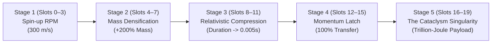

### #############################################################
### 20 Slots weapon design
### #############################################################

If a 5-to-8 card sequence is already capable of breaking 1 billion damage, **a 20-slot weapon should NOT just be 20 slashes in a row**—that would feel bloated, sluggish, and drain the player's stamina on swing 4.

Instead, in masterclass games like *Noita*, *Path of Exile*, and *Grim Dawn*, late-game high-capacity weapons exist for **Systemic Architecture**. A 20-slot frame transforms the weapon from a *"sword"* into a **modular physical supercomputer**.

Here are the **5 game systems** that incentivize and justify a 20-slot weapon:

---

### 1. The "Cyclotron" Staged Particle Accelerator (Linear Momentum Pipeline)
In real physics (like CERN’s Large Hadron Collider), you cannot accelerate a mass to near-light speed in a single step—particles must pass through **successive accelerating rings**.

A 20-slot weapon is literally a **kinetic cyclotron**:

* **Why 5 cards can't do this**: A 5-card deck must choose between mass, reach, or speed. A 20-slot frame allows **compounding every physical variable in discrete stages**, scaling damage from billions into the **trillions** to slay world-class subterranean colossal entities (e.g., giant procedural worms).

---

### 2. "Passive Engine" Modules (Socketed Overclocks)
If every slotted card is a physical swing, the combo takes 4 seconds to cycle. But what if a 20-slot weapon allows **non-motion engine cards** that act as internal circuitry powering 2 or 3 apex strikes?

| Engine Module Card | Sockets Consumed | What It Does to the Weapon |
| :--- | :---: | :--- |
| **Inertia Compensator** | 3 slots | Nullifies the swing-speed penalty of colossal 40kg weapon frames. |
| **Zero-Point Flywheel** | 2 slots | Replaces stamina cost with stored centrifugal momentum. |
| **Kinetic Heat Sink** | 4 slots | Reduces `deck_recharge_time` to `0.0s`, allowing instantaneous continuous combo cycling. |
| **Gravitational Gyroscope** | 2 slots | Player can dash, sprint, and steer freely at full speed while swinging. |

* **The Incentive**: The player slots **16 engine cards** and only **4 apex motion cards**. The result is a weapon that feels like an effortless, weightless divine blade that executes Mach-20 slashes instantly without consuming stamina.

---

### 3. The "Swiss Army Frame" (Integrated Locomotion & Defense)
In traditional combat, players must constantly swap between weapons: a sword for attack, a shield for defense, and a dagger for dashing.

A 20-slot frame allows players to script an **entire combat kit into a single weapon sequence**:
* **Slots 0–4 (The Blink Initiation)**: Zero-damage forward warp + kinetic parry shockwave that staggers nearby targets.
* **Slots 5–9 (The Gravity Vortex)**: Multicast radial sweep with negative knockback (implosion) that vacuums all enemies into a tight clump.
* **Slots 10–15 (The Kinetic Accelerator)**: Momentum buildup while the enemies are trapped.
* **Slots 16–19 (The Guillotine Slam)**: Overwhelming overhead cleave that obliterates the clumped targets.

---

### 4. Recursive Tree Branching (Trigger Payload Trees)
In *Noita*, high-slot wands shine because of **deep recursive trigger trees**. A single primary strike branches out like a fractal tree on impact:

```
[Slot 0: Motion: Piercing Thrust] 
   └── [Slot 1: Trigger on Hit]
         ├── [Slot 2: Mod: Reach Extender]
         ├── [Slot 3: Motion: Horizontal Cleave]
         └── [Slot 4: Trigger on Hit]
               ├── [Slot 5: Mod: Heavy Impact]
               ├── [Slot 6: Motion: Downcleave]
               └── [Slot 7: Trigger on Hit]
                     └── [Slots 8–19: 12-way Multicast Omnidirectional Nova]
```
* **The Gameplay Feel**: The player presses left-click **once**. The weapon thrusts forward, hits an enemy, and triggers a chained cascade that blooms into a 12-blade omni-directional blender inside the enemy's hitbox. This is structurally impossible on a 6-slot frame.

---

---

### Summary: What a 20-Slot Weapon Represents

| Weapon Capacity | Archetype | Player Mindset |
| :---: | :--- | :--- |
| **4 – 6 Slots** | **The Weapon** | *"I swing a heavy sword."* (Direct, punchy, low overhead). |
| **7 – 9 Slots** | **The Combo Engine** | *"I designed a high-damage physical loop."* (Min-maxing $E_k$). |
| **16 – 20 Slots** | **The Operating System** | *"I programmed a self-sustaining kinetic automaton that warps, vacuums, accelerates, and disintegrates reality."* |

Got it! Completely scratching out voxel terraforming and environmental destruction. The terrain remains a clean, stylized procedural arena (including other dimension arenas), and combat stays **100% focused on pure action, movement, and kinetic physics**.

Without terraforming, a **20-slot weapon** becomes the holy grail for **Pure Combat Choreography and Kinetic Scaling**.

Here is what makes a 20-slot weapon intensely desirable in a pure arena-combat game:

---

### 1. The "Complete Combat Dance" (All Phases in One Weapon)
In a tight 5-slot weapon, you are forced to specialize: you either build a quick poke weapon, a slow heavy smite weapon, or a mobility dash weapon.

With a 20-slot weapon, you can sequence a **complete, fluid combat choreography** that adapts to every phase of a fight:

```
[Slots 0–3: Engagement]    ──> [Slots 4–9: The Stagger Combo] ──> [Slots 10–16: The Apex Punisher] ──> [Slots 17–19: Evasion]
 Supersonic gap-closer           Fast horizontal sweeps              Multi-stage kinetic slam           Evasive back-hop
 to close distance               breaking enemy poise                into the staggered boss            cut to safety
```

* **Why players want this**: You never get caught in an awkward state. The weapon flows organically from gap-closing $\to$ combo rhythm $\to$ devastating execution $\to$ clean retreat.

---

### 2. "Blade Storm" Multicast Formations (Geometric Slicing)
A 5-slot weapon can at most pull off a basic double-slash (`Multicast 2` + 2 motions consumes 3 of your 5 slots).

A 20-slot weapon unlocks **massive geometric formations**:
* **The 8-Blade Lotus**: A `Multicast 8` that erupts with 8 volumetric 3D slash arcs simultaneously across different tilt planes (horizontal, vertical, $\pm 45^\circ$, $\pm 30^\circ$, reversed).
* **The Guillotine Cross**: Multiple opposing sweeps colliding at the exact same focal point in front of the player, compounding kinetic forces into an instantaneous shredding zone.
* The visual spectacle in a minimal/stylized arena is breathtaking: a single click paints an intricate mandala of glowing 3D energy ribbons around the player.

---

### 3. Recursive Trigger Cascades (The Point-Blank Blender)
Instead of 20 swings taking 5 seconds, a 20-slot weapon can compress its entire payload into a **fraction of a second** using trigger trees:

```
[Slot 0: Motion: Piercing Thrust]
   └── [Slot 1: Trigger on Hit]
         ├── [Slot 2: Multicast 3]
         │     ├── [Slot 3: Mod: Swift] ──> [Slot 4: Motion: Upswing A]
         │     ├── [Slot 5: Mod: Heavy] ──> [Slot 6: Motion: Downcleave B]
         │     └── [Slot 7: Mod: Reach] ──> [Slot 8: Motion: Sweep C]
         └── [Slot 9: Trigger on Hit (from Downcleave B)]
               └── [Slots 10–19: Secondary explosive kinetic burst]
```
* **The Gameplay Feel**: You land **one clean thrust**. The instant it connects, 8 secondary and tertiary slashes detonate *inside the impact point* in a microsecond, obliterating the boss's poise bar.

---

### 4. Passive "Overclock" Modules (Zero-Draw Circuitry)
If a player doesn't want 20 separate attacks, a 20-slot weapon lets them treat sockets like a **motherboard / circuit board**:
* You slot only **3 or 4 apex motion cards** (the actual attacks).
* The remaining **16 slots are filled with passive engine modifiers**:
  * *Zero-Inertia Couplers*: Eliminates the swing-speed penalty of colossal $35\text{ kg}$ weapons.
  * *Stamina Siphons*: Eliminates stamina drain.
  * *Zero-Cooldown Heat Sinks*: Reduces `deck_recharge_time` to 0, making the weapon fire like a semi-automatic cannon.
  * *Momentum Capacitors*: Converts residual velocity into passive defensive poise.

---

### 5. Reaching True Cosmic Kinetic Damage (1B $\to$ 100B)
As discussed in our physics breakdown, reaching 1 billion damage with 4–6 cards requires extreme min-maxing and near-zero margins for error.

A 20-slot frame is the **cyclotron**:
* It gives the player enough runway to build multiple stages of acceleration:
  * Stage 1: Spin up base RPM to $400\text{ m/s}$.
  * Stage 2: Mass compaction ($+150\%$ frame density).
  * Stage 3: Reach extension ($4.5\text{m}$ lever arm).
  * Stage 4: $100\%$ momentum retention latch.
  * Stage 5: The final Trillion-Joule point-blank kinetic release.

### Summary
Without terraforming, a 20-slot weapon is **the ultimate combat sandbox**: it lets players build **self-contained combat choreographies, screen-filling multi-cast blade storms, and trigger cascades** that turn boss fights into pure sensory spectacles.