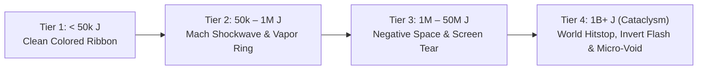

Here is an architectural and game-feel design discussion for both questions, drawing from the design philosophies of *Noita*, *Ultrakill*, and *Hyper Light Drifter*.

---

# Part 1: Combo Complexity — 4-Card Shortcut vs. 8-Card "God Engine"?

### The Verdict: **A Hybrid 3-Tier Power Curve (The "Noita" Model)**
If a player can reach 1 billion damage with just **4 cards**, two major design problems emerge:
1. **The Game Collapses Too Early**: The player accidentally stumbles upon 1 billion in early/mid game, making every boss, terrain encounter, and subsequent weapon drop feel obsolete.
2. **Dead Sockets**: If 4 cards hit 1 billion, a colossal 8-slot weapon frame has 4 completely useless sockets. There is no incentive to seek out high-capacity weapons.

Conversely, if reaching 1 billion requires an overly convoluted 15-card spreadsheet, players will just look up a YouTube meta guide and copy-paste it without experimentation.

### The Ideal Design: The 3-Tier Kinetic Curve

```
Tier 1: Foundational (3–4 Cards)  ──>  Tier 2: The Resonator (5–6 Cards)  ──>  Tier 3: The God-Engine (7–9 Cards)
    1,000 – 50,000 Joules                  100,000 – 10,000,000 Joules              1,000,000,000+ Joules
 "I made a heavy cleave."              "I'm breaking sound barriers."            "I fractured the physics."
```

#### Tier 1: The Foundational Combo (3 – 4 Slots)
* **What it achieves**: $\sim 5,000\text{ – }50,000\text{ Joules}$.
* **How it feels**: Crisp, immediate gratification. The player slots a `Swift Mod` + `Downcleave` and realizes: *"Hey, making this swing 40% faster just quadrupled my damage because of $v^2$!"*
* **The Limiter**: Basic stamina depletion and singular swing limits keep it grounded.

#### Tier 2: The Multi-Stage Resonator (5 – 6 Slots)
* **What it achieves**: $\sim 100,000\text{ – }10,000,000\text{ Joules}$.
* **How it feels**: The player discovers **Momentum Chaining** and **Leverage Stacking**:
  * Slot 0: *Radius Extender* ($R \times 1.8$)
  * Slot 1: *360° Whirlwind Arc* ($\theta \times 2.5$)
  * Slot 2: *Momentum Relay* (retains 100% velocity)
  * Slot 3: *Lead-in Accelerator Sweep* (builds initial $300\text{ m/s}$)
  * Slot 4: *Payload Heavy Smash*
* **The Puzzle**: The weapon is now moving fast enough that stamina costs are high, and misses leave the player vulnerable.

#### Tier 3: The 1-Billion "God-Engine" (7 – 9 Slots)
* **What it achieves**: $\mathbf{1,000,000,000+\text{ Joules}}$.
* **Why it feels truly earned**: It requires solving **all 4 mechanical bottlenecks simultaneously**:
  1. **Frame Selection**: Finding or forging a massive, high-mass ($30+\text{ kg}$) colossal voxel frame with 7–9 sockets.
  2. **Stamina / Inertia Management**: Slotted mods to mitigate the colossal frame's inertia.
  3. **The Multi-Cast Accelerator Stage**: 2–3 cards dedicated solely to winding up rotational and lunge momentum.
  4. **The Compression & Payload Stage**: A `Trigger on Hit` or `Point-Blank Multicast` that releases the stored kinetic energy into a micro-second impact.

> **Takeaway:** Let 4 cards give players the *formula epiphany* ($E = \frac{1}{2}mv^2$), but require 7–9 finely tuned cards to construct the *1-Billion God-Engine*.

---

# Part 2: Turning Minimal Graphics into Maximum Visual Spectacle

In games with minimal or voxel aesthetics (*Noita*, *Ultrakill*, *Risk of Rain*, *Hyper Light Drifter*), visual spectacle does not come from high-polygon models or photorealistic textures. It comes from **Juice, Contrast, and Sensory Distortion**.

Here is a blueprint for making hyper-kinetic attacks look and feel monumental:

---

### 1. Kinetic Tiering (The Visual Escalation)
Don't just make the slash bigger—**change its visual state** as Kinetic Energy passes orders of magnitude:



| Kinetic Tier | Visual Behavior | What the Player Sees |
| :--- | :--- | :--- |
| **Normal (< 50k J)** | Clean 3D ribbon with standard edge emission. | A clean, sharp sword slash. |
| **Supersonic (50k – 1M J)** | **Perpendicular Mach Ring**: Spawns a conical white vapor ring (Prandtl-Glauert singularity) perpendicular to the blade path. | Visual sonic boom slicing through air. |
| **Hypersonic (1M – 50M J)** | **Negative Space (Void Inversion)**: The core of the slash ribbon turns pure pitch black (`#000000`) with an incandescent white-hot glowing rim. Screen-space radial motion blur kicks in. | Looks like the sword is tearing a hole in reality. |
| **Cataclysm (1 Billion+ J)** | **The 1-Billion Event**: Micro-freeze hitstop ($0.12\text{s}$), a 1-frame full-screen inverted color flash, radial shockwave rings expanding across the arena, and a lingering gravitational implosion spark. | A nuclear-scale localized kinetic event. |

---

### 2. The 3 Golden Pillars of "Juice" for High-Energy Combat

#### Pillar A: The "Impact Freeze" (Hitstop)
When an attack dealing 1 billion Joules lands:
* **Never let it just play at 60 FPS**. A strike that powerful must pause time itself.
* Freeze the game engine for **$6\text{ to }10\text{ frames}$** (`Engine.time_scale = 0.02` for $0.10\text{s}$):
  * The player freezes in mid-strike at the point of contact.
  * The enemy's mesh jitters rapidly along the impact normal.
  * Then—**BANG!**—time unfreezes, particles explode outward, and the enemy ragdoll/knockback launches with screen-shaking speed.

#### Pillar B: The "Director's Lens" (Camera Math)
The camera should actively react to the sword's kinetic energy:
1. **Velocity Pull-back**: When tip velocity exceeds $500\text{ m/s}$, smoothly lerp the camera FOV outward ($70^\circ \to 88^\circ$) to simulate extreme centrifugal force.
2. **Impact Snap**: On collision, punch the FOV inward ($88^\circ \to 65^\circ$) for 2 frames, then spring back to neutral.
3. **Directional Screen Shake**: Shake the camera along the slash's cutting plane (e.g. down-left for a cleave, horizontal for a sweep), rather than random noise.

#### Pillar C: Locomotion Spectacle (Blink, Warp, Lunge) Modifier Cards
For high-velocity moves and blink teleports:
1. **Ghosting / Afterimages**: When lunging faster than $15\text{ m/s}$, spawn 4 static silhouette clones of the player's voxel mesh every $0.03\text{s}$ that fade to transparent with an emissive cyan/gold trail.
2. **Instantaneous Translocation (Blink)**:
   * **Origin**: Player mesh vanishes in an inward voxel implosion.
   * **Vector**: A laser-thin incandescent ray line connects start and end points for 2 frames.
   * **Arrival**: A cylindrical kinetic shockwave ring puffs outward along the ground where the player reappears.

---

### Summary Checklist for the Next Iteration

| Design Domain | Recommended Direction |
| :--- | :--- |
| **Combo Depth** | Keep 3–4 card combos potent ($\sim 10^4\text{ J}$), but require 7–9 card chaining and colossal frame mass to break $10^9\text{ J}$. |
| **Visual Scaling** | Add a **Mach shockwave ring** at Tier 2 and a **Negative-Space Inversion** at Tier 3+. |
| **Hit Feel** | Add **$0.08\text{s}$ hitstop (time freeze)** on strikes exceeding $10^6\text{ J}$. |
| **Locomotion** | Implement **voxel afterimage mesh ghosting** during player lunges. |