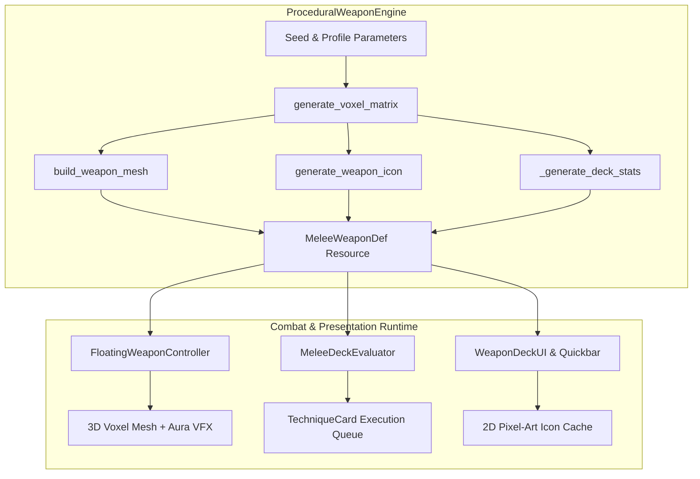
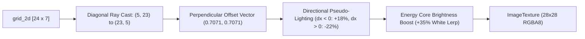
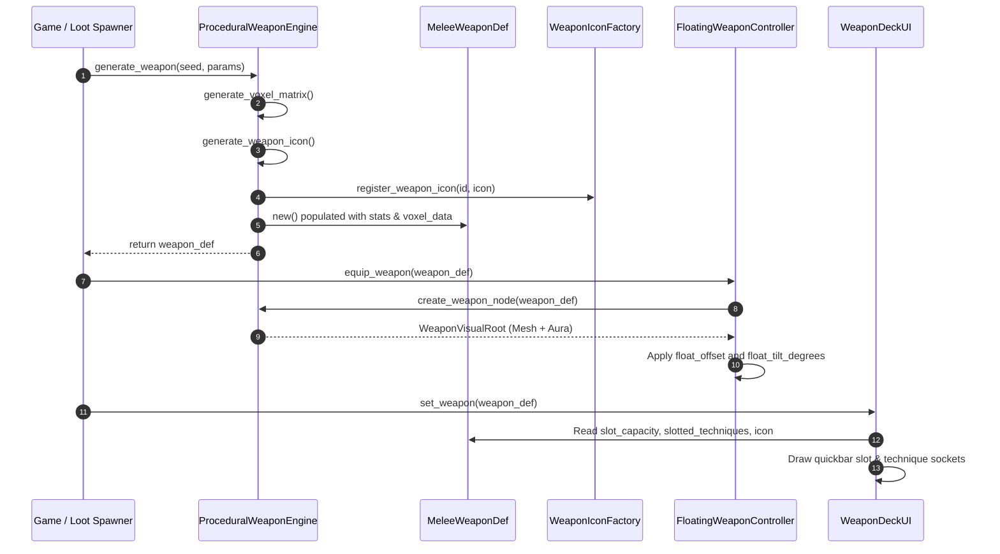

# ProceduralWeaponEngine Architecture & Technical Guide

The [`ProceduralWeaponEngine`](file:///d:/GODOT/terrain/src/combat/generator/procedural_weapon_engine.gd) is a dedicated procedural synthesis engine written in GDScript for Godot 4. It deterministically generates complete, modular voxel-based melee weapon frames paired with 3D optimized meshes, 2D pixel-art HUD icons, and deck-building combat statistics.

---

## 1. High-Level Design Philosophy

In traditional action-RPGs, weapons are static 3D meshes bound to fixed animation data and hardcoded swing timings. In this codebase's combat architecture (inspired by modular wand-crafting mechanics such as *Noita*), a weapon is conceptualized as an **arcane floating frame or stance** rather than a static animation rig:



### Key Principles:
1. **Decoupled Combat Mechanics**: The weapon definition ([`MeleeWeaponDef`](file:///d:/GODOT/terrain/src/combat/core/melee_weapon_def.gd)) does **not** contain hardcoded attack animations or damage values. All combat behaviors (slashes, thrusts, lunges) and Kinetic Energy damage are driven dynamically by slotted [`TechniqueCard`](file:///d:/GODOT/terrain/src/combat/core/technique_card.gd)s (see detailed combat documentation in [`docs/procedural_attack_system.md`](file:///d:/GODOT/terrain/docs/procedural_attack_system.md)).
2. **Unified Triple Output**: A single call to `ProceduralWeaponEngine.generate_weapon()` creates:
   - A **3D voxel ArrayMesh** with dual-material shading and face culling.
   - A **2D pixel-art ImageTexture** with directional shading for UI/HUDs.
   - A **Deck profile** with slot capacity, shuffle behavior, recharge times, and stat multipliers.
3. **Deterministic Seeding**: Any integer seed produces the identical 3D structure, color theme, icon, and deck attributes.

---

## 2. Core Data Structures & Types

### 2.1 Voxel Types (`VoxelType`)
Every discrete point in the 3D grid is assigned a semantic voxel role:

| Value | Identifier | Semantic Function | Material / Shading |
|:---:|:---|:---|:---|
| `0` | `EMPTY` | Air or negative space | Skipped during meshing |
| `1` | `HANDLE` | Grip wraps and hilt core | Dark, low-roughness structural tone |
| `2` | `JUNCTION` | Collars, crossguards, socket brackets | Mid-tone alloy bracket |
| `3` | `BODY` | Main blade spine, hammer bulk, structural alloy | High-metallic frame material |
| `4` | `EDGE` | Polished perimeter, cutting bevels, spikes | Bright, reflective surface |
| `5` | `ENERGY` | Mana conduits, glowing power cores, plasma tips | **Emissive Material** (`multiplier = 3.5`) |
| `6` | `ACCENT` | Gold trim, pommel rings, magnetic stabilization coils | Highlighting specular tone |

### 2.2 Weapon Profiles (`WeaponProfile`) & Exotic Topologies (`TopologyType`)
Profiles dictate the deck archetype and default exotic topology. The engine locks the structural handle ($y=1\dots4$), collar ($y=5$), and central spine core ($(cx, y, cz)$ for $y=6\dots23$) while driving the outer bounds through advanced generative algorithms:

| Profile | Topology | ID | Topology Archetype | Deck Capacity | Recharge Time | Damage Mult | Stamina Mult | Exotic Topological Features |
|:---|:---|:---:|:---|:---:|:---:|:---:|:---:|:---|
| **BALANCED** / **KALEIDOSCOPIC** | `KALEIDOSCOPIC` | `0` / `9` | Sacred Geometry Mandala | 5 – 7 | 0.45 – 0.55s | 1.00 – 1.10x | 1.00x | 4/8-axis multi-mirroring, concentric energy rings, faceted diamond snowflake stars |
| **SLENDER** / **PARAMETRIC_HELIX** | `PARAMETRIC_HELIX` | `1` / `6` | Helical Caduceus / Arcane Staff | 6 – 9 | 0.28 – 0.40s | 0.88 – 1.00x | 0.82 – 0.92x | Double-helix $\sin/\cos$ orbital strands wrapping central spine, tuning fork emitter, stabilizer rungs |
| **HEAVY** / **VOLUMETRIC_EROSION** | `VOLUMETRIC_EROSION` | `2` / `5` | Porous Cellular Hive Relic | 4 – 6 | 0.62 – 0.78s | 1.25 – 1.45x | 1.15 – 1.30x | 3D Cellular Automata 26-neighbor erosion, Swiss-cheese cavities with glowing energy nodules |
| **SEGMENTED** / **NOISE_SHATTERED** | `NOISE_SHATTERED` | `3` / `8` | Shattered Floating Shards | 5 – 8 | 0.42 – 0.55s | 1.02 – 1.15x | 1.00x | 3D Simplex noise slicing, telekinetic tether energy spine, molten energy-lined fracture faces |
| **FLANGED** / **BRANCHING_FRACTAL** | `BRANCHING_FRACTAL` | `4` / `7` | Crystalline / Fractal Growth | 5 – 7 | 0.45 – 0.58s | 1.10 – 1.22x | 0.95 – 1.05x | L-System recursive branching from spine anchors, crystalline facet clusters, frozen lightning |
| **FUNGAL_BRACKET** | `FUNGAL_BRACKET` | `10` / `5` | Fungal Bracket & Mycelial Rot | 4 – 6 | 0.55 – 0.70s | 1.20 – 1.35x | 1.10 – 1.25x | Asymmetrical unilateral bracket shelves, decaying host spine, random-walk creeping mycelium filaments |
| **OSTEOLOGICAL_CAGE** | `OSTEOLOGICAL_CAGE` | `11` / `6` | The Osteological Cage | 6 – 8 | 0.35 – 0.48s | 1.05 – 1.18x | 0.90 – 1.02x | Vertebral column spine, curving rib-like arches, suspended untouched floating massive energy core |
| **INSECTOID_HIVE** | `INSECTOID_HIVE` | `12` / `7` | Insectoid Hive (Hexagonal Porosity) | 5 – 7 | 0.40 – 0.52s | 1.12 – 1.28x | 0.98 – 1.10x | Bulky teardrop chitinous mass, 3D modulo honeycomb cavities, glowing volatile nectar in deep recesses |
| **ABYSSAL_MARINE** | `ABYSSAL_MARINE` | `13` / `8` | Abyssal Marine (Coral & Bioluminescence) | 6 – 9 | 0.32 – 0.44s | 0.95 – 1.10x | 0.85 – 0.95x | Branching staghorn coral random walk, apex umbrella jellyfish dome with trailing venomous tentacles |
| **CARNIVOROUS_BOTANICAL** | `CARNIVOROUS_BOTANICAL` | `14` / `9` | Carnivorous Botanical Overgrowth | 5 – 8 | 0.45 – 0.58s | 1.15 – 1.30x | 1.05 – 1.18x | Thick central stalk, strangling thorny vine helix, flared bulbous pitcher cavity with inward predatory teeth |

### 2.3 Curated Color Palettes (`PALETTES`)
The engine defines 11 distinct aesthetic themes that map colors to all voxel roles:
1. **Aether Steel**: Polished steel body with cyan energy conduits and brass accent.
2. **Molten Basalt**: Volcanic dark rock frame with fiery orange emission and copper edges.
3. **Verdant Jade**: Deep jade and forest green alloy with emerald energy conduits.
4. **Void Amethyst**: Shadowy purple alloy with vivid magenta energy and silver trim.
5. **Frost Cobalt**: Glacial blue steel with electric ice-blue emission.
6. **Brass Mechanum**: Steampunk brass and blackened iron with golden amber energy.
7. **Mycelial Spore**: Decaying bark, bracket ivory, toxic bioluminescent spore green, and mold sulfur yellow.
8. **Ossuary Bleached**: Weathered osteo ivory, cartilage gray, spectral soul cyan core, and marrow crimson.
9. **Vespoid Amber**: Hardened black chitin, honeycomb tan, sharp amber stinger edge, and glowing royal nectar.
10. **Abyssal Biolume**: Reef basalt, staghorn coral bone, siphonophore electric cyan, and venomous tentacle magenta.
11. **Predatory Flora**: Thorny briar, pitcher plant mottled green, serrated trap teeth ivory, and acid lime digestive pool.

---

## 3. Spatial Grid & Voxel Dimensions (Monster Hunter Colossal Scale)

The weapon is forged inside a 3-dimensional discrete matrix sized for imposing Monster Hunter colossal proportions:

```
                  +Y (Top: Height = 40 voxels, ~2.00m)
                   ^
                   |    [Apex Emitter & Crest: y = 37..39]
                   |    [Colossal Blade & Generative Topologies: y = 8..36]
                   |    [Crossguard / Junction: y = 7] <-- Pivot Origin (0,0,0)
                   |    [Two-Handed Grip Layer: y = 1..6]
                   |    [Pommel Counterweight: y = 0]
                   +----------------------------------> +X (Width = 11 voxels, ~0.55m)
                  /
                 /
                v
               +Z (Depth = 5 voxels, ~0.25m thickness)
```

- **Voxel Size**: `DEFAULT_VOXEL_SIZE = 0.05m` (5 cm per voxel).
- **Total Height / Length**: $40 \text{ voxels} \times 0.05\text{m} = 2.00\text{m}$ (matches 2 world blocks in height; towers over the hunter).
- **Grid Dimensions**: `X = 11` (width), `Y = 40` (height), `Z = 5` (depth) — totaling **2,200 voxel cells** (over $4.3\times$ previous volume).
- **Centers**: `cx = 5` (horizontal center), `cz = 2` (depth center).
- **Pivot Origin (`JUNCTION_Y = 7`)**: The crossguard at $y=7$ is translated to local $(0,0,0)$ in 3D mesh space. Below $y=7$, a $0.35\text{m}$ two-handed grip extends backward; above $y=7$, a massive $1.60\text{m}$ blade extends upward over the player's shoulder.

---

## 4. Procedural Generation Pipeline (Exotic Topologies)

Moving away from traditional layer-by-layer blade extrusion, the engine locks the structural core and handle while pushing the outer grid bounds toward abstract, chaotic, and cosmic topologies.

### Step 1: Locked Structural Core & Handle
1. **Pommel Counterweight ($y = 0$)**:
   - Central accent voxel at $(cx, 0, cz)$ reinforced with flanking junction voxels and 3D depth counterweights at $z = cz \pm 1$.
2. **Two-Handed Handle Grip ($y = 1 \dots 6$)**:
   - Central handle column $(cx, y, cz)$ locked to `VoxelType.HANDLE` with alternating `VoxelType.ACCENT` wire wraps and full 3D grip depth thickness ($z = cz \pm 1$).
3. **Collar & Junction ($y = 7$)**:
   - Heavy bracket crossguard socket locked to `VoxelType.JUNCTION` at width $\pm 2$ to $\pm 5$ with dual-depth reinforcement ($z \in [0, 4]$).
4. **Readable Central Spine ($y = 8 \dots 39$)**:
   - The central axis $(cx, y, cz)$ is locked with `VoxelType.BODY` and rhythmic `VoxelType.ENERGY` conduits. Even when chaotic slicing or erosion is applied, the spine is permanently safeguarded to guarantee structural connectivity.
   - Crossguard socket bracket locked to `VoxelType.JUNCTION` at width $\pm 1$ to $\pm 3$.
4. **Readable Central Spine ($y = 6 \dots 23$)**:
   - The central axis $(cx, y, cz)$ is locked with `VoxelType.BODY` and rhythmic `VoxelType.ENERGY` conduits. Even when chaotic slicing or erosion is applied, the spine is permanently safeguarded to guarantee structural connectivity.

### Step 2: Advanced Exotic Topology Algorithms

#### 1. Volumetric Erosion (3D Cellular Automata)
- **Concept**: Fills $y = 6 \dots 23$ with a solid geometric block seeded with 20% initial cavity vacuoles and 24% glowing energy nodules around the locked spine.
- **Simulation**: Runs 3 iterations of 3D Cellular Automata using 26-neighborhood survival ($6 \le neighbors \le 18$) and birth ($11 \le neighbors \le 14$) rules.
- **Visual Result**: An ancient, porous, Swiss-cheese/hive relic. Surviving exterior body voxels receive polished `EDGE` bevels, revealing inner glowing `ENERGY` cores peeking through irregular cavities.

#### 2. Parametric Helices & Orbitals
- **Concept**: Abandons axial symmetry for the blade and uses mathematical sine/cosine winding around the central spine.
- **Implementation**: Two orbital strands 180° out of phase:
  $$\theta_1 = y \cdot \text{freq} + \phi, \quad \theta_2 = \theta_1 + \pi$$
  Strand 1 plots `ENERGY` plasma conduits; Strand 2 plots `EDGE` striking perimeter rails. Stabilizing horizontal `ACCENT` rungs bridge to the spine every 4 steps, flaring into a cosmic tuning fork at the apex.
- **Customizable Grid**: Supports widened grid bounds (`grid_width = 11`, `grid_depth = 5`) for expansive celestial orbits.

#### 3. L-System Branching (Fractal & Crystalline Growth)
- **Concept**: Grows recursive crystalline clusters, coral formations, or frozen lightning bolts outward from spine anchors ($y \in \{6, 9, 13, 17, 21\}$).
- **Implementation**: Recursive branching functions step along 3D diagonal vectors with stochastic bifurcations (55% fork chance), terminating at grid borders or recursion limits with faceted `EDGE` crystals and `ENERGY` spark veins.

#### 4. Noise-Sliced Fracturing (The "Shattered" Matrix)
- **Concept**: Synthesizes a solid heavy blade silhouette, then shatters it into floating shards using 3D Simplex noise (`FastNoiseLite.TYPE_SIMPLEX`).
- **Implementation**: Voxels falling within a narrow noise band ($|n| \le 0.12$) are cleaved into empty space. Along the central spine $(cx, y, cz)$, the fault cut is replaced with glowing `ENERGY`, creating telekinetic tether conduits that suspend floating shards. Exposed fracture surfaces are lined with molten `ENERGY`.

#### 5. Multi-Axis Mirroring (Kaleidoscopic / Sacred Geometry)
- **Concept**: Generates a sacred geometric cluster in one quadrant around midpoint $mid\_y = 14$ and mirrors it simultaneously across $X$, $Y$, and $Z$ axes.
- **Implementation**: Evaluates Manhattan and Euclidean harmonics ($dx + 0.45 dy$) to forge concentric glowing arcane rings, radial structural spokes, and faceted snowflake perimeters.
- **Visual Result**: Hyper-symmetrical "biblically accurate" geometric mandalas and star matrices orbiting the player's stance.

### Step 3: 2D Matrix Projection & Synchronization
Following 3D generation, `_update_grid_2d()` evaluates the depth columns along $Z$, ensuring that internal cavities, energy veins, and orbital strands project accurately into the $28 \times 28$ UI pixel-art icon without ghost voxels.

---

## 5. 3D Mesh Generation & Mesh Optimization

The 3D mesh is created inside `build_weapon_mesh()` using Godot's `SurfaceTool`.

### 5.1 Greedy Face Culling
Rather than generating 6 quad faces (12 triangles) for every voxel (which would generate thousands of hidden polygons inside solid structures), the engine checks all 6 neighbor directions:
- $+Z$ (Front)
- $-Z$ (Back)
- $+X$ (Right)
- $-X$ (Left)
- $+Y$ (Top)
- $-Y$ (Bottom)

A quad is emitted **only if the adjacent cell is `VoxelType.EMPTY` or falls outside the grid bounds**:
```gdscript
# Example: +X (Right Face) Culling
if x + 1 >= w or grid_3d[x + 1][y][z] == VoxelType.EMPTY:
    _emit_quad(st, col, Vector3(1, 0, 0), ...)
```
> [!TIP]
> This reduces the polygon count of heavy and solid weapons by over **60%**, dramatically improving batch rendering efficiency for floating weapons and inventory inspect screens.

### 5.2 Dual Surface Materials
Voxels are segregated into two distinct draw passes:
1. **Opaque Geometry (`st_opaque`)**:
   - Material: `StandardMaterial3D`
   - Properties: `vertex_color_use_as_albedo = true`, `metallic = 0.78`, `roughness = 0.32`, `cull_mode = CULL_BACK`.
2. **Energy Geometry (`st_energy`)**:
   - Material: `StandardMaterial3D`
   - Properties: `emission_enabled = true`, `emission = palette["energy"]`, `emission_energy_multiplier = 3.5`.
   - Results in natural bloom and glow when WorldEnvironment / Post-processing HDR is active.

---

## 6. 2D Pixel-Art Icon Projection

For UI inventory slots, quickbars, and card HUDs, [`ProceduralWeaponEngine.generate_weapon_icon()`](file:///d:/GODOT/terrain/src/combat/generator/procedural_weapon_engine.gd#L512) renders a dedicated $28 \times 28$ pixel-art texture directly from the 2D projection matrix (`grid_2d`):



### Features:
- **Diagonal Display ($45^\circ$)**: Fits naturally into RPG weapon slots and quickbars.
- **Directional Lighting**: Pixels offset to the left ($dx < 0$) receive an 18% tint brightening, while pixels to the right ($dx > 0$) receive a 22% shadow darkening.
- **Icon Registration**: Icons are automatically registered in [`WeaponIconFactory`](file:///d:/GODOT/terrain/src/combat/ui/weapon_icon_factory.gd) using the weapon's unique ID for instantaneous retrieval across all UI panels.

---

## 7. Visual Node Assembly & Particle VFX

Calling `create_weapon_node(weapon_def)` instantiates a complete `Node3D` hierarchy ready to attach to the player or weapon socket:

```
WeaponVisualRoot (Node3D)
├── WeaponMeshInstance (MeshInstance3D) [ArrayMesh with Opaque & Energy surfaces]
└── WeaponAuraParticles (CPUParticles3D)
```

### Particle System Specification (`WeaponAuraParticles`):
- **Count**: 14 ambient motes
- **Emission Box**: Extents `(0.045, 0.45, 0.035)` spanning the blade length
- **Position**: Offset `Vector3(0.0, 0.50, 0.0)` above the guard
- **Material**: Unshaded billboard particles matching the palette's energy color with an emission boost of `3.0`
- **Behavior**: Gentle upward draft with low velocity ($0.04 \dots 0.15 \text{ m/s}$) to give floating frames a living, resonant aura.

---

## 8. Integration with the Combat System

The following sequence illustrates how `ProceduralWeaponEngine` interacts with the rest of the game:



### Key Consumer Classes:
- [`MeleeWeaponDef`](file:///d:/GODOT/terrain/src/combat/core/melee_weapon_def.gd): Data container holding deck capacity, recharge timings, damage/stamina multipliers, and floating mount coordinates.
- [`FloatingWeaponController`](file:///d:/GODOT/terrain/src/combat/visuals/floating_weapon_controller.gd): Controls the weapon in 3D space, handles floating idle bobbing, sway, attack arcs, and calls `builder.create_weapon_node(weapon_def)`.
- [`MeleeDeckEvaluator`](file:///d:/GODOT/terrain/src/combat/core/melee_deck_evaluator.gd): Consumes the weapon's card slots to execute attack combos without coupling to geometry.
- [`WeaponIconFactory`](file:///d:/GODOT/terrain/src/combat/ui/weapon_icon_factory.gd): Stores and provides cached pixel textures for UI buttons, loot tooltips, and HUD readouts.

---

## 9. Usage Examples

### 9.1 Generating a Random Weapon
```gdscript
# Generates a completely randomized weapon from current system time
var weapon: MeleeWeaponDef = ProceduralWeaponEngine.generate_weapon()

print("Generated:", weapon.display_name)
print("Capacity:", weapon.slot_capacity, "Recharge:", weapon.deck_recharge_time)
```

### 9.2 Generating a Deterministic Archetype with Overrides
```gdscript
var custom_params = {
    "profile": ProceduralWeaponEngine.WeaponProfile.HEAVY,
    "name": "Oblivion Sunderer",
    "slot_capacity": 6,
    "deck_recharge_time": 0.70,
    "base_damage_multiplier": 1.40,
    "stamina_cost_multiplier": 1.20
}

# Fixed seed (42001) guarantees identical visuals every run
var heavy_blade: MeleeWeaponDef = ProceduralWeaponEngine.generate_weapon(42001, custom_params)
```

### 9.3 Spawning 3D Visuals in Scene
```gdscript
# Instantiate visual node hierarchy
var weapon_node: Node3D = ProceduralWeaponEngine.create_weapon_node(heavy_blade)
add_child(weapon_node)

# Position and tilt according to weapon definition defaults
weapon_node.position = Vector3(heavy_blade.float_offset_right, heavy_blade.float_offset_height, heavy_blade.float_offset_forward)
weapon_node.rotation_degrees = heavy_blade.float_tilt_degrees
```

---

## 10. Summary of Constants & Tuning Parameters

| Parameter | Type | Default Value | Description |
|:---|:---|:---|:---|
| `DEFAULT_VOXEL_SIZE` | `float` | `0.045` | Real-world meters per voxel side (~1.08m total height). |
| `TARGET_WEAPON_HEIGHT_VOXELS` | `int` | `24` | Total vertical voxel resolution along the Y-axis. |
| `DEFAULT_GRID_WIDTH` | `int` | `7` | Maximum voxel spread along the lateral X-axis. |
| `DEFAULT_GRID_DEPTH` | `int` | `3` | Maximum voxel thickness along the Z-axis. |
| `JUNCTION_Y` | `int` | `5` | Height index of collar/crossguard; aligns with mesh local origin. |
| `float_offset_right` | `float` | `0.68` | Resting horizontal hover distance from player center. |
| `float_offset_height` | `float` | `0.95` | Resting vertical hover height relative to player origin. |
| `float_offset_forward` | `float` | `-0.12` | Resting forward/rearward offset relative to player camera. |

---

## 11. Debug Hotkeys & In-Game Prototyping

- **`[F7]` Debug Generate Weapons**:
  - Dynamically invokes `FloatingWeaponController.generate_debug_weapons()`.
  - Instantly generates **4 new procedural weapons** spanning the new stylized topologies (`FUNGAL_BRACKET`, `OSTEOLOGICAL_CAGE`, `INSECTOID_HIVE`, `ABYSSAL_MARINE`, `CARNIVOROUS_BOTANICAL`).
  - Automatically loads and equips them across all 4 player weapon slots and synchronizes the HUD Quickbar and Inventory UI.
  - Displays an on-screen status banner with the equipped weapon's name.
| `float_offset_forward` | `float` | `-0.12` | Resting forward/backward position relative to player facing. |
| `float_tilt_degrees` | `Vector3` | `(18.0, -12.0, 10.0)` | Natural aesthetic 3-axis idle tilt angles. |

