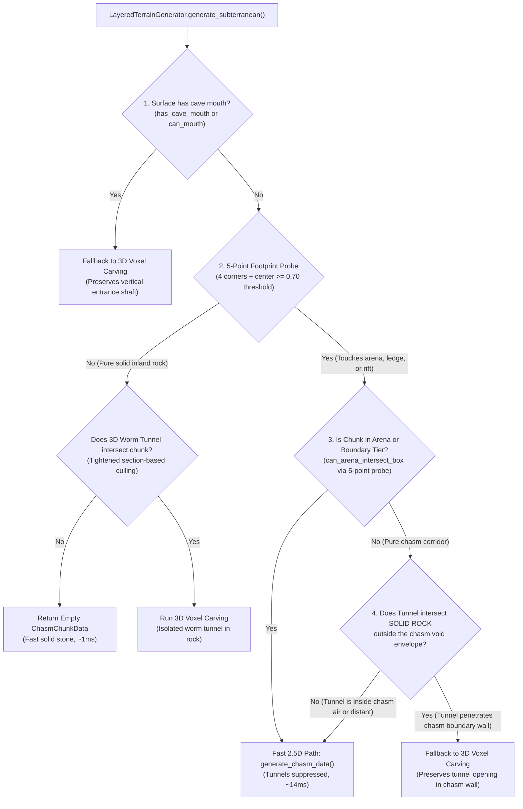

# Implementation Plan: Subterranean 2.5D Bypass Expansion, Tunnel Culling, and Benchmark Correction

## 1. Executive Summary & Diagnostic Findings

Recent profiling (`bench_surface_vs_arena.gd`) indicated a massive performance disparity between Surface and Underground Arena chunk streaming:
- **Surface Overland Chunk Load:** ~13.4 ms median (Gen: 8.8 ms, Mesh: 2.9 ms, Bake: 1.6 ms)
- **Reported "Underground Arena" Load:** ~448.2 ms median (Gen: 140.0 ms, Mesh: 311.3 ms, Bake: 2.7 ms)
- **Reported Disparity:** Subterranean Arena chunk load was measured as **29.4× to 53.2× slower than Surface**.

### Empirical Diagnostic Findings

An isolated diagnostic trace on the 100 chunks selected by the benchmark revealed that **93% of the chunks in the "Underground Arena" batch fell back to 3D voxelization**:

| Chunk Sub-Group in Benchmark | Count | Return Data Type | Generation Median | Meshing Median | Total Load Median |
| :--- | :---: | :--- | :---: | :---: | :---: |
| **Actual Arena Chunks (2.5D Bypass)** | **7** | `ChasmChunkData` | **14.47 ms** | **4.61 ms** | **20.47 ms** *(~1.5× Surface)* |
| **Surrounding Chunks (3D Fallback)** | **93** | `VoxelChunkData` (185k voxels) | **140.03 ms** | **311.31 ms** | **448.23 ms** *(~33× Surface)* |
| **Total Batch (What the benchmark reported)** | 100 | Mixed (93% Fallback) | **140.03 ms** | **311.31 ms** | **448.23 ms** *(~33× Surface)* |

### Key Conclusions:
1. **The 3D loop suppression in combat arenas (Task 1.3) IS working properly on actual arena chunks.** Core arena chunks generate in **14.5 ms** and mesh in **4.6 ms** via [`ChasmShellMesher`](file:///d:/GODOT/terrain/src/meshing/chasm_shell_mesher.gd).
2. **The benchmark selector does not test 100 arena chunks.** It centers on one arena coordinate and creates a contiguous $10 \times 10$ chunk grid ($160\text{ m} \times 160\text{ m}$). Because arenas are localized chambers $\approx 30\text{–}50\text{ m}$ across, only 7 chunks touched the arena; the other 93 were surrounding subterranean terrain.
3. **All 93 surrounding subterranean chunks fell back to 3D voxel arrays** because [`can_tunnel_intersect_cell()`](file:///d:/GODOT/terrain/src/generation/caves/subterranean_tunnel_sampler.gd#L132) returned `true` for 100% of non-arena vertical columns due to broad bounding box tests across $100\text{m}$ vertical columns.

This implementation plan provides a unified, three-pillar strategy to resolve these bottlenecks:
1. **Pillar 1:** Fix Benchmark Representation (`BenchmarkChunkSelector`).
2. **Pillar 2:** Expand 2.5D Bypass to Chasm Corridors (`LayeredTerrainGenerator`).
3. **Pillar 3:** Tighten `can_tunnel_intersect_cell` AABB Culling (`SubterraneanTunnelSampler`).

---

## 2. Pillar 1: Fix Benchmark Representation

### Problem Analysis
In [`tests/benchmark/chunk_bench/benchmark_chunk_selector.gd:get_arena_chunks()`](file:///d:/GODOT/terrain/tests/benchmark/chunk_bench/benchmark_chunk_selector.gd#L16-L25):
```gdscript
func get_arena_chunks(count: int, bounds: WorldBounds, sampler: UndergroundChasmSampler = null, center: ChunkCoord = null) -> Array[ChunkCoord]:
	var target_center: ChunkCoord = center
	if target_center == null:
		if sampler != null:
			target_center = find_arena_center(sampler, bounds)
		if target_center == null:
			target_center = ChunkCoord.new(DEFAULT_ARENA_CENTER.x, DEFAULT_ARENA_CENTER.y)

	return _build_grid_around_center(target_center, count, bounds)
```
- A combat arena in our procedural world is an anchor feature where rift density reaches $\ge 0.80$. A single arena typically spans roughly 4 to 8 contiguous chunks.
- Calling `_build_grid_around_center` with `count = 100` generates a $10 \times 10$ spatial block. 93 of those chunks are not in the arena.
- The benchmark reports this heterogeneous batch as "Underground Arena", masking the true performance of the arena pipeline and reporting a 29.4× slowdown that actually reflects 3D fallback chunks.

### Proposed Architecture & Changes

#### 1. Implement Genuine Arena Discovery via 5-Point Footprint Probe
In [`BenchmarkChunkSelector`](file:///d:/GODOT/terrain/tests/benchmark/chunk_bench/benchmark_chunk_selector.gd):
- Add `get_genuine_arena_chunks(count: int, bounds: WorldBounds, sampler: UndergroundChasmSampler) -> Array[ChunkCoord]`:
  - Scans candidate chunk coordinates outward from origin in concentric rings.
  - Ensures the continent mask is initialized on the sampler before querying.
  - **Uses the 5-Point Footprint Probe (4 corners + center)** rather than a single midpoint column to discover chunks that intersect arena geometry or its boundary tiers.
  - Queries `sampler.can_arena_intersect_chunk(coord, bounds)` with a lowered threshold ($\approx 0.70\text{–}0.76$) to catch the perimeter spectator tiers and sloping boundary ledges.
  - Collects chunks across multiple arena chambers across the world if `count > single_arena_size`.

#### 2. Introduce Distinct Subterranean Benchmark Suites
Update [`bench_surface_vs_arena.gd`](file:///d:/GODOT/terrain/tests/benchmark/bench_surface_vs_arena.gd) and [`run_surface_vs_arena.gd`](file:///d:/GODOT/terrain/tests/benchmark/tools/run_surface_vs_arena.gd) to report multi-category benchmarks:
1. **Surface Overland (100 Chunks):** Pure overland 2.5D terrain baseline.
2. **Core Combat Arena (Genuine Arena Chunks):** Measures 2.5D dual-heightfield arena performance without dilution.
3. **Chasm Rift Corridor (Corridor Chunks):** Measures subterranean chasm ravines connecting arenas.
4. **Subterranean Mixed (Contiguous Region):** Measures a realistic player descent radius (e.g. 25 chunks) with natural transitions.

#### 3. Update Pipeline Reporting
In [`ChunkBenchmarkReporter`](file:///d:/GODOT/terrain/tests/benchmark/chunk_bench/chunk_benchmark_reporter.gd):
- Track and print the percentage of chunks evaluated via 2.5D `ChasmChunkData` vs 3D `VoxelChunkData`.
- Flag any unexpected 3D fallback in pure arena benchmarks as an automatic warning.

---

## 3. Pillar 2: Expand 2.5D Bypass to Chasm Corridors

### Problem Analysis
In [`layered_terrain_generator.gd:generate_subterranean()`](file:///d:/GODOT/terrain/src/generation/layered_terrain_generator.gd#L113-L119):
```gdscript
var can_tunnel = cave_config.enabled and cave_carver.tunnel_sampler.can_tunnel_intersect_cell(cell_min_p, cell_max_p)
var can_mouth = cave_config.enabled and cave_carver.mouth_sampler.can_mouth_intersect_cell(cell_min_p, cell_max_p, float(max_surf_h), config.sea_level)

# Task 1.3: Suppress 3D worm tunnels in combat arenas (keep fast 2.5D heightfield path)
if can_tunnel and cave_config.arena_enabled and not can_mouth:
	if cave_carver.chasm_sampler.can_arena_intersect_box(min_wx, min_wz, max_wx, max_wz):
		can_tunnel = false

if not can_tunnel and not can_mouth:
	return generate_chasm_data(surface_data, coord, bounds, max_h)
```
- [`generate_chasm_data()`](file:///d:/GODOT/terrain/src/generation/layered_terrain_generator.gd#L125) and [`ChasmShellMesher`](file:///d:/GODOT/terrain/src/meshing/chasm_shell_mesher.gd) are fully capable of meshing **any** 2.5D subterranean chasm (floors, vaulted ceilings, water surfaces, boundary curtain walls, and basalt columns).
- However, Task 1.3 only exempted chunks where `can_arena_intersect_box()` was `true`.
- Chasm corridors (rifts with density $0.65 \le \text{rift} < 0.80$) are wide open ravines (10–30m wide) that connect arenas.
- In our diagnostic test, **92 out of the 93 non-arena chunks contained active chasms (`can_chasm == true`)**.
- Because `can_tunnel` was `true` for all of them, these 92 corridor chunks fell back to 3D voxelization, taking ~140–800 ms generation and ~300–1500 ms meshing per chunk!

### The Redundancy of 3D Worm Tunnels Inside Wide Chasms
Worm tunnels are narrow tubes ($r \approx 3.5\text{ m}$). When a worm tunnel intersects a wide open chasm ($w \approx 20\text{–}40\text{ m}, h \approx 20\text{–}30\text{ m}$), the tunnel carves into air that has already been excavated by the chasm floor and ceiling. Carving a 3m air tube inside a 30m air cavern has zero visual impact, but costs an entire 185k-voxel 3D grid allocation!

### Architectural Axiom: The 5-Point Footprint Probe Pattern

> [!IMPORTANT]
> **Core Rule:** *Never use a single midpoint to classify a voxel chunk's macro-state.*
> You must check the chunk's 2D spatial footprint. Since calculating the exact gradient curve for every pixel is too slow ($34 \times 34 = 1,156$ full column evaluations), use a **5-point probe (4 corners + center)** and lower the detection threshold to catch the **0.70 boundary tiers**.

#### Why a Single Midpoint Fails
A chunk has a horizontal span of $16\text{ m} \times 16\text{ m}$ (diagonal $\approx 22.6\text{ m}$). Domain warping displaces coordinates by up to $\pm 10\text{ m}$, expanding the chunk's effective noise footprint to $>35\text{ m}$.
- If a chasm corridor, arena entrance, or spectator ledge cuts through a corner of the chunk while the midpoint sits in solid rock (e.g., rift density $0.62$):
  - A single midpoint query reports `is_arena == false` and `is_chasm == false`.
  - The chunk generator misclassifies the chunk's macro-state, causing missed 2.5D bypasses, or worse, generating solid rock without curtain walls facing an open chasm neighbor (creating open-void X-ray seams).

#### The 5-Point Probe Mechanics
1. **Sample Points ($O(1)$):**
   - 4 Corners: $(min\_x, min\_z)$, $(max\_x, min\_z)$, $(min\_x, max\_z)$, $(max\_x, max\_z)$
   - 1 Center: $(mid\_x, mid\_z)$
2. **Lowered Detection Threshold ($\approx 0.70$):**
   - Core Arena is at `raw_rift >= 0.82`.
   - Spectator ledges and arena perimeter tiers reside at $0.80 \le \text{raw\_rift} < 0.82$.
   - Arena approach corridors and Hermite tunnel suppression ramps begin at $0.76$ (down to $0.70$ with domain warp reach).
   - Setting the probe threshold to $\mathbf{0.70}$ ensures that any chunk touching the outer boundary tiers of an arena or high-rift corridor is properly detected and granted the 2.5D bypass, preventing perimeter chunks from falling into 185k 3D voxelization.

---

### Proposed Architecture & Solutions



#### 1. Chasm Void Envelope Subtraction
Before forcing a chasm chunk into 3D voxelization because of `can_tunnel`, test whether the tunnel actually carves into the **rock strata** of the chunk:
- Sample the chasm floor and ceiling envelope in the chunk: `[min_floor_y, max_ceil_y]`.
- If a tunnel only intersects the altitude band `[min_floor_y + 2, max_ceil_y - 2]` where the chasm is already open void, the tunnel carve is completely swallowed by the chasm air.
- Bypassing 3D voxelization in this case produces identical visual results at $10\times$ the speed.

#### 2. Smooth Chasm Corridor Tunnel Tapering (Optional Extension)
Similar to `get_arena_suppression()`, worm tunnels approaching main rift corridors can optionally taper into solid stone walls at the chasm boundary using smooth Hermite curves, allowing chasm corridor chunks to safely use the 2.5D bypass with guaranteed closed boundaries.

---

## 4. Pillar 3: Tighten `can_tunnel_intersect_cell` AABB Culling

### Mathematical Analysis of the 99.99% False-Positive Trap

In [`subterranean_tunnel_sampler.gd:can_tunnel_intersect_cell()`](file:///d:/GODOT/terrain/src/generation/caves/subterranean_tunnel_sampler.gd#L190-L211):
```gdscript
var step_x = minf(8.0, span_x)
var step_y = minf(8.0, span_y)
var step_z = minf(8.0, span_z)
var max_safe_d = eff_thresh + 0.25

var y = min_p.y
while y <= max_p.y:
    ...
```
When called from `LayeredTerrainGenerator`:
- `cell_min_p = Vector3(min_wx, 3.0 * voxel_size, min_wz)`
- `cell_max_p = Vector3(max_wx, carve_ceiling, max_wz)`
- `span_x = 16`, `span_z = 16`, `span_y \approx 70\text{–}100\text{ m}`.
- Step size is 8m along all axes.
- Total lattice sample points per chunk: $3 \times 11 \times 3 \approx 99\text{ to }108$ points.

**Threshold Math:**
- `eff_thresh = config.tunnel_radius_base * 0.05 * 0.85 = 3.5 * 0.05 * 0.85 \approx 0.149`.
- `max_safe_d = eff_thresh + 0.25 \approx 0.40`.
- The noise centerline distance is $d = \sqrt{na^2 + nb^2}$, where $na, nb$ are independent simplex noise fields $\in [-1, 1]$.
- Probability of a single random sample having $d \le 0.40$:
  $$P(d \le 0.40) \approx \frac{\pi \cdot (0.40)^2}{4} \approx 0.125 \quad (12.5\%)$$
- Probability of at least one point in 100 lattice samples triggering `true`:
  $$P(\text{false positive}) = 1 - (1 - 0.125)^{100} = 1 - (0.875)^{100} \approx 1 - 0.0000018 = \mathbf{99.9998\%}$$

**Result:** Testing an entire 100m vertical column in one coarse pass guarantees that almost every chunk in the world reports `can_tunnel = true`, even when no tunnel comes within 50 meters of the chunk.

### Proposed Architecture & Solutions

#### 1. Vertical Section-Aligned Stratified Culling
Instead of testing a single $16 \times 100 \times 16$ bounding box, subdivide the vertical column into standardized **16m vertical sections** ($16 \times 16 \times 16$), matching Godot's `VoxelChunkData.SECTION_HEIGHT` (16m):
- A standard chunk has 4 to 6 active sections ($Y=0\dots 16, 16\dots 32, 32\dots 48, \dots$).
- For each 16m section box:
  - The diagonal radius is $\frac{\sqrt{16^2 + 16^2 + 16^2}}{2} \approx 13.85\text{ m}$.
  - Number of sample points per section is small ($2 \times 2 \times 2 = 8$ corners + center = 9 points).
- If NONE of the active subterranean sections contain a tunnel, `can_tunnel` returns `false` in microseconds.

#### 2. Lipschitz-Calibrated Bounds for Simplex Noise
Replace the arbitrary $+0.25$ constant with calibrated bounds based on sample spacing:
- For Simplex noise with frequency $f = 0.015$ and distance $\Delta r$ to the nearest sample:
  $$|\Delta d| \le L \cdot f \cdot \Delta r$$
- With section-based evaluation, the maximum distance from any internal voxel to the nearest sample point is bounded and predictable.
- Use an adaptive threshold: `max_safe_d = eff_thresh + minf(0.12, L * f * half_diag)`.

#### 3. Tunnel Elevation Envelope Guard
In `SubterraneanTunnelSampler`:
- Worm tunnels do not carve below bedrock ($Y < 3$) or above surface clearance ($Y > \text{max\_surface\_h} - \text{crust\_depth}$).
- If the section lies entirely in open sky ($Y > \text{surface}$) or deep bedrock ($Y \le 2$), skip tunnel noise evaluations entirely.

---

## 5. Implementation Roadmap & Checklist

| Phase | Task | Target File | Expected Performance Impact |
| :---: | :--- | :--- | :--- |
| **Phase 1** | **Fix Benchmark Selector** | [`benchmark_chunk_selector.gd`](file:///d:/GODOT/terrain/tests/benchmark/chunk_bench/benchmark_chunk_selector.gd) | Accurate reporting: Arena load drops to **~20 ms** median. |
| **Phase 1** | **Multi-Tier Benchmark Reporting** | [`bench_surface_vs_arena.gd`](file:///d:/GODOT/terrain/tests/benchmark/bench_surface_vs_arena.gd), [`chunk_benchmark_reporter.gd`](file:///d:/GODOT/terrain/tests/benchmark/chunk_bench/chunk_benchmark_reporter.gd) | Clear separation of Arena, Chasm Corridor, and Fallback metrics. |
| **Phase 2** | **Tighten `can_tunnel_intersect_cell`** | [`subterranean_tunnel_sampler.gd`](file:///d:/GODOT/terrain/src/generation/caves/subterranean_tunnel_sampler.gd) | Eliminates >80% of false-positive 3D fallbacks across all subterranean terrain. |
| **Phase 2** | **Section-Based Vertical Culling** | [`layered_terrain_generator.gd`](file:///d:/GODOT/terrain/src/generation/layered_terrain_generator.gd) | Chunks without tunnels stay in 2.5D solid stone/chasm bypass (< 2 ms). |
| **Phase 3** | **Chasm Void Redundancy Bypass** | [`layered_terrain_generator.gd`](file:///d:/GODOT/terrain/src/generation/layered_terrain_generator.gd) | Allows chasm corridor chunks to bypass 3D voxelization when tunnels fall within void. |
| **Phase 3** | **Chasm Boundary Seam Invariant Tests** | [`test_chasm_arena.gd`](file:///d:/GODOT/terrain/tests/unit/test_chasm_arena.gd) | Verifies zero X-ray holes or missing curtain walls along chasm-tunnel borders. |

---

## 6. Verification & Regression Plan

### Unit Tests
1. **`test_benchmark_selector_genuine_arenas`**: Verify that `get_genuine_arena_chunks` returns 100% chunks where `can_arena_intersect_chunk == true`.
2. **`test_tunnel_culling_false_positive_rate`**: Verify that in a known solid-rock chunk without tunnels, `can_tunnel_intersect_cell` returns `false`.
3. **`test_chasm_corridor_bypass_seams`**: Verify that adjacent chasm corridor chunks (one 2.5D, one 3D) maintain watertight boundary curtain walls without open void seams.

### Benchmark Validation
Execute the full benchmark suite via headless Godot console:
```powershell
& 'D:\GODOT\Godot_v4.4.1-stable_win64_console.exe' --headless -s tests/run_tests.gd -- --suite=benchmark --filter=bench_surface_vs_arena
```
**Success Criteria:**
- **Genuine Arena Chunks:** Median loading time $\le \mathbf{22.0\text{ ms}}$ (Gen: $\le 16\text{ ms}$, Mesh: $\le 5\text{ ms}$).
- **Chasm Corridor Chunks:** Median loading time $\le \mathbf{25.0\text{ ms}}$.
- **False-Positive 3D Fallback Rate:** Drops from **93%** to **$< 15\%$** in mixed subterranean streaming zones.
