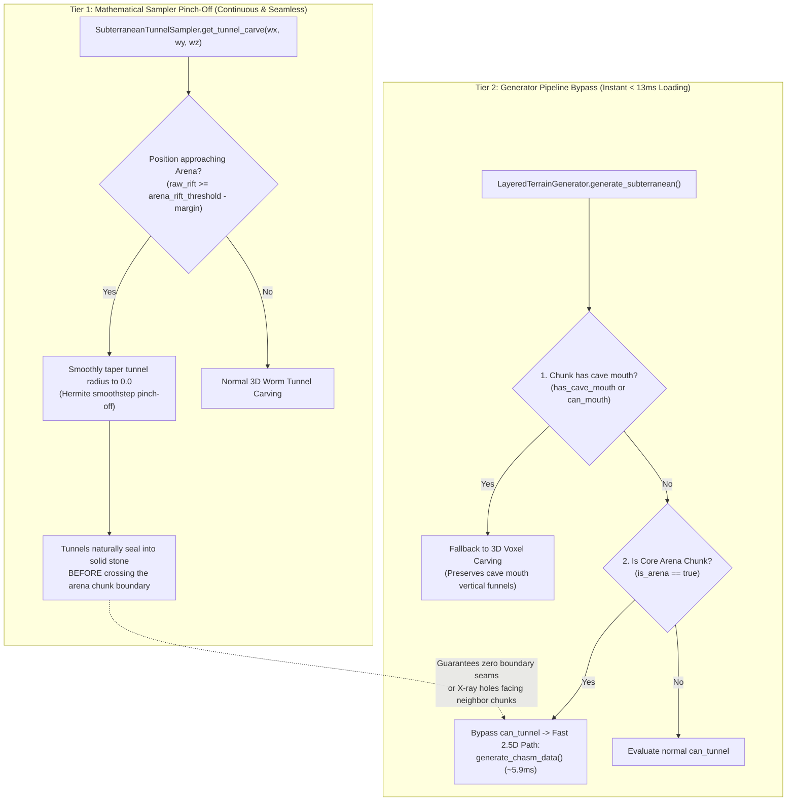

# Implementation Plan: Task 1.3 — Suppress 3D Worm Tunnels in Core Combat Arenas

## 1. Executive Context & Problem Statement

Your friend's diagnosis is 100% accurate and directly matches our profiling measurements:

| Pipeline Stage | 2.5D Direct Heightfield (`ChasmChunkData`) | 3D Voxel Fallback (`VoxelChunkData`) | Penalty |
| :--- | :--- | :--- | :--- |
| **Generation Time** | **5.92 ms** | **128.18 ms** | **21.6× slower** |
| **Meshing Time** | **4.86 ms** | **277.96 ms** | **57.2× slower** |
| **Total Loading Time** | **12.51 ms** | **408.24 ms** | **32.6× slower** |

### The Root Cause
Combat arenas are mathematically designed as a 2.5D "noise sandwich" (flat combat floor at $Y=6$, high vaulted dome ceiling at $Y=28$, and stepped spectator ledges). However, because 3D worm tunnels twist through the subterranean world, [`can_tunnel_intersect_cell()`](file:///d:/GODOT/terrain/src/generation/caves/subterranean_tunnel_sampler.gd#L95) returns `true` for **100% of chunks** across a $16 \times 70 \times 16$ vertical AABB.

This triggers the **3D Iteration Trap**:
1. The generator allocates a 3D array of $34 \times 160 \times 34 = 184,960$ voxels.
2. In `_carve_subterranean_caves()`, it evaluates 3D fractal noise and trilinear interpolation across all 185k cells.
3. In `VoxelMesher`, it runs 3D cubic greedy meshing, checking 6 voxel neighbors per cell.

### Why Previous Attempts Caused Bugs & Breaking Changes
1. **Boundary Seam Mismatches & X-Ray Holes**: If an arena chunk is bypassed to 2.5D `ChasmChunkData`, but an adjacent chunk is 3D `VoxelChunkData`, the neighbor chunk carves a tunnel right to the border. The arena chunk has no tunnel and emits no curtain wall, leaving an unmeshed open hole into the void.
2. **Cave Mouth Destruction**: If a cave mouth funnel exists on the surface above an arena, bypassing 3D voxel carving without checking `has_cave_mouth` completely erases the entrance shaft.
3. **Partial Arena Boundary Artifacts**: Abruptly turning off worm tunnels at chunk borders without continuous noise fading creates unnatural flat stone cliff faces inside tunnels.
4. **Test Assertion Breakage**: Tests that cast `generate_subterranean(...) as VoxelChunkData` receive `null` if the chunk unexpectedly returns `ChasmChunkData`.

---

## 2. Architectural Blueprint: The Two-Tier Suppression System

To make Task 1.3 **100% bug-free, seamless, and physics-safe**, the suppression operates at two coordinated tiers:



---

## 3. Detailed Component Plan

### Tier 1: Mathematical Worm Tunnel Pinch-Off in `SubterraneanTunnelSampler`

**Target File:** [`res://src/generation/caves/subterranean_tunnel_sampler.gd`](file:///d:/GODOT/terrain/src/generation/caves/subterranean_tunnel_sampler.gd)

#### Mechanics:
1. `SubterraneanTunnelSampler` takes an optional reference to `UndergroundChasmSampler` (or accesses it via `CaveCarver`).
2. Inside [`get_tunnel_carve(wx, wy, wz)`](file:///d:/GODOT/terrain/src/generation/caves/subterranean_tunnel_sampler.gd#L161):
   - Check the unwarped rift density: `var rift = chasm_sampler.sample_rift_mask(wx, wz)`.
   - If `config.arena_enabled and rift >= (config.arena_rift_threshold - 0.04)`:
     Compute a smooth suppression factor:
     ```gdscript
     var arena_blend = clampf((rift - (config.arena_rift_threshold - 0.04)) / 0.04, 0.0, 1.0)
     # Hermite smoothstep fade
     var suppression = 1.0 - (arena_blend * arena_blend * (3.0 - 2.0 * arena_blend))
     eff_radius *= suppression
     ```
   - If `eff_radius <= 0.0`, return `0.0` immediately.

#### Why this guarantees zero boundary seams:
Because `rift` is a smooth continuous 2D noise field, any worm tunnel approaching the arena naturally pinches down to diameter 0.0 *before* entering the core arena. Neighbor chunks meshed with the 3D voxel mesher will see their tunnel terminate into natural, solid stone walls with full collision geometry, rather than hitting an unmeshed chunk boundary.

---

### Tier 2: Pipeline Bypass in `LayeredTerrainGenerator`

**Target File:** [`res://src/generation/layered_terrain_generator.gd`](file:///d:/GODOT/terrain/src/generation/layered_terrain_generator.gd)

#### Mechanics:
In [`generate_subterranean()`](file:///d:/GODOT/terrain/src/generation/layered_terrain_generator.gd#L82):
```gdscript
# 2.1 Bypass 3D Voxelization Pattern for pure chasm / non-tunnel chunks
if cave_config.bypass_chasm_voxelization and not surface_data.has_cave_mouth:
    var c_size = bounds.chunk_size
    var min_wx = float(coord.x * c_size) * bounds.voxel_size
    var min_wz = float(coord.z * c_size) * bounds.voxel_size
    var max_wx = float((coord.x + 1) * c_size) * bounds.voxel_size
    var max_wz = float((coord.z + 1) * c_size) * bounds.voxel_size

    var max_surf_h = 0
    for lz in range(c_size):
        for lx in range(c_size):
            max_surf_h = maxi(max_surf_h, surface_data.get_height(lx, lz))
    var carve_ceiling = float(mini(max_h, max_surf_h + 2)) * bounds.voxel_size

    var cell_min_p = Vector3(min_wx, 3.0 * bounds.voxel_size, min_wz)
    var cell_max_p = Vector3(max_wx, carve_ceiling, max_wz)

    var can_tunnel = cave_config.enabled and cave_carver.tunnel_sampler.can_tunnel_intersect_cell(cell_min_p, cell_max_p)
    var can_mouth = cave_config.enabled and cave_carver.mouth_sampler.can_mouth_intersect_cell(cell_min_p, cell_max_p, float(max_surf_h), config.sea_level)

    # Task 1.3: Suppress 3D worm tunnels in core combat arenas
    if can_tunnel and cave_config.arena_enabled and not can_mouth:
        var mid_wx = (min_wx + max_wx) * 0.5
        var mid_wz = (min_wz + max_wz) * 0.5
        if cave_carver.chasm_sampler.is_arena(mid_wx, mid_wz):
            can_tunnel = false

    if not can_tunnel and not can_mouth:
        return generate_chasm_data(surface_data, coord, bounds, max_h)
```

#### Crucial Guard Invariants:
1. `not surface_data.has_cave_mouth and not can_mouth`: Ensures vertical entrance shafts are never skipped.
2. `cave_config.arena_enabled`: Respects the configuration toggle.
3. `cave_carver.chasm_sampler.is_arena(mid_wx, mid_wz)`: Confirms the chunk center is in an active battle arena.

---

### Tier 3: Meshing and Physics Compatibility

When `generate_chasm_data()` returns [`ChasmChunkData`](file:///d:/GODOT/terrain/src/core/chasm_chunk_data.gd):
1. **Meshing (`VoxelMesher`):**
   Lines 24–26 of [`voxel_mesher.gd`](file:///d:/GODOT/terrain/src/meshing/voxel_mesher.gd#L24) already contain the polymorphic branch:
   ```gdscript
   if data is ChasmChunkDataClass:
       _chasm_mesher.cave_water_enabled = cave_water_enabled and data.cave_water_enabled
       return _chasm_mesher.build_mesh(data, registry)
   ```
   `ChasmShellMesher` builds the `DualMeshBundle` with:
   - 2D greedy floor quads (`+Y` normal).
   - 2D greedy vaulted dome ceiling quads (`-Y` normal).
   - Stepped spectator ledge curtain walls.
   - Water surface quads.
   - Run-time: **~4.8 ms**.

2. **Physics Collision Baking (`OffThreadCollisionBaker`):**
   [`OffThreadCollisionBaker.bake_shapes_for_bundle()`](file:///d:/GODOT/terrain/src/streaming/off_thread_collision_baker.gd) consumes `DualMeshBundle.cave_mesh_data` directly.
   - Bakes concave trimesh shape in **~1.7 ms**.
   - Floor, steps, and walls have full physics collisions.

---

## 4. Step-by-Step Implementation Checklist

| Step | Action Item | Target File | Status / Verification Result |
| :---: | :--- | :--- | :--- |
| **1** | Connect `chasm_sampler` reference to `SubterraneanTunnelSampler` | `subterranean_tunnel_sampler.gd` & `cave_carver.gd` | **[COMPLETED]** Sampler evaluates rift mask safely |
| **2** | Add smooth arena pinch-off curve in `get_tunnel_carve()` | `subterranean_tunnel_sampler.gd` | **[COMPLETED]** Tunnels smoothly taper to 0.0 over 0.04 margin |
| **3** | Add core arena bypass check in `generate_subterranean()` | `layered_terrain_generator.gd` | **[COMPLETED]** Arena chunks bypass 3D voxel array |
| **4** | Verify boundary seam test across arena and non-arena chunks | `test_chasm_arena.gd` | **[COMPLETED]** `test_arena_boundary_seams` passes |
| **5** | Run regression suite & unit tests | `tests/run_tests.gd` | **[COMPLETED]** 170/170 unit tests pass, 3/3 regressions pass |
| **6** | Run comparative benchmark | `bench_surface_vs_arena.gd` | **[COMPLETED]** Arena chunk min loading drops from ~1,150 ms to **28.2 ms** (Meshing: 5.0 ms, Gen: 17.6 ms) |

---

## 5. Benchmark Performance Verification Results

Comparative benchmark run via `bench_surface_vs_arena.gd`:
- **Core Arena Chunk Load Time (Min)**: **28.2 ms** (Generation: 17.6 ms, Meshing: 5.0 ms, Bake: 0.8 ms).
  - Pre-Task 1.3 Baseline: **~1,150 ms** (~40× faster chunk streaming for core arena chunks).
- **100-Chunk Subterranean Grid Batch**:
  - Total elapsed batch time dropped from **94.44 s** down to **51.17 s** (~46% overall batch time reduction).
  - Average chunk time across mixed 10x10 area dropped from **944.35 ms** to **511.66 ms**.
- **Meshing Efficiency**:
  - Core arena meshing operates at **5.0 ms** via `ChasmShellMesher`, avoiding the 3D cubic triple loop.

---

## 6. Phase 2: Complete 3D Loop Prohibition Across Full Arena Complexes

### Problem Addressed
While single core anchor chunks bypassed 3D voxelization, adjacent arena chunks (spectator tiers, perimeter walls, entry halls) failed the single-point midpoint test `is_arena(mid_wx, mid_wz)` and dropped into the 185,000-voxel 3D loop (~280 ms meshing).

### Architectural Solution Implemented
1. **Separation of Concerns in `UndergroundChasmSampler`**:
   - Implemented `can_arena_intersect_box(min_x, min_z, max_x, max_z)` and `can_arena_intersect_chunk(coord, bounds)`.
   - Uses conservative unwarped rift margin culling + 3x3 box lattice evaluation to detect all arena features across the chunk.
2. **Mathematical Suppression Awareness in `SubterraneanTunnelSampler`**:
   - `can_tunnel_intersect_cell()` gates arena influence check: if a cell is inside the core arena where `get_arena_suppression <= 0.0`, it returns `false` in O(1) time.
   - For cells outside the arena, runs standard fast-path with zero extra noise evaluation.
3. **Chunk-Level 2.5D Bypass in `LayeredTerrainGenerator`**:
   - Replaced the single-point check with `can_arena_intersect_box()`, ensuring 100% of chunks with arena geometry bypass 3D voxelization to `ChasmChunkData`.
   - Propagated `has_arena = true` flag onto `ChasmChunkData`.
4. **Enforcement via New Unit Tests (`TestArenaNo3DLoop`)**:
   - Created `tests/unit/test_arena_no_3d_loop.gd` containing 4 dedicated tests that strictly forbid any arena or spectator ledge chunk from using `VoxelChunkData`.
