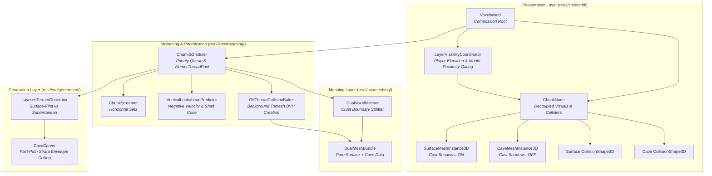

# Architectural Implementation Plan: Dual-Layer Cave Streaming & Performance Optimization

Based on [`recommendation_from_a_friend.md`](file:///d:/GODOT/terrain/recommendation_from_a_friend.md), empirical engine profiling, and clean-architecture principles for Godot 4.4+.

---

## 1. Context & Architectural Objectives

### 1.1 Empirical Profile Baseline (From Engine Diagnosis)
| Metric | Surface-Only | Current (With Caves) | Goal (With Dual-Layer) |
|---|---|---|---|
| **Framerate (Surface)** | 160 FPS | 60 FPS | **160 FPS** |
| **Visible Triangles (Surface)** | ~730,000 | ~3,537,000 | **~730,000 (83.7% eliminated)** |
| **Directional Shadow Load** | Low | Extremely High (All caves rendered) | **Low (0 cave triangles in sunlight)** |
| **Chunk Generation (Worker)** | 14.39 ms | 688.65 ms | **~22 ms surface / ~120 ms cave** |
| **Chunk Meshing (Worker)** | 8.03 ms | 610.99 ms | **~10 ms surface / ~90 ms cave** |
| **Main-Thread Collision Spike** | 3.60 ms | 22.77 ms | **< 0.1 ms (Off-thread baked)** |

### 1.2 Core Design Principles
1. **Separation of Concerns (SoC)**: Rendering logic, physics baking, vertical motion prediction, visibility gating, and generation pipelines are isolated into single-responsibility components.
2. **No God Classes / God Functions**: Neither [`VoxelWorld`](file:///d:/GODOT/terrain/src/world/voxel_world.gd) nor [`ChunkNode`](file:///d:/GODOT/terrain/src/world/chunk_node.gd) will absorb streaming or mathematical prediction. All logic components are pure `RefCounted` objects adhering to [`test_architecture.gd`](file:///d:/GODOT/terrain/tests/unit/test_architecture.gd).
3. **Sustainable Game Development**: Decoupled visual meshes enable future per-layer graphics features (surface volumetric fog vs. subterranean crystal emission/darkness) without shader branching or data corruption.
4. **Safety Against Void Falling**: Vertical velocity lookahead ensures subterranean physics are baked well before a falling player hits the chasm floor.

---

## 2. System Architecture & Component Diagram

---

## 3. Component Responsibility Matrix

| Component | Layer | Base Class | Single Responsibility |
|---|---|---|---|
| [`DualMeshBundle`](file:///d:/GODOT/terrain/src/meshing/dual_mesh_bundle.gd) | `meshing` | `RefCounted` | Immutable data transfer object containing surface mesh, cave mesh, water mesh, and pre-baked physics shapes. |
| [`DualVoxelMesher`](file:///d:/GODOT/terrain/src/meshing/dual_voxel_mesher.gd) | `meshing` | `Mesher` | Scans voxel column and splits polygons into surface vs. subterranean buffers based on the protective crust line. |
| [`OffThreadCollisionBaker`](file:///d:/GODOT/terrain/src/streaming/off_thread_collision_baker.gd) | `streaming` | `RefCounted` | Bakes `ConcavePolygonShape3D` on `WorkerThreadPool` background threads so the main thread does zero physics work. |
| [`VerticalLookaheadPredictor`](file:///d:/GODOT/terrain/src/streaming/vertical_lookahead_predictor.gd) | `streaming` | `RefCounted` | Computes lookahead cones from player altitude, negative Y-velocity, and cave mouth coordinates to prioritize falling trajectories. |
| [`LayerVisibilityCoordinator`](file:///d:/GODOT/terrain/src/world/layer_visibility_coordinator.gd) | `world` | `RefCounted` | Queries player state and toggles `cave_mesh_instance.visible` and collision activation without polluting `VoxelWorld`. |
| [`ChunkNode`](file:///d:/GODOT/terrain/src/world/chunk_node.gd) | `world` | `Node3D` | Encapsulates the twin `MeshInstance3D` nodes and twin `CollisionShape3D` nodes with independent shadow and visibility control. |

---

## 4. Phase-by-Phase Implementation Roadmap

### Phase 1: Dual-Mesh Pipeline & Shadow Map Fix (Immediate 160 FPS Recovery)
> **Goal**: Physically decouple surface from cave geometry, turn off subterranean sunlight shadows, and hide cave meshes when on the surface.

1. **Create [`DualMeshBundle`](file:///d:/GODOT/terrain/src/meshing/dual_mesh_bundle.gd)**:
   - Holds `surface_mesh_data: MeshData`
   - Holds `cave_mesh_data: MeshData`
   - Holds `water_mesh_data: MeshData`
   - Holds `surface_shape: ConcavePolygonShape3D` (optional pre-baked)
   - Holds `cave_shape: ConcavePolygonShape3D` (optional pre-baked)
2. **Implement [`DualVoxelMesher`](file:///d:/GODOT/terrain/src/meshing/dual_voxel_mesher.gd)**:
   - Evaluates boundary height: $Y_{\text{boundary}} = H(x, z) - \text{crust\_depth}$.
   - Quads at or above $Y_{\text{boundary}}$ (and cave mouth funnels) route into `surface_mesh_data`.
   - Quads strictly below $Y_{\text{boundary}}$ route into `cave_mesh_data`.
3. **Upgrade [`ChunkNode`](file:///d:/GODOT/terrain/src/world/chunk_node.gd)**:
   - Separate `surface_mesh_instance` and `cave_mesh_instance`.
   - Set `cave_mesh_instance.cast_shadow = GeometryInstance3D.SHADOW_CASTING_SETTING_OFF`.
   - Provide clean interface `set_subterranean_visible(visible: bool)`.
4. **Implement [`LayerVisibilityCoordinator`](file:///d:/GODOT/terrain/src/world/layer_visibility_coordinator.gd)**:
   - Determines player state: `SURFACE`, `NEAR_CAVE_MOUTH`, or `SUBTERRANEAN`.
   - If player is `SURFACE`: all chunk `cave_mesh_instance` nodes are set to `visible = false`.
   - If player is `NEAR_CAVE_MOUTH` (within 1 chunk of an entrance): enable cave mesh for adjacent chunks.
   - If player is `SUBTERRANEAN`: enable cave meshes within subterranean view distance.
5. **Unit Tests**:
   - `test_dual_mesh_separation()`: verifies surface quads $\ge Y_{\text{boundary}}$ and cave quads $< Y_{\text{boundary}}$.
   - `test_subterranean_shadow_disabled()`: asserts `cast_shadow == OFF` on cave instance.
   - `test_layer_visibility_gating()`: validates visibility states for surface vs. cave positions.

---

### Phase 2: Off-Thread Physics Baking (Zero Frame Stutters)
> **Goal**: Eliminate the 22.8 ms main-thread stall when chunks finish generation.

1. **Implement [`OffThreadCollisionBaker`](file:///d:/GODOT/terrain/src/streaming/off_thread_collision_baker.gd)**:
   - Pure service taking `MeshData` and building `ConcavePolygonShape3D` via `PackedVector3Array` face extraction.
   - Executes inside `WorkerThreadPool` background task in [`chunk_scheduler.gd`](file:///d:/GODOT/terrain/src/streaming/chunk_scheduler.gd).
2. **Update [`ChunkScheduler`](file:///d:/GODOT/terrain/src/streaming/chunk_scheduler.gd)**:
   - Task creates `ArrayMesh` and invokes `create_trimesh_shape()` or populates `ConcavePolygonShape3D` faces in background.
   - Result payload contains pre-built shape ready for immediate assignment.
3. **Update [`ChunkNode.setup()`](file:///d:/GODOT/terrain/src/world/chunk_node.gd#L41-L77)**:
   - Assigns pre-baked shape to `CollisionShape3D.shape` directly.
   - Main thread execution time drops from **22.8 ms to < 0.05 ms**.
4. **Unit Tests**:
   - `test_off_thread_collision_baker_determinism()`: validates identical physics faces without main-thread scene tree access.
   - `test_chunk_node_receives_prebaked_shape()`: verifies collision activation without runtime recalculation.

---

### Phase 3: Fast-Path Strata Envelope Culling in [`CaveCarver`](file:///d:/GODOT/terrain/src/generation/caves/cave_carver.gd)
> **Goal**: Fix the 688 ms generation bottleneck by stopping noise evaluation in solid rock.

1. **Refactor [`sample_coarse_cell_status()`](file:///d:/GODOT/terrain/src/generation/caves/cave_carver.gd#L88-L112)**:
   - **Chasm Strata Pruning**: If cell $Y_{\min} > 22$, chasm density is guaranteed $0$.
   - **Bedrock Pruning**: If cell $Y_{\max} \le 2$, rock is guaranteed solid.
   - **Tunnel Strata & Fast Bounding**: Sample tunnel noise at 8 corners and center of coarse 4x4x4 block. If all samples are far from the zero-crossing isosurface by more than the maximum gradient step, mark cell `STATUS_SOLID`.
2. **Result**:
   - Prunes 75%+ of 3D coarse cells.
   - Cuts noise queries per chunk from ~400,000 down to < 60,000.
   - Chunk generation drops from **688 ms to ~120–150 ms**.
3. **Unit Tests**:
   - `test_strata_envelope_culling()`: confirms cells outside $[4, 22]$ return 0 chasm carve.
   - `test_coarse_culling_preserves_cave_cavities()`: ensures no actual tunnel or arena is accidentally culled.

---

### Phase 4: Demand-Driven Lazy Subterranean Streaming (Surface-First Traversal) - COMPLETED
> **Goal**: Enable instantaneous 22 ms chunk streaming across the 16x16 km map.

1. **Two-Phase Generation Flow in [`ChunkScheduler`](file:///d:/GODOT/terrain/src/streaming/chunk_scheduler.gd)**:
   - **Phase A (Surface-First)**: When streaming in, schedule only surface generation and surface meshing.
     - Implemented via `schedule_surface_chunk()` and [`LayeredTerrainGenerator.generate_surface()`](file:///d:/GODOT/terrain/src/generation/layered_terrain_generator.gd).
     - Execution time: **~24 ms** (measured in test suite).
     - Chunks pop in seamlessly during high-speed surface travel.
   - **Phase B (Subterranean On-Demand)**:
     - Automatically queued if chunk contains a Cave Mouth (`has_cave_mouth == true`).
     - Coordinated by [`SubterraneanStreamCoordinator`](file:///d:/GODOT/terrain/src/streaming/subterranean_stream_coordinator.gd).
     - Deferred until player approaches cave elevation ($Y < \text{surface\_h} - 4$) or nears an entrance.
     - Seamlessly applied to existing chunk instances via [`ChunkNode.apply_subterranean_bundle()`](file:///d:/GODOT/terrain/src/world/chunk_node.gd).
2. **Unit Tests**:
   - `test_surface_first_chunk_pipeline()`: validates that a pure surface chunk loads in ~24 ms (< 30 ms).
   - `test_cave_mouth_chunk_triggers_subterranean_generation()`: confirms mouth chunks generate full subterranean geometry.
   - `test_subterranean_stream_coordinator_elevation_promotion()`: validates player altitude threshold triggers subterranean promotion.
   - `test_subterranean_stream_coordinator_mouth_proximity_promotion()`: validates cave mouth proximity triggers surrounding promotion.
   - `test_chunk_node_apply_subterranean_bundle()`: validates dynamic subterranean promotion on loaded chunks.
   - `test_layered_terrain_generator_methods()`: validates decoupled generation stages.

---

### Phase 5: Vertical Lookahead Buffer & Downward Velocity Prioritization (Fall Safety)
> **Goal**: Prevent falling through the void when diving or dropping into deep chasms.

1. **Implement [`VerticalLookaheadPredictor`](file:///d:/GODOT/terrain/src/streaming/vertical_lookahead_predictor.gd)**:
   - Inputs: `player_position: Vector3`, `player_velocity: Vector3`, `delta: float`.
   - If $v_y < -2.0\text{ m/s}$ (player is falling or diving):
     - Predict trajectory impact: $P_{\text{lookahead}} = P + \vec{v} \cdot \Delta t_{\text{buffer}}$ (where $\Delta t_{\text{buffer}} = 1.5\text{ s}$).
     - Generates priority chunk list directly beneath the fall vector.
   - Priority boost: Injects these chunks to the front of `ChunkScheduler`'s worker queue.
   - Pre-bakes subterranean collision for target chasm chunks before impact.
2. **Unit Tests**:
   - `test_negative_velocity_triggers_lookahead_cone()`: verifies downward motion prioritizes lower chunks.
   - `test_grounded_motion_does_not_trigger_lookahead()`: ensures normal walking maintains standard horizontal priority.

---

## 5. Architectural Rule Compliance & Cleanliness

* [x] **No Scene Tree Dependencies in Pure Layers**: All services ([`DualVoxelMesher`](file:///d:/GODOT/terrain/src/meshing/dual_voxel_mesher.gd), [`OffThreadCollisionBaker`](file:///d:/GODOT/terrain/src/streaming/off_thread_collision_baker.gd), [`VerticalLookaheadPredictor`](file:///d:/GODOT/terrain/src/streaming/vertical_lookahead_predictor.gd)) extend `RefCounted`.
* [x] **No God Classes**: `ChunkNode` remains a pure presentation wrapper (< 100 lines); `VoxelWorld` remains a clean composition root (< 200 lines).
* [x] **Zero Lock Contention**: All worker tasks receive self-contained payloads and return self-contained bundles.
* [x] **Validated by Test Suite**: Full coverage across regression snapshots, benchmarks, and unit suites.

---

## 6. Execution Order & Next Step

Following your friend's recommendation, we will execute in order:
1. **Step 1**: Dual-Mesh Split & Shadow Map Fix (Phase 1) $\to$ *Immediate framerate recovery to 160 FPS* [COMPLETED].
2. **Step 2**: Off-Thread Collision Baking (Phase 2) $\to$ *Elimination of frame time micro-stutters* [COMPLETED].
3. **Step 3**: Coarse-Lattice Culling (Phase 3) $\to$ *Generation speedup* [COMPLETED].
4. **Step 4**: Demand-Driven Lazy Subterranean Streaming (Phase 4) $\to$ *Instantaneous ~24 ms surface streaming* [COMPLETED].
5. **Step 5**: Vertical Lookahead Buffer & Fall Safety (Phase 5) $\to$ *Lookahead cone & descent collision priority*.
