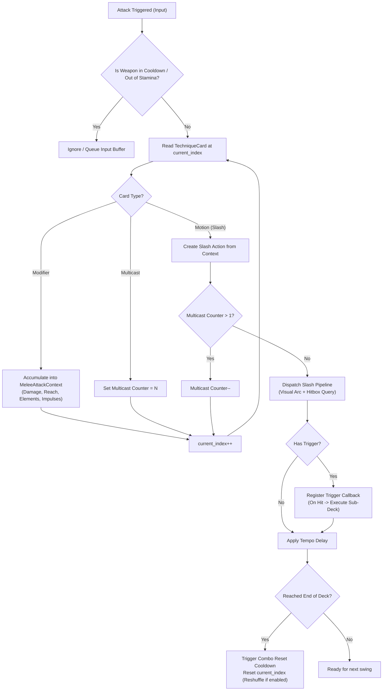
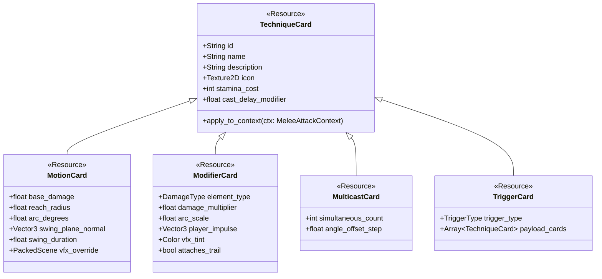

# Procedural Melee Attack System (Noita-Style) — Implementation Plan

## 1. Executive Summary & Core Concept

This plan outlines the architecture, visual pipeline, and step-by-step implementation of a **Procedural Melee Attack System** inspired by *Noita's* wand and spellcrafting mechanics, adapted for 3D third-person melee combat in Godot 4.

In *Noita*, wands cast combinations of projectile spells, stat modifiers, multicast formations, and chain triggers. In our system:
- **Weapons** act as **Wands / Stances** with distinct pacing (tempo delay, combo reset time, stamina pool, capacity, shuffle mode).
- **Attacks** are assembled from **Technique Cards** (Motions, Modifiers, Multicasts, Triggers).
- **Animation & Visuals**: Characters are unrigged modular pawns / capsules. Rather than traditional skeletal swinging animations, kinetic weight and direction are driven by:
  1. A **Procedural Weapon Pivot Controller** that handles anticipation tilt, swing sweeps, hit-stop freezes, and recovery tweens.
  2. A **Heavy Procedural Slash VFX System** (parametric curved ribbon/arc meshes, erosion shaders, elemental particle trails, and hit sparks) that defines the physical cutting volume and visual impact.

```
                    [ PLAYER INPUT: Attack Request ]
                                   │
                                   ▼
                   [ MELEE DECK EVALUATOR (Interpreter) ]
             Evaluates queued Technique Cards (Motions + Modifiers)
                                   │
                ┌──────────────────┴──────────────────┐
                ▼                                     ▼
     [ PROCEDURAL WEAPON PIVOT ]          [ PROCEDURAL SLASH VFX & HITBOX ]
   • Rapid anticipation angle           • Dynamic parametric arc mesh
   • Sweep interpolation (Tween)        • Dissolving slash shader
   • Hitstop micro-freeze on contact    • ShapeCast3D / Spatial volume query
   • Dynamic recoil & rest blend        • Elemental trails & voxel impact
                │                                     │
                └──────────────────┬──────────────────┘
                                   ▼
             [ HIT REGISTRATION & CHAIN TRIGGERS ]
       • Damage & elemental status applied to targets
       • On-Hit triggers recursively cast next techniques
       • Voxel terrain carved / chipped
```

---

## 2. Noita to Melee Translation Matrix

| Noita Wand / Spell Concept | Procedural Melee System Equivalent | Description |
| :--- | :--- | :--- |
| **Wand** | **Weapon Frame / Blade Stance** (`MeleeWeaponDef`) | Holds attack slots, dictates base tempo, stamina pool, and shuffle behavior. |
| **Cast Delay** | **Swing Windup / Tempo Delay** (`tempo_delay`) | The minimum delay between consecutive swings in a combo sequence. |
| **Recharge Time** | **Combo Reset Time** (`combo_reset_time`) | Cooldown after exhausting all slotted techniques before resetting to slot 0. |
| **Mana Max / Recharge** | **Stamina / Ki Pool & Recovery** (`stamina_max`, `stamina_recharge_rate`) | Resource consumed by slashes and heavy modifiers. |
| **Capacity** | **Kata Slots** (`slot_capacity`) | Number of technique cards that can be equipped (e.g. 3 to 8). |
| **Shuffle (Yes/No)** | **Fixed Combo vs. Dynamic Stance** (`is_shuffle`) | Deterministic combo order (1 -> 2 -> 3) vs. unpredictable rapid stance dance. |
| **Spread** | **Trajectory Jitter / Angle Drift** (`arc_variance`) | Procedural angular deviation added to slash planes. |
| **Projectile Spell** (e.g. *Spark Bolt*) | **Base Motion / Slash Card** (e.g. *Upswing Slash*) | The physical strike action. Defines arc angle, trajectory plane, damage, and reach. |
| **Spell Modifier** (e.g. *Damage Plus, Fire Trail*) | **Blade Infusion / Modifier Card** (e.g. *Flame Edge, Lunge*) | Modifies damage, arc radius, adds player lunges, or attaches elemental fire effects. |
| **Multicast** (e.g. *Double Cast, Scatter*) | **Formations / Twin Slash** (e.g. *Cross Cut, Flurry*) | Executes 2 or more slash motions simultaneously or in immediate succession. |
| **Trigger / Timer** (e.g. *Spark Bolt with Trigger*) | **Chain Trigger** (e.g. *Thrust with Hit-Trigger*) | On hitting an enemy or surface, immediately executes the payload techniques! |
| **Projectile Wave** (e.g. *Bouncing Burst*) | **Blade Beam / Sword Wave** (`BladeBeamModifier`) | Releases a crescent flying energy wave upon swinging the blade. |

---

## 3. Architecture & Directory Layout

A dedicated, isolated module `res://src/combat/` will be established, keeping gameplay mechanics cleanly decoupled from world generation and player locomotion:

```
src/combat/
├── core/
│   ├── melee_attack_context.gd       # Runtime packet: damage, element, reach, arc angles, impulses
│   ├── melee_deck_evaluator.gd       # Interpreter: parses slots, handles modifiers, multicasts & triggers
│   ├── melee_weapon_def.gd           # Resource: weapon stats, visual mesh/sprite, slot count, cooldowns
│   └── technique_card.gd             # Base Resource for all technique cards
├── techniques/
│   ├── motions/
│   │   ├── motion_upswing.gd         # Vertical upward slash (launches light enemies)
│   │   ├── motion_downcleave.gd      # Overhead slam (heavy impact, ground slam VFX)
│   │   ├── motion_horizontal_sweep.gd# 120° wide horizontal cleave
│   │   ├── motion_thrust.gd          # Narrow linear stab with high penetration
│   │   ├── motion_spin.gd            # 360° circular sweep
│   │   └── motion_iaido_cut.gd       # High-speed dash-slash with delayed slice marks
│   ├── modifiers/
│   │   ├── mod_flame_edge.gd         # Fire damage + burning trail + voxel ignition
│   │   ├── mod_frost_edge.gd         # Chill/slow + ice shatter VFX
│   │   ├── mod_shock_edge.gd         # Chain lightning to adjacent targets on hit
│   │   ├── mod_lunge.gd              # Impulse boost to character velocity during swing
│   │   ├── mod_vacuum_pull.gd        # Pulls nearby entities into slash center before strike
│   │   ├── mod_heavy_impact.gd       # Massive knockback + terrain gouging
│   │   └── mod_blade_beam.gd         # Spawns a crescent energy projectile along the slash vector
│   ├── multicast/
│   │   ├── multi_double_slash.gd     # Resolves 2 slash motions in one swing action
│   │   ├── multi_cross_cut.gd        # Executes intersecting diagonal slashes (X-cut)
│   │   └── multi_flurry.gd           # Burst of 3 micro-slashes with reduced damage
│   └── triggers/
│       ├── trigger_on_hit.gd         # Dispatches sub-deck execution upon collision
│       └── trigger_on_timer.gd       # Dispatches sub-deck execution after T seconds mid-swing
├── visuals/
│   ├── weapon_pivot_controller.gd    # Procedural weapon mount (idle bob, windup, swing, hitstop)
│   ├── slash_arc_mesh_builder.gd     # Generates parametric 3D ribbon arc meshes on the fly
│   ├── procedural_slash_effect.gd    # Controls the animated slash instance (mesh + shader + particles)
│   └── hit_impact_spawner.gd         # Spawns spark bursts, blood/ash splatters, and terrain decals
├── hitbox/
│   ├── slash_hitbox_query.gd         # Godot ShapeCast3D / convex shape intersection pipeline
│   └── damage_packet.gd              # Damage, knockback, damage type, poise break, instigator
├── ui/
│   ├── deck_editor_hud.gd            # Noita-style card inventory and weapon slot interface
│   └── combo_readout_hud.gd          # On-screen active combo indicator & stamina gauge
└── shaders/
    ├── slash_arc.gdshader            # High-intensity energy ribbon shader with noise dissolve & fresnel
    └── blade_trail.gdshader          # High-speed tip streak ribbon shader
```

---

## 4. Subsystem Detailed Specifications

### 4.1. Core Interpreter & Deck Evaluator (`MeleeDeckEvaluator`)

The evaluator runs an evaluation loop identical in spirit to *Noita's* wand interpreter:
1. **Queue Processing**: Reads the weapon's `Array[TechniqueCard]` from `current_index`.
2. **Modifier Accumulator**: Modifiers (e.g. `FlameEdge`, `Lunge`, `GiantBlade`) add stats and behaviors to an active `MeleeAttackContext`.
3. **Motion Resolution**: When a `MotionCard` is reached:
   - If a `MulticastCard` is active, it continues evaluating the next card until all multicast slots are filled.
   - The compiled `MeleeAttackContext` is dispatched to the **Execution Pipeline** (Visuals + Hitbox).
   - If the Motion contains a `Trigger`, child cards are stored inside the context to be dispatched upon event firing.
4. **Timing & Pacing**:
   - Applies `tempo_delay` before the next swing can start.
   - Deducts stamina cost.
   - If the deck reaches the end, enters `combo_reset_time` (recharge cooldown) and resets `current_index = 0` (or reshuffles if `is_shuffle = true`).



### 4.2. Procedural Weapon Rigging (No-Skeleton Animation)

Since pawns lack humanoid bone rigs, weapons are mounted to a `WeaponPivotController` (a `Node3D` attached to the pawn):
- **Components**:
  - `WeaponAnchor`: Pivot point positioned slightly to the right/front of the character.
  - `MeshInstance3D`: 3D weapon model (or stylized billboard sprite) held at the grip.
  - `TrailAnchor`: Node marking the blade tip for ribbon trail emission.
- **Procedural States**:
  - `REST / GUARD`: Weapon hovers near the hip/shoulder, subtly tilting with the `PawnLocomotionWaddler` waddle phase.
  - `WINDUP`: Tweens into the windup stance over 0.05s–0.12s (e.g. raised high for `Downcleave`, held low-right for `Upswing`, pulled back for `Thrust`).
  - `STRIKE / SWEEP`: Rapidly sweeps along the calculated attack plane matching the VFX arc duration (0.08s–0.16s) using custom easing curves (`TRANS_EXPO`, `EASE_OUT`).
  - `HITSTOP`: On collision impact, weapon and pawn experience a 0.03s–0.06s freeze-frame shudder to deliver tactile physical weight.
  - `RECOVERY`: Smoothly interpolates back to guard posture or directly flows into the next combo attack's windup.

### 4.3. Procedural Slash VFX System (The Kinetic Core)

Because there are no skeletal animations, the visual slashes do the heavy lifting for combat feel:
1. **Parametric Arc Mesh (`SlashArcMeshBuilder`)**:
   - Generates a curved ribbon mesh using `ArrayMesh` on the fly (or pooled).
   - Parameters:
     - `inner_radius` (e.g. 0.8m) and `outer_radius` (e.g. 2.4m).
     - `start_angle` and `arc_sweep` (e.g. 120° for cleaves, 360° for spins, 25° for thrust needle cones).
     - `plane_rotation`: Quat/Basis rotating the arc to be vertical (upswing/downcleave), horizontal (sweep), or diagonal.
     - `UV coordinates`: U spans 0.0 (trail tail) to 1.0 (leading edge); V spans 0.0 (inner blade) to 1.0 (outer tip).
2. **Custom Slash Shader (`slash_arc.gdshader`)**:
   - `lifetime_progress` uniform driving the animation from 0.0 to 1.0.
   - UV-based mask: Sharp glowing leading edge followed by an exponential fade tail.
   - Flowing noise texture: Distorts the arc edges into stylized anime-style speed lines.
   - Color / Emission ramp: Modulated dynamically by elemental modifiers:
     - Physical: Bright steel white-blue core with translucent blue vapor rim.
     - Flame Edge: White-hot inner core fading into turbulent orange-red fire with ember sparks.
     - Shock Edge: Jagged electric cyan/violet flicker with arcing lightning bolts.
     - Acid/Toxic: Corrosive lime-green bubbling edge.
3. **Weapon Tip Ribbon Trail**:
   - A `RibbonTrailMesh` attached to the blade tip that renders during high-speed swings to bridge the weapon to the slash arc.
4. **Hit Impact VFX**:
   - Directional spark spray (`GPUParticles3D`) oriented along the hit normal.
   - Camera micro-nudge / shake proportional to damage and poise impact.
   - Hit flash on impacted enemy models.

### 4.4. Procedural Hitbox & Voxel Interaction (`SlashHitboxQuery`)

To match the dynamic nature of procedural slashes:
- **Spatial Query**:
  - Instead of static collision shapes, uses `PhysicsDirectSpaceState3D.intersect_shape()` or a parametric `ShapeCast3D` (cylinder or convex sector shape) matching the exact dimensions of the evaluated slash (radius, arc angle, height thickness).
- **Target Detection**:
  - Queries `collision_mask` for Hurtboxes (enemies, breakable props) and Environment (terrain voxels).
- **Voxel Carving / Environmental Impact**:
  - For slashes with `HeavyImpact` or `FlameEdge`, queries `VoxelWorld` at the strike point.
  - Chipping/Scoring: Digs a small furrow or spawns debris particles on hit voxel surfaces.
  - Foliage Interaction: Slashes instantly mow down grass tufts and bushes (`FoliageChunkData`) within the strike radius.

### 4.5. Technique Card Catalog (Starter Set)



#### Starter Card Roster:
1. **Motions**:
   - `UpswingSlash`: Fast vertical upward slice (lifts lightweight targets, vertical crescent VFX).
   - `DownwardCleave`: Overhead slam (high poise damage, slams targets down, ground shockwave VFX).
   - `HorizontalSweep`: 130° wide horizontal arc (crowd control, multi-target cleave).
   - `PiercingThrust`: High-speed linear stab (narrow 20° forward cone, high armor piercing, forward step).
   - `SpinWhirl`: Full 360° rotational sweep (hits all surrounding targets, centrifugal push).
2. **Modifiers**:
   - `FlameEdge`: +35% damage as Fire, ignites targets and terrain, fire trail VFX.
   - `FrostEdge`: Freezes/slows targets, brittle ice impact VFX.
   - `ShockEdge`: Chains lightning to up to 2 nearby enemies upon hit.
   - `Lunge`: Propels the player forward 4.0m during the swing.
   - `VacuumBlade`: Sucks nearby enemies inward before the slash connects.
   - `HeavyImpact`: +80% knockback, breaks enemy guard, carves small voxel crater on ground hit.
   - `BladeBeam`: Fires a crescent shockwave projectile forward from the blade tip.
3. **Multicasts**:
   - `DoubleSlash`: Executes 2 motions in one swing action (e.g. Upswing + Cleave simultaneous).
   - `CrossCut`: Angles two slashes into an intersecting "X" formation.
4. **Triggers**:
   - `OnHitTrigger`: When the slash strikes an enemy or wall, instantly triggers the nested technique cards! (e.g. *Thrust with On-Hit Trigger -> Downward Cleave* = stab enemy, and on contact instantly trigger a crushing overhead slam).
   - `OnTimerTrigger`: Triggers nested technique 0.1s after swing starts.

---

## 5. Phased Implementation Roadmap

### Phase 1: Core Combat Data Structures & Evaluator
- [ ] Create `src/combat/core/melee_attack_context.gd`.
- [ ] Create base `src/combat/core/technique_card.gd` and sub-resources (`MotionCard`, `ModifierCard`, `MulticastCard`, `TriggerCard`).
- [ ] Create `src/combat/core/melee_weapon_def.gd` with slot capacity, delays, and stamina properties.
- [ ] Implement `src/combat/core/melee_deck_evaluator.gd` with complete Noita-style evaluation loop (modifiers accumulation, multicast grouping, trigger tree resolution, timing state machine).
- [ ] Write headless unit tests (`tests/test_melee_deck_evaluator.gd`) verifying deterministic card parsing, multicast splitting, and trigger dispatching.

### Phase 2: Procedural Weapon Mount & Non-Rigged Rigging
- [ ] Create `src/combat/visuals/weapon_pivot_controller.gd`.
- [ ] Create procedural placeholder weapon models / meshes (e.g. Stylized Greatsword, Katana, Polearm) in `assets/models/weapons/`.
- [ ] Implement procedural states: Rest Sway, Anticipation/Windup Tween, Strike Sweep, Hitstop Micro-Pause, and Recovery Smoothing.
- [ ] Mount the weapon pivot onto `Player` (`scenes/player.tscn`) and synchronize with `PlayerMotor` and `PlayerInput`.

### Phase 3: Procedural Slash VFX & Shader Pipeline
- [ ] Create `src/combat/visuals/slash_arc_mesh_builder.gd` for dynamic parametric 3D arc ribbons.
- [ ] Author `src/combat/shaders/slash_arc.gdshader` (polar UVs, noise distortion, bright leading rim, lifetime dissolution, dynamic HDR color tint).
- [ ] Author `src/combat/shaders/blade_trail.gdshader` for weapon tip speed streaks.
- [ ] Implement `src/combat/visuals/procedural_slash_effect.gd` combining mesh generation, shader animation, and GPU particle bursts.
- [ ] Build a visual playground test scene (`scenes/test_slash_vfx.tscn`) allowing real-time tuning of arc angles, radius, speeds, and elemental tints.

### Phase 4: Dynamic Arc Hitbox & Voxel Interaction
- [ ] Implement `src/combat/hitbox/slash_hitbox_query.gd` using Godot 4 `PhysicsDirectSpaceState3D.intersect_shape` / `ShapeCast3D` matching the exact visual arc sector.
- [ ] Define `DamagePacket` structure (damage value, elemental flags, knockback vector, poise damage).
- [ ] Connect terrain interaction: mow down grass foliage (`FoliageChunkData`) within slash radius, chip voxels on heavy ground slams.
- [ ] Add directional hit sparks, hit sound hooks, and camera hit-shake.

### Phase 5: Card Library & Procedural Combos
- [ ] Implement standard motions: `Upswing`, `DownwardCleave`, `HorizontalSweep`, `Thrust`, `Spin`.
- [ ] Implement elemental and kinetic modifiers: `FlameEdge`, `ShockEdge`, `FrostEdge`, `Lunge`, `Vacuum`, `HeavyImpact`, `BladeBeam`.
- [ ] Implement multicasts (`DoubleSlash`, `CrossCut`) and triggers (`OnHitTrigger`).
- [ ] Create pre-configured starter weapons (e.g. *"Novice Broadsword"* [Fixed 3-hit combo], *"Caster Rapier"* [Thrust with Hit-Trigger], *"Chaos Falchion"* [Shuffle blade with high capacity]).

### Phase 6: HUD & Deck Customization UI
- [ ] Implement `src/combat/ui/combo_readout_hud.gd`: Display current weapon, active combo card highlight, cooldown progress bar, and stamina bar on the player HUD.
- [ ] Implement `src/combat/ui/deck_editor_hud.gd`: Noita-inspired inventory grid allowing drag-and-drop / slotting of technique cards into weapon sockets.
- [ ] Wire keyboard/gamepad toggle (e.g. `Tab` or `I` to open Kata Editor).

---

## 6. Verification & Acceptance Criteria

1. **Procedural Purity (No Bone Rigging)**:
   - The player pawn must swing and display dynamic directional attacks without any skeletal animation or rigged bone dependencies.
   - The weapon rotates smoothly via mathematical tweens and aligns precisely with the spawned VFX slash arc.

2. **Noita-Accurate Deck Logic**:
   - Equipping *Flame Edge* + *Upswing Slash* produces a fiery vertical slash with fire damage.
   - Equipping *Double Slash* + *Horizontal Sweep* + *Downward Cleave* fires both attacks together in an intersecting cleave.
   - Equipping *Thrust with Hit-Trigger* + *Downward Cleave* stabs forward, and *only* upon contacting an enemy or surface triggers the overhead cleave.
   - Shuffle weapons randomly reorder cards upon each combo cycle; non-shuffle weapons execute deterministically.

3. **Performance & Voxel Cleanliness**:
   - Generating dynamic arc meshes or pooling slash instances must maintain 60+ FPS on target hardware with zero frame drops during multi-slash flurries.
   - Hitbox spatial queries must not cause main-thread physics stalls.
   - Foliage clearing within the slash volume must update cleanly without disrupting voxel meshing threads.
