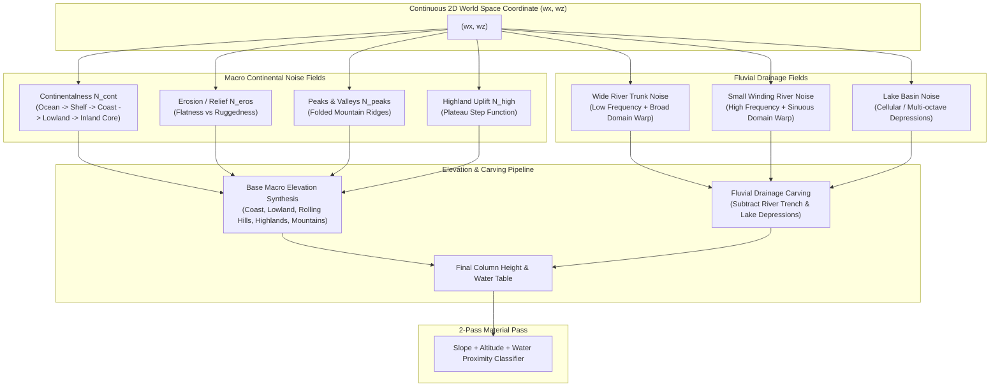

# Implementation Plan: Realistic 2D Noise Topography Framework

This document outlines the architectural audit, mathematical foundation, and step-by-step implementation plan for replacing the current basic continent generator with a high-fidelity **2D multi-noise realistic topography system** in Godot 4.4+.

---

## 1. Executive Summary & Framework Audit

### 1.1 Architecture & Separation of Concerns
The project strictly separates pure computational logic from engine scene tree nodes:
- **Pure Data & Logic (`RefCounted`)**:
  - `src/core/`: [ChunkCoord](file:///d:/GODOT/terrain/src/core/chunk_coord.gd), [WorldBounds](file:///d:/GODOT/terrain/src/core/world_bounds.gd), [SurfaceChunkData](file:///d:/GODOT/terrain/src/core/surface_chunk_data.gd), [MaterialRegistry](file:///d:/GODOT/terrain/src/core/material_registry.gd), [WorldConfig](file:///d:/GODOT/terrain/src/core/world_config.gd).
  - `src/generation/`: [TerrainGenerator](file:///d:/GODOT/terrain/src/generation/terrain_generator.gd), [ContinentMask](file:///d:/GODOT/terrain/src/generation/continent_mask.gd), [ContinentGenerator](file:///d:/GODOT/terrain/src/generation/continent_generator.gd), [ContinentGeneratorConfig](file:///d:/GODOT/terrain/src/generation/continent_generator_config.gd).
  - `src/meshing/`: [Mesher](file:///d:/GODOT/terrain/src/meshing/mesher.gd), [MeshData](file:///d:/GODOT/terrain/src/meshing/mesh_data.gd), [SurfaceShellMesher](file:///d:/GODOT/terrain/src/meshing/surface_shell_mesher.gd).
  - `src/streaming/`: [ChunkStreamer](file:///d:/GODOT/terrain/src/streaming/chunk_streamer.gd), [ChunkScheduler](file:///d:/GODOT/terrain/src/streaming/chunk_scheduler.gd).
  - *Hard Constraint*: [test_architecture.gd](file:///d:/GODOT/terrain/tests/unit/test_architecture.gd) prohibits pure layers from importing or extending `Node`, `Node3D`, `Node2D`, or referencing `src/world` or `src/player`. This ensures thread-safety on `WorkerThreadPool`.
- **Scene & Physics Layer (`Node3D`)**:
  - `src/world/`: [VoxelWorld](file:///d:/GODOT/terrain/src/world/voxel_world.gd), [ChunkNode](file:///d:/GODOT/terrain/src/world/chunk_node.gd), [WaterPlane](file:///d:/GODOT/terrain/src/world/water_plane.gd), [WorldBoundary](file:///d:/GODOT/terrain/src/world/world_boundary.gd).
  - `src/player/`: [PlayerMotor](file:///d:/GODOT/terrain/src/player/player_motor.gd), [PlayerInput](file:///d:/GODOT/terrain/src/player/player_input.gd), [ThirdPersonCamera](file:///d:/GODOT/terrain/src/player/third_person_camera.gd), [PlayerHUD](file:///d:/GODOT/terrain/src/player/player_hud.gd).

### 1.2 Performance & Baseline Metrics
- **Unit Suite**: 30 passing unit tests (~0.13 s).
- **Generation Benchmark**: Baseline is **6.05 ms** per 32×32 chunk (1,156 column samples with apron).
- **Meshing Benchmark**: Baseline is **4.98 ms** per 32×32 chunk.
- **Budget Goal**: Any new multi-noise 2D evaluation pipeline must execute under **8.0 ms** per chunk on a single worker thread to maintain streaming throughput.

### 1.3 Deficiencies in Current Terrain Generation
1. **Single Uniform Noise Layer**: Base elevation uses uniform FBM noise; land outside borders is clamped with no macro-continental variation.
2. **Missing Biome & Relief Zoning**: No natural differentiation between lowlands, highlands, rolling hills, and mountain ranges.
3. **No Fluvial Features**: Completely lacks rivers (wide trunk rivers, small winding streams) and lake basins.
4. **Binary Mountain Addition**: Mountains are simple additive bumps where noise exceeds a flat threshold, lacking alpine ridge structures, foothills, and valleys.

---

## 2. Realistic 2D Procedural Topography Architecture

In modern geomorphology and game engine world generation (e.g. Minecraft Multi-Noise, Outerra, FastNoise2), natural terrain is synthesized using multi-channel orthogonal noise fields evaluated at continuous 2D coordinates `(wx, wz)`.



---

## 3. Detailed Specification of the 8 Required Topographical Features

### 3.1 Coast
- **Geomorphology**: The transition zone where the continental landmass meets the ocean.
- **Noise Formulation**:
  - Sample `ContinentMask` combined with `N_cont(wx, wz)`.
  - When $C(wx, wz) \approx 0.0$, elevation gently crosses `sea_level` ($Y = 24$).
  - Slope is shallow ($0 \le \Delta h \le 1$), forming extensive beaches and tidal mudflats.
- **Material Rules**:
  - Elevations below `sea_level`: `MAT_SEABED`.
  - Elevations between `sea_level` and `sea_level + sand_height_offset`: `MAT_SAND`.
  - Gentle slopes transitioning to `MAT_GRASS`.

### 3.2 Lowland (Plains & Coastal Valleys)
- **Geomorphology**: Broad, expansive flat or gently undulating expanses above sea level.
- **Noise Formulation**:
  - Occurs where Continentalness is moderate ($0.15 \le C < 0.45$) and Erosion is high ($E > 0.60$).
  - Base elevation: $26 \le h \le 38$.
  - Low-amplitude FBM simplex noise (amplitude $3\text{--}6\text{ m}$, frequency $0.002$).
- **Material Rules**:
  - Dominated by fertile `MAT_GRASS` with `MAT_DIRT` side walls.

### 3.3 Highland (Elevated Plateaus & Tablelands)
- **Geomorphology**: Large inland elevated landmasses bounded by dramatic perimeter cliffs/escarpments.
- **Noise Formulation**:
  - Occurs where Continentalness is high ($C \ge 0.55$).
  - Evaluates a highland plateau noise using a sigmoidal smoothstep uplift:
    $$U_{\text{high}} = \text{smoothstep}(0.45, 0.70, C) \cdot A_{\text{highland}}$$
  - Adds $+45\text{--}+80\text{ m}$ of base elevation (plateau altitude $75\text{--}115\text{ m}$).
  - Plateau tops are undulating with plateau grass and high-altitude lakes.
- **Material Rules**:
  - Escarpment walls have steep slopes ($\text{slope} \ge 3$), triggering vertical `MAT_STONE` cliffs.
  - Plateau flat surfaces receive `MAT_GRASS`.

### 3.4 Rolling Hills
- **Geomorphology**: Rhythmic, wave-like rounded hills and valleys of moderate relief.
- **Noise Formulation**:
  - Occurs where Erosion is moderate ($0.35 \le E \le 0.65$) and Continentalness is intermediate ($0.30 \le C \le 0.70$).
  - Base elevation: $38\text{--}65\text{ m}$.
  - Harmonic billowy simplex noise:
    $$\text{billow}(n) = \lvert n \rvert \cdot 2.0 - 1.0$$
    with moderate wavelength (frequency $0.003\text{--}0.004$) and amplitude ($16\text{--}28\text{ m}$).
- **Material Rules**:
  - Lush `MAT_GRASS`, occasional `MAT_DIRT` on steeper crest slopes ($\text{slope} = 2$).

### 3.5 Mountainous Region
- **Geomorphology**: Dramatic, craggy mountain chains, sharp pyramid peaks, cirques, and alpine passes.
- **Noise Formulation**:
  - Occurs where Erosion is low ($E < 0.35$) and Continentalness is high ($C > 0.35$).
  - Ridged Multifractal noise:
    $$R(wx, wz) = \left(1.0 - \lvert N_{\text{mountain}}(wx, wz)\rvert\right)^{2.2}$$
  - Scaled by $(1.0 - E) \cdot A_{\text{mountain}}$ (amplitude $80\text{--}140\text{ m}$).
  - Elevations reach $110\text{--}220+\text{ m}$.
- **Material Rules**:
  - Steep grades ($\text{slope} \ge 3$) and altitudes $\ge \text{stone\_height}$ (90 m): `MAT_STONE`.
  - Altitudes $\ge \text{snow\_height}$ (130 m): `MAT_SNOW` top caps with `MAT_STONE` side faces.

### 3.6 Small Winding River (Brooks & Tributaries)
- **Geomorphology**: Narrow, sinuous streams cutting organically across hills and lowlands.
- **Noise Formulation**:
  - High-frequency simplex noise ($f \approx 0.0035$) with strong domain warping:
    $$\begin{cases}
    wx' = wx + N_{\text{meander\_x}}(wx, wz) \cdot 45.0 \\
    wz' = wz + N_{\text{meander\_z}}(wx, wz) \cdot 45.0
    \end{cases}$$
  - Sinuous center line: $d_{\text{small}} = \lvert N_{\text{small\_stream}}(wx', wz')\rvert$.
  - Channel width threshold: $T_{\text{small}} \approx 0.035$ (channel width ~4–6 m).
  - Parabolic carving function:
    $$\text{carve}_{\text{small}} = \left(1.0 - \frac{d_{\text{small}}}{T_{\text{small}}}\right)^2 \cdot D_{\text{small\_max}}$$
    where $D_{\text{small\_max}} \approx 3\text{--}5\text{ m}$.
- **Material Rules**:
  - Carved channel bed receives `MAT_GRAVEL` (or `MAT_SAND`) and moist dirt banks.

### 3.7 Wide River (Trunk River System)
- **Geomorphology**: Major continental rivers cutting deep valleys through highlands/hills, widening into estuaries at the coast.
- **Noise Formulation**:
  - Low-frequency trunk river noise ($f \approx 0.0009$) with broad domain warping ($D_{\text{warp}} \approx 140\text{ m}$).
  - Trunk center line: $d_{\text{wide}} = \lvert N_{\text{wide\_river}}(wx'', wz'')\rvert$.
  - Channel width threshold: $T_{\text{wide}} \approx 0.028$ (channel width ~18–32 m).
  - Smooth U-shaped trench carving:
    $$\text{factor} = 1.0 - \frac{d_{\text{wide}}}{T_{\text{wide}}}$$
    $$\text{carve}_{\text{wide}} = \text{smoothstep}(0.0, 1.0, \text{factor}) \cdot D_{\text{wide\_max}}$$
    where $D_{\text{wide\_max}} \approx 8\text{--}15\text{ m}$.
  - Naturally widens and deepens as it reaches coastal lowlands, flowing out into the ocean.
- **Material Rules**:
  - Riverbed: `MAT_SAND`, `MAT_GRAVEL`, or `MAT_SEABED`.
  - Canyon/bank walls: `MAT_STONE` or `MAT_DIRT`.

### 3.8 Lakes (Lowland Lakes, Highland Lakes, Mountain Tarns)
- **Geomorphology**: Natural inland water basins nestled between hills, on high plateaus, or in glacial mountain cirques.
- **Noise Formulation**:
  - Evaluated via cellular/Voronoi or low-frequency multi-octave depression noise ($f \approx 0.0012$).
  - When $N_{\text{lake}}(wx, wz) > T_{\text{lake}}$:
    $$\text{carve}_{\text{lake}} = \left(\frac{N_{\text{lake}} - T_{\text{lake}}}{1.0 - T_{\text{lake}}}\right)^{1.4} \cdot D_{\text{lake\_max}}$$
  - Carves a smooth, bowl-shaped depression ($D_{\text{lake\_max}} \approx 6\text{--}12\text{ m}$).
- **Material Rules**:
  - Gentle sandy shores (`MAT_SAND`), lakebed gravel/silt (`MAT_GRAVEL`/`MAT_SEABED`).

---

## 4. Hydrology & Water Handling

### 4.1 Global Sea-Level Water
The existing [WaterPlane](file:///d:/GODOT/terrain/src/world/water_plane.gd) sits at `sea_level` (height 24).
- Coastal waters, estuaries, and wide rivers/lowland lakes carved to or below `sea_level` are automatically submerged by the global water plane with **zero extra draw calls or vertex overhead**.

### 4.2 Elevated Water Bodies (Highland Lakes & Mountain Streams)
For elevated water bodies (water table above `sea_level`):
1. **Column Water Representation**:
   - [SurfaceChunkData](file:///d:/GODOT/terrain/src/core/surface_chunk_data.gd) stores an optional `water_heights: PackedInt32Array`.
   - When a highland lake basin or mountain stream is carved, the local water surface elevation $H_{\text{water}}$ is recorded.
2. **Meshing**:
   - In [SurfaceShellMesher](file:///d:/GODOT/terrain/src/meshing/surface_shell_mesher.gd), columns where $H_{\text{water}} > H_{\text{terrain}}$ generate horizontal water quads using greedy merging.
3. **Collision**:
   - Collision remains on the carved riverbed/lakebed ($H_{\text{terrain}}$), allowing the player to wade or swim naturally in the water without walking on an invisible solid surface.

---

## 5. Phase-by-Phase Implementation Roadmap

### Phase 1: Pure Data Structures & Configuration
**Target Files**:
- `src/generation/continent_generator_config.gd`
- `src/core/surface_chunk_data.gd`
- `src/core/material_registry.gd`
- `config/materials.tres`
- `config/default_generator.tres`

**Tasks**:
1. **Extend [ContinentGeneratorConfig](file:///d:/GODOT/terrain/src/generation/continent_generator_config.gd)** with typed `@export_group` categories:
   - `Continentalness`: `coast_falloff_distance`, `coast_warp_amplitude`, `continent_noise_frequency`.
   - `Erosion & Relief`: `erosion_frequency`, `lowland_base_elevation`, `lowland_amplitude`, `rolling_hills_frequency`, `rolling_hills_amplitude`.
   - `Highlands & Plateaus`: `highland_threshold`, `highland_boost`, `plateau_sharpness`.
   - `Mountain Ranges`: `mountain_frequency`, `mountain_octaves`, `mountain_power`, `mountain_amplitude`, `mountain_threshold`.
   - `Wide Rivers`: `wide_river_frequency`, `wide_river_warp_amplitude`, `wide_river_width`, `wide_river_depth`.
   - `Small Rivers`: `small_river_frequency`, `small_river_warp_amplitude`, `small_river_width`, `small_river_depth`.
   - `Lakes`: `lake_frequency`, `lake_threshold`, `lake_depth`.
2. **Add Material `MAT_GRAVEL = 7`**:
   - Register in [MaterialRegistry](file:///d:/GODOT/terrain/src/core/material_registry.gd) and [materials.tres](file:///d:/GODOT/terrain/config/materials.tres) with natural gravel/riverbed tones (`#5a574f`).
3. **Augment [SurfaceChunkData](file:///d:/GODOT/terrain/src/core/surface_chunk_data.gd)**:
   - Add `water_heights: PackedInt32Array`, `get_water_height(lx, lz)`, `set_water_height(lx, lz)`, `has_water(lx, lz)`.

### Phase 2: Procedural Topography Generation Pipeline
**Target Files**:
- `src/generation/continent_generator.gd`
- `src/generation/continent_mask.gd`

**Tasks**:
1. **Multi-Noise Engine Setup in `_init()`**:
   - Pre-configure all `FastNoiseLite` instances deterministically from `seed_val`:
     - `_cont_noise`: Continentalness noise (Simplex Smooth, low freq).
     - `_erosion_noise`: Erosion / roughness noise.
     - `_highland_noise`: Plateau uplift noise.
     - `_hills_noise`: Billowy rolling hills FBM noise.
     - `_mountain_noise`: Ridged multifractal mountain noise.
     - `_wide_river_noise` & `_wide_warp_noise`: Trunk river noise + large domain warp.
     - `_small_river_noise` & `_small_warp_noise`: Sinuous tributary noise + high-freq warp.
     - `_lake_noise`: Lake basin cellular / depression noise.
   - All noise instances remain strictly read-only after `_init()`, ensuring 100% thread safety on `WorkerThreadPool`.
2. **Height & Fluvial Calculation**:
   - Implement `_calculate_height()` combining macro elevation and fluvial carving.
   - Implement `height_at()` returning exact world heights for player spawn and raycasting.
3. **2-Pass Slope & Material Classifier**:
   - Pass 1: Compute heightfield and apron.
   - Pass 2: Calculate local 4-directional slope and classify materials:
     - Waterbed / riverbed: `MAT_GRAVEL` / `MAT_SAND`.
     - Beach / water line: `MAT_SAND`.
     - Escarpments & cliff faces ($\text{slope} \ge 3$): `MAT_STONE`.
     - Mountain crests: `MAT_STONE` ($h \ge \text{stone\_height}$), `MAT_SNOW` ($h \ge \text{snow\_height}$).
     - Lowlands & rolling hills: `MAT_GRASS` surface with `MAT_DIRT` walls.

### Phase 3: Meshing & Scene Layer Integration
**Target Files**:
- `src/meshing/surface_shell_mesher.gd`
- `src/world/chunk_node.gd`
- `src/world/voxel_world.gd`

**Tasks**:
1. **Water Surface Meshing**:
   - Extend [SurfaceShellMesher](file:///d:/GODOT/terrain/src/meshing/surface_shell_mesher.gd) to mesh horizontal water quads using 2D greedy merging for columns with elevated water ($H_{\text{water}} > \text{sea\_level}$).
2. **VoxelWorld Spawn Safety**:
   - Update `get_spawn_point()` in [VoxelWorld](file:///d:/GODOT/terrain/src/world/voxel_world.gd) to verify that the spawn column is dry land ($H > H_{\text{water}} + 1$) and on a gentle slope ($\le 1$) so the player never spawns submerged in a lake or river.

### Phase 4: Automated Testing, Benchmarking & Golden Verification
**Target Files**:
- `tests/unit/test_realistic_topography.gd` (new)
- `tests/regression/reg_generation.gd`
- `tests/benchmark/bench_generation.gd`

**Tasks**:
1. **Feature Unit Tests (`test_realistic_topography.gd`)**:
   - Test **Coast**: Verifies beach sand presence and elevation near sea level.
   - Test **Lowland**: Verifies low slope variance and elevation in lowland bounds.
   - Test **Highland**: Verifies plateau elevation step and stone cliff walls.
   - Test **Rolling Hills**: Verifies smooth wave-like undulations.
   - Test **Mountainous Region**: Verifies extreme elevation, stone faces, and snow caps.
   - Test **Small Winding River**: Verifies channel carving width (3–6 m) and depth (2–5 m).
   - Test **Wide River**: Verifies wide channel carving (18–32 m) and depth (8–15 m).
   - Test **Lakes**: Verifies localized bowl depression.
   - Test **Determinism & Bounds**: Verifies identical output for identical seeds and $h \in [6, 255]$.
2. **Benchmark Execution**:
   - Run `tests/run_tests.gd --suite=benchmark` to verify generation time stays within $\approx 6\text{--}8\text{ ms}$ per chunk.
3. **Golden Snapshot Update**:
   - Update regression snapshots using `--update-golden`.

---

## 6. Verification Plan

```bash
# 1. Run all unit tests (including architecture linter)
& 'D:\GODOT\Godot_v4.4.1-stable_win64_console.exe' --headless --path . -s res://tests/run_tests.gd -- --suite=unit

# 2. Run automated benchmarks to ensure < 10 ms budget
& 'D:\GODOT\Godot_v4.4.1-stable_win64_console.exe' --headless --path . -s res://tests/run_tests.gd -- --suite=benchmark

# 3. Update golden snapshots and run regression suite
& 'D:\GODOT\Godot_v4.4.1-stable_win64_console.exe' --headless --path . -s res://tests/run_tests.gd -- --suite=regression --update-golden

# 4. Run entire suite
& 'D:\GODOT\Godot_v4.4.1-stable_win64_console.exe' --headless --path . -s res://tests/run_tests.gd -- --suite=all
```
