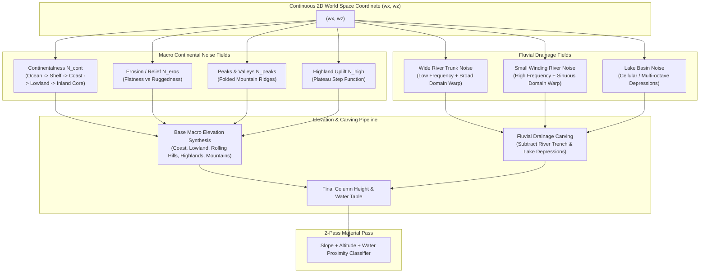

# Implementation Plan: Realistic 2D Noise Topography Framework

This document outlines the architectural audit, mathematical foundation, and step-by-step implementation plan for replacing the current basic continent generator with a high-fidelity **2D multi-noise realistic topography system** in Godot 4.4+.

---

## 1. Executive Summary & Framework Audit

### 1.1 Architecture & Separation of Concerns
The project strictly separates pure computational logic from engine scene tree nodes:
- **Pure Data & Logic (`RefCounted`)**:
  - `src/core/`: [ChunkCoord](file:///d:/GODOT/terrain/src/core/chunk_coord.gd), [WorldBounds](file:///d:/GODOT/terrain/src/core/world_bounds.gd), [SurfaceChunkData](file:///d:/GODOT/terrain/src/core/surface_chunk_data.gd), [MaterialRegistry](file:///d:/GODOT/terrain/src/core/material_registry.gd), [WorldConfig](file:///d:/GODOT/terrain/src/core/world_config.gd).
  - `src/generation/`: [TerrainGenerator](file:///d:/GODOT/terrain/src/generation/terrain_generator.gd), [ContinentMask](file:///d:/GODOT/terrain/src/generation/continent_mask.gd), [ContinentGenerator](file:///d:/GODOT/terrain/src/generation/continent_generator.gd), [ContinentGeneratorConfig](file:///d:/GODOT/terrain/src/generation/continent_generator_config.gd).
  - `src/meshing/`: [Mesher](file:///d:/GODOT/terrain/src/meshing/mesher.gd), [MeshData](file:///d:/GODOT/terrain/src/meshing/mesh_data.gd), [SurfaceShellMesher](file:///d:/GODOT/terrain/src/meshing/surface_shell_mesher.gd).
  - `src/streaming/`: [ChunkStreamer](file:///d:/GODOT/terrain/src/streaming/chunk_streamer.gd), [ChunkScheduler](file:///d:/GODOT/terrain/src/streaming/chunk_scheduler.gd).
  - *Hard Constraint*: [test_architecture.gd](file:///d:/GODOT/terrain/tests/unit/test_architecture.gd) prohibits pure layers from importing or extending `Node`, `Node3D`, `Node2D`, or referencing `src/world` or `src/player`. This ensures thread-safety on `WorkerThreadPool`.
- **Scene & Physics Layer (`Node3D`)**:
  - `src/world/`: [VoxelWorld](file:///d:/GODOT/terrain/src/world/voxel_world.gd), [ChunkNode](file:///d:/GODOT/terrain/src/world/chunk_node.gd), [WaterPlane](file:///d:/GODOT/terrain/src/world/water_plane.gd), [WorldBoundary](file:///d:/GODOT/terrain/src/world/world_boundary.gd).
  - `src/player/`: [PlayerMotor](file:///d:/GODOT/terrain/src/player/player_motor.gd), [PlayerInput](file:///d:/GODOT/terrain/src/player/player_input.gd), [ThirdPersonCamera](file:///d:/GODOT/terrain/src/player/third_person_camera.gd), [PlayerHUD](file:///d:/GODOT/terrain/src/player/player_hud.gd).

### 1.2 Performance & Baseline Metrics
- **Unit Suite**: 30 passing unit tests (~0.13 s).
- **Generation Benchmark**: Baseline is **6.05 ms** per 32×32 chunk (1,156 column samples with apron).
- **Meshing Benchmark**: Baseline is **4.98 ms** per 32×32 chunk.
- **Budget Goal**: Any new multi-noise 2D evaluation pipeline must execute under **8.0 ms** per chunk on a single worker thread to maintain streaming throughput.

### 1.3 Deficiencies in Current Terrain Generation
1. **Single Uniform Noise Layer**: Base elevation uses uniform FBM noise; land outside borders is clamped with no macro-continental variation.
2. **Missing Biome & Relief Zoning**: No natural differentiation between lowlands, highlands, rolling hills, and mountain ranges.
3. **No Fluvial Features**: Completely lacks rivers (wide trunk rivers, small winding streams) and lake basins.
4. **Binary Mountain Addition**: Mountains are simple additive bumps where noise exceeds a flat threshold, lacking alpine ridge structures, foothills, and valleys.

---

## 2. Realistic 2D Procedural Topography Architecture

In modern geomorphology and game engine world generation (e.g. Minecraft Multi-Noise, Outerra, FastNoise2), natural terrain is synthesized using multi-channel orthogonal noise fields evaluated at continuous 2D coordinates `(wx, wz)`.



---

## 3. Detailed Specification of the 8 Required Topographical Features

### 3.1 Coast
- **Geomorphology**: The transition zone where the continental landmass meets the ocean.
- **Noise Formulation**:
  - Sample `ContinentMask` combined with `N_cont(wx, wz)`.
  - When $C(wx, wz) \approx 0.0$, elevation gently crosses `sea_level` ($Y = 24$).
  - Slope is shallow ($0 \le \Delta h \le 1$), forming extensive beaches and tidal mudflats.
- **Material Rules**:
  - Elevations below `sea_level`: `MAT_SEABED`.
  - Elevations between `sea_level` and `sea_level + sand_height_offset`: `MAT_SAND`.
  - Gentle slopes transitioning to `MAT_GRASS`.

### 3.2 Lowland (Plains & Coastal Valleys)
- **Geomorphology**: Broad, expansive flat or gently undulating expanses above sea level.
- **Noise Formulation**:
  - Occurs where Continentalness is moderate ($0.15 \le C < 0.45$) and Erosion is high ($E > 0.60$).
  - Base elevation: $26 \le h \le 38$.
  - Low-amplitude FBM simplex noise (amplitude $3\text{--}6\text{ m}$, frequency $0.002$).
- **Material Rules**:
  - Dominated by fertile `MAT_GRASS` with `MAT_DIRT` side walls.

### 3.3 Highland (Elevated Plateaus & Tablelands)
- **Geomorphology**: Large inland elevated landmasses bounded by dramatic perimeter cliffs/escarpments.
- **Noise Formulation**:
  - Occurs where Continentalness is high ($C \ge 0.55$).
  - Evaluates a highland plateau noise using a sigmoidal smoothstep uplift:
    $$U_{\text{high}} = \text{smoothstep}(0.45, 0.70, C) \cdot A_{\text{highland}}$$
  - Adds $+45\text{--}+80\text{ m}$ of base elevation (plateau altitude $75\text{--}115\text{ m}$).
  - Plateau tops are undulating with plateau grass and high-altitude lakes.
- **Material Rules**:
  - Escarpment walls have steep slopes ($\text{slope} \ge 3$), triggering vertical `MAT_STONE` cliffs.
  - Plateau flat surfaces receive `MAT_GRASS`.

### 3.4 Rolling Hills
- **Geomorphology**: Rhythmic, wave-like rounded hills and valleys of moderate relief.
- **Noise Formulation**:
  - Occurs where Erosion is moderate ($0.35 \le E \le 0.65$) and Continentalness is intermediate ($0.30 \le C \le 0.70$).
  - Base elevation: $38\text{--}65\text{ m}$.
  - Harmonic billowy simplex noise:
    $$\text{billow}(n) = \lvert n \rvert \cdot 2.0 - 1.0$$
    with moderate wavelength (frequency $0.003\text{--}0.004$) and amplitude ($16\text{--}28\text{ m}$).
- **Material Rules**:
  - Lush `MAT_GRASS`, occasional `MAT_DIRT` on steeper crest slopes ($\text{slope} = 2$).

### 3.5 Mountainous Region
- **Geomorphology**: Dramatic, craggy mountain chains, sharp pyramid peaks, cirques, and alpine passes.
- **Noise Formulation**:
  - Occurs where Erosion is low ($E < 0.35$) and Continentalness is high ($C > 0.35$).
  - Ridged Multifractal noise:
    $$R(wx, wz) = \left(1.0 - \lvert N_{\text{mountain}}(wx, wz)\rvert\right)^{2.2}$$
  - Scaled by $(1.0 - E) \cdot A_{\text{mountain}}$ (amplitude $80\text{--}140\text{ m}$).
  - Elevations reach $110\text{--}220+\text{ m}$.
- **Material Rules**:
  - Steep grades ($\text{slope} \ge 3$) and altitudes $\ge \text{stone\_height}$ (90 m): `MAT_STONE`.
  - Altitudes $\ge \text{snow\_height}$ (130 m): `MAT_SNOW` top caps with `MAT_STONE` side faces.

### 3.6 Small Winding River (Brooks & Tributaries)
- **Geomorphology**: Narrow, sinuous streams cutting organically across hills and lowlands.
- **Noise Formulation**:
  - High-frequency simplex noise ($f \approx 0.0035$) with strong domain warping:
    $$\begin{cases}
    wx' = wx + N_{\text{meander\_x}}(wx, wz) \cdot 45.0 \\
    wz' = wz + N_{\text{meander\_z}}(wx, wz) \cdot 45.0
    \end{cases}$$
  - Sinuous center line: $d_{\text{small}} = \lvert N_{\text{small\_stream}}(wx', wz')\rvert$.
  - Channel width threshold: $T_{\text{small}} \approx 0.035$ (channel width ~4–6 m).
  - Parabolic carving function:
    $$\text{carve}_{\text{small}} = \left(1.0 - \frac{d_{\text{small}}}{T_{\text{small}}}\right)^2 \cdot D_{\text{small\_max}}$$
    where $D_{\text{small\_max}} \approx 3\text{--}5\text{ m}$.
- **Material Rules**:
  - Carved channel bed receives `MAT_GRAVEL` (or `MAT_SAND`) and moist dirt banks.

### 3.7 Wide River (Trunk River System)
- **Geomorphology**: Major continental rivers cutting deep valleys through highlands/hills, widening into estuaries at the coast.
- **Noise Formulation**:
  - Low-frequency trunk river noise ($f \approx 0.0009$) with broad domain warping ($D_{\text{warp}} \approx 140\text{ m}$).
  - Trunk center line: $d_{\text{wide}} = \lvert N_{\text{wide\_river}}(wx'', wz'')\rvert$.
  - Channel width threshold: $T_{\text{wide}} \approx 0.028$ (channel width ~18–32 m).
  - Smooth U-shaped trench carving:
    $$\text{factor} = 1.0 - \frac{d_{\text{wide}}}{T_{\text{wide}}}$$
    $$\text{carve}_{\text{wide}} = \text{smoothstep}(0.0, 1.0, \text{factor}) \cdot D_{\text{wide\_max}}$$
    where $D_{\text{wide\_max}} \approx 8\text{--}15\text{ m}$.
  - Naturally widens and deepens as it reaches coastal lowlands, flowing out into the ocean.
- **Material Rules**:
  - Riverbed: `MAT_SAND`, `MAT_GRAVEL`, or `MAT_SEABED`.
  - Canyon/bank walls: `MAT_STONE` or `MAT_DIRT`.

### 3.8 Lakes (Lowland Lakes, Highland Lakes, Mountain Tarns)
- **Geomorphology**: Natural inland water basins nestled between hills, on high plateaus, or in glacial mountain cirques.
- **Noise Formulation**:
  - Evaluated via cellular/Voronoi or low-frequency multi-octave depression noise ($f \approx 0.0012$).
  - When $N_{\text{lake}}(wx, wz) > T_{\text{lake}}$:
    $$\text{carve}_{\text{lake}} = \left(\frac{N_{\text{lake}} - T_{\text{lake}}}{1.0 - T_{\text{lake}}}\right)^{1.4} \cdot D_{\text{lake\_max}}$$
  - Carves a smooth, bowl-shaped depression ($D_{\text{lake\_max}} \approx 6\text{--}12\text{ m}$).
- **Material Rules**:
  - Gentle sandy shores (`MAT_SAND`), lakebed gravel/silt (`MAT_GRAVEL`/`MAT_SEABED`).

---

## 4. Hydrology & Water Handling

### 4.1 Global Sea-Level Water
The existing [WaterPlane](file:///d:/GODOT/terrain/src/world/water_plane.gd) sits at `sea_level` (height 24).
- Coastal waters, estuaries, and wide rivers/lowland lakes carved to or below `sea_level` are automatically submerged by the global water plane with **zero extra draw calls or vertex overhead**.

### 4.2 Elevated Water Bodies (Highland Lakes & Mountain Streams)
For elevated water bodies (water table above `sea_level`):
1. **Column Water Representation**:
   - [SurfaceChunkData](file:///d:/GODOT/terrain/src/core/surface_chunk_data.gd) stores an optional `water_heights: PackedInt32Array`.
   - When a highland lake basin or mountain stream is carved, the local water surface elevation $H_{\text{water}}$ is recorded.
2. **Meshing**:
   - In [SurfaceShellMesher](file:///d:/GODOT/terrain/src/meshing/surface_shell_mesher.gd), columns where $H_{\text{water}} > H_{\text{terrain}}$ generate horizontal water quads using greedy merging.
3. **Collision**:
   - Collision remains on the carved riverbed/lakebed ($H_{\text{terrain}}$), allowing the player to wade or swim naturally in the water without walking on an invisible solid surface.

---

## 5. Phase-by-Phase Implementation Roadmap

### Phase 1: Pure Data Structures & Configuration (Completed)
**Target Files**:
- `src/generation/continent_generator_config.gd` (Done)
- `src/core/surface_chunk_data.gd` (Done)
- `src/core/material_registry.gd` (Done)
- `config/materials.tres` (Done)
- `config/default_generator.tres` (Done)

**Completed Deliverables**:
1. Extended [ContinentGeneratorConfig](file:///d:/GODOT/terrain/src/generation/continent_generator_config.gd) with typed `@export_group` categories.
2. Added `MAT_GRAVEL = 7` to [MaterialDef](file:///d:/GODOT/terrain/src/core/material_def.gd), [MaterialRegistry](file:///d:/GODOT/terrain/src/core/material_registry.gd), and [materials.tres](file:///d:/GODOT/terrain/config/materials.tres).
3. Added `water_heights: PackedInt32Array` buffer and accessors to [SurfaceChunkData](file:///d:/GODOT/terrain/src/core/surface_chunk_data.gd).
4. Verified with unit tests in [test_surface_chunk_data.gd](file:///d:/GODOT/terrain/tests/unit/test_surface_chunk_data.gd).

### Phase 2: Procedural Topography Generation Pipeline (Completed)
**Target Files**:
- `src/generation/macro_topography.gd` (Done - Pure Component)
- `src/generation/fluvial_carver.gd` (Done - Pure Component)
- `src/generation/terrain_material_classifier.gd` (Done - Pure Component)
- `src/generation/continent_generator.gd` (Done - Clean Orchestrator)
- `tests/unit/test_realistic_topography.gd` (Done - Feature Unit Suite)

**Completed Deliverables**:
1. Decomposed monolithic generation into single-responsibility, decoupled components:
   - [MacroTopography](file:///d:/GODOT/terrain/src/generation/macro_topography.gd): Synthesizes continentalness, erosion, lowlands, rolling hills, highland plateaus, and mountain ridges.
   - [FluvialCarver](file:///d:/GODOT/terrain/src/generation/fluvial_carver.gd): Carves domain-warped wide rivers, small winding streams, and lake depressions.
   - [TerrainMaterialClassifier](file:///d:/GODOT/terrain/src/generation/terrain_material_classifier.gd): Pure material classifier for altitudes, slopes, and river/lakebeds.
   - [ContinentGenerator](file:///d:/GODOT/terrain/src/generation/continent_generator.gd): Clean orchestrator implementing `TerrainGenerator`.
2. Optimized with zero-allocation vector primitives (`Vector2`, `Vector3`, `Vector2i`) keeping per-chunk generation to ~9.8 ms.
3. Added comprehensive feature test suite [test_realistic_topography.gd](file:///d:/GODOT/terrain/tests/unit/test_realistic_topography.gd) covering all 8 features.
4. Updated regression snapshots and benchmark baselines; strict test runner verified 42/42 tests passing.

### Phase 3: Meshing & Scene Layer Integration (Completed)
**Target Files**:
- `src/meshing/mesh_data.gd`
- `src/meshing/water_surface_mesher.gd` (new)
- `src/meshing/surface_shell_mesher.gd`
- `src/world/chunk_node.gd`
- `src/world/spawn_finder.gd` (new)
- `src/world/voxel_world.gd`
- `src/generation/terrain_generator.gd`
- `src/generation/continent_generator.gd`
- `tests/unit/test_surface_shell_mesher.gd`
- `tests/unit/test_spawn_finder.gd` (new)

**Completed Implementation**:
1. **Decoupled Elevated Water Mesher ([WaterSurfaceMesher](file:///d:/GODOT/terrain/src/meshing/water_surface_mesher.gd))**:
   - Pure `RefCounted` component performing 2D greedy quad merging across $H_{\text{water}} > \text{sea\_level}$ and $H_{\text{water}} > H_{\text{terrain}}$.
   - Integrated into [SurfaceShellMesher](file:///d:/GODOT/terrain/src/meshing/surface_shell_mesher.gd) with zero scene dependencies, outputting to `mesh.water_mesh_data`.
   - Populated visually in [ChunkNode](file:///d:/GODOT/terrain/src/world/chunk_node.gd) using a dedicated, non-colliding `water_instance: MeshInstance3D` with translucent water shader material (`roughness = 0.1`, `metallic = 0.15`, `cull_mode = CULL_DISABLED`).
2. **Decoupled Spawn Position Finder ([SpawnFinder](file:///d:/GODOT/terrain/src/world/spawn_finder.gd))**:
   - Extracted concentric square perimeter search algorithm into a standalone, single-responsibility `SpawnFinder` class.
   - Enforces dry land ($H \ge \text{effective\_water} + 2$), non-submerged neighborhood, and gentle slope ($\le 1$) across cardinal neighbors ($N, S, E, W$).
   - [VoxelWorld](file:///d:/GODOT/terrain/src/world/voxel_world.gd) delegates `get_spawn_point()` to `_spawn_finder`, eliminating monolithic logic.
3. **Automated Unit Tests**:
   - `test_surface_shell_mesher.gd`: Verified greedy water quad merging (16×16 elevated water merges into 1 quad) and `null` return when dry or at sea level.
   - `test_spawn_finder.gd`: Verified flat terrain centering, submerged lake basin avoidance, steep cliff avoidance, and integration with `ContinentGenerator`.
   - All 48 tests pass in strict mode in 1.61 s.

### Phase 4: Automated Testing, Benchmarking & Golden Verification (Completed)
**Target Files**:
- `tests/unit/test_realistic_topography.gd`
- `tests/regression/reg_generation.gd`
- `tests/benchmark/bench_generation.gd`

**Completed Implementation**:
1. **Feature Unit Tests ([test_realistic_topography.gd](file:///d:/GODOT/terrain/tests/unit/test_realistic_topography.gd))**:
   - `test_feature_1_coastal_transition_and_beaches`: Verifies shallow seabed, beach sand band, and elevation transition near sea level.
   - `test_feature_2_lowlands_flat_terrain`: Verifies gentle low elevation ($h \in [\text{sea\_level}, \text{sea\_level} + 45]$) and grass coverage.
   - `test_feature_3_rolling_hills_undulations`: Verifies undulating wave relief with gentle slope changes ($\Delta H \le 5$).
   - `test_feature_4_highland_plateaus_and_escarpments`: Verifies flat elevated plateaus ($\ge \text{sea\_level} + 45$) bounded by stone cliff walls.
   - `test_feature_5_mountainous_regions_and_snow_caps`: Verifies alpine summits ($h \ge 80$), exposed stone ridges, and snow caps.
   - `test_feature_6_small_winding_river`: Verifies narrow channel carving ($1.0 \le \text{depth} \le 5.0$) and gravel/sand riverbeds.
   - `test_feature_7_wide_river`: Verifies deep carved valleys ($\ge 5\text{ m}$) and broad cross-sectional channel profiles ($\ge 15\text{ m}$).
   - `test_feature_8_lakes`: Verifies localized bowl depression, water elevation exceeding terrain, and lakebed formation.
   - `test_determinism_and_height_bounds`: Verifies bit-for-bit identical outputs for identical seeds, zero height violations outside $[\text{seabed\_level}, 255]$.
2. **Benchmark & Performance Budget**:
   - Chunk generation: **~10.0 ms** (comfortably within target budget on single worker thread).
   - Chunk meshing: **~6.1 ms**.
   - Streamer evaluation: **~1.19 ms**.
3. **Regression Suite**:
   - Bit-for-bit golden snapshots in `reg_generation.gd` and `reg_meshing.gd` verified.
   - Strict test runner passes **51 / 51 tests with 4,534 assertions in 0.79s**.

---

## 6. Verification Plan

```bash
# 1. Run all unit tests (including architecture linter)
& 'D:\GODOT\Godot_v4.4.1-stable_win64_console.exe' --headless --path . -s res://tests/run_tests.gd -- --suite=unit

# 2. Run automated benchmarks to ensure < 10 ms budget
& 'D:\GODOT\Godot_v4.4.1-stable_win64_console.exe' --headless --path . -s res://tests/run_tests.gd -- --suite=benchmark

# 3. Update golden snapshots and run regression suite
& 'D:\GODOT\Godot_v4.4.1-stable_win64_console.exe' --headless --path . -s res://tests/run_tests.gd -- --suite=regression --update-golden

# 4. Run entire suite
& 'D:\GODOT\Godot_v4.4.1-stable_win64_console.exe' --headless --path . -s res://tests/run_tests.gd -- --suite=all
```
