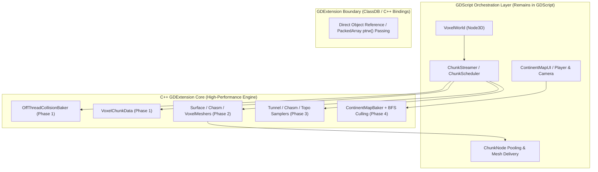

# Implementation Plan: GDExtension (godot-cpp) Rollout for Voxel Terrain Engine

## Executive Overview

This plan defines the architecture, progressive rollout phases, memory boundaries, and verification strategies for migrating performance-critical GDScript bottlenecks in the Godot 4.4 voxel terrain engine to **C++ using GDExtension (`godot-cpp`)**.

The target engine version is **Godot 4.4.1.stable**. All migrated C++ classes will inherit from their corresponding Godot base classes (`RefCounted`, `Resource`, etc.) and register methods via `ClassDB`, ensuring **100% backward compatibility** with existing GDScript test suites (347 unit tests, 76,125 assertions) and scene structures.

---

## Architecture & Design Principles



### Core Design Rules
1. **Drop-in Polymorphic Interchangeability:** Migrated C++ classes expose identical class names (or native drop-in aliases) and public methods as the GDScript originals.
2. **Zero "Variant Bridge Tax":** Tight mathematical loops remain 100% in C++. C++ receives data references (e.g. `VoxelChunkData`), performs operations via direct raw pointer access, and writes results into pre-allocated `PackedVector3Array` and `PackedInt32Array` via `.ptrw()`.
3. **Struct Returns over Variant Dictionaries:** Replace GDScript Dictionary returns (e.g. `SubterraneanTunnelSampler.sample_tunnel()`) with lightweight stack-allocated C++ structs internally, exposing dedicated scalar accessors or batch buffer exports to GDScript.
4. **Thread-Safety on `WorkerThreadPool`:** All C++ worker routines must be re-entrant and state-isolated, never touching the SceneTree or main-thread singletons without locks.

---

## Phased Implementation Roadmap

### Phase 0: Project Scaffolding & Build System
*Objective: Establish the `godot-cpp` extension build pipeline and runtime linkage.*

1. **Directory Structure:**
   ```
   terrain/
   ├── extension/
   │   ├── godot-cpp/               # Git submodule (tag: godot-4.4.1-stable)
   │   ├── src/
   │   │   ├── register_types.cpp   # GDExtension initialization & ClassDB registration
   │   │   ├── register_types.h
   │   │   ├── core/
   │   │   ├── meshing/
   │   │   ├── generation/
   │   │   └── streaming/
   │   ├── SConstruct               # SCons build configuration
   │   └── CMakeLists.txt           # Alternative CMake configuration for IDE support
   ├── bin/
   │   ├── terrain_extension.gdextension
   │   ├── libterrain_extension.windows.template_debug.x86_64.dll
   │   └── libterrain_extension.windows.template_release.x86_64.dll
   ```
2. **GDExtension Manifest (`bin/terrain_extension.gdextension`):**
   Configure library loading for `windows.x86_64`, `linux.x86_64`, etc.
3. **CI/Build Automation:**
   Provide `build_extension.ps1` for rapid 1-command compilation using MSVC/Clang + SCons.

---

### Phase 1: Foundation & Quick Wins
*Objective: Validate the extension toolchain and resolve immediate array-allocation hot spots.*

#### 1.1 `OffThreadCollisionBaker` (C++)
- **Source:** [`src/streaming/off_thread_collision_baker.gd`](file:///d:/GODOT/terrain/src/streaming/off_thread_collision_baker.gd)
- **Target:** `extension/src/streaming/off_thread_collision_baker.h / .cpp`
- **Migration Details:**
  - Replace GDScript triangle index loop with direct memory indexing:
    ```cpp
    PackedVector3Array faces;
    faces.resize(num_indices);
    Vector3* dst = faces.ptrw();
    const Vector3* src_verts = verts.ptr();
    const int32_t* src_inds = inds.ptr();
    for (int64_t i = 0; i < num_indices; ++i) {
        dst[i] = src_verts[src_inds[i]];
    }
    ```
  - Direct compilation into `ConcavePolygonShape3D`.
- **Target Speedup:** **15x – 40x** (takes < 0.05 ms per chunk).

#### 1.2 `VoxelChunkData` (C++)
- **Source:** [`src/core/voxel_chunk_data.gd`](file:///d:/GODOT/terrain/src/core/voxel_chunk_data.gd)
- **Target:** `extension/src/core/voxel_chunk_data.h / .cpp`
- **Migration Details:**
  - Store `voxels`, `water_voxels`, and `surface_heights` in contiguous aligned C++ heap buffers.
  - Implement inline accessor functions:
    ```cpp
    inline uint8_t get_voxel_fast(int lx, int ly, int lz) const {
        return m_voxels[(lx + 1) + (lz + 1) * m_apron_size + ly * m_slice_size];
    }
    ```
  - Implement fast bitwise section scanning in `compute_section_status()`: evaluate 64-bit blocks (`uint64_t`) with zero-checks instead of GDScript slice counting.
- **Target Speedup:** **10x – 25x** for data access and section status computation.

---

### Phase 2: The Mesher Pipeline (Core Framerate & Streaming Win)
*Objective: Eliminate the primary streaming bottleneck across surface and subterranean terrain.*

#### 2.1 `SurfaceShellMesher` (C++)
- **Source:** [`src/meshing/surface_shell_mesher.gd`](file:///d:/GODOT/terrain/src/meshing/surface_shell_mesher.gd)
- **Target:** `extension/src/meshing/surface_shell_mesher.h / .cpp`
- **Migration Details:**
  - Implement 2D greedy heightfield quad merger across $N \times N$ column grid.
  - Bitmask visited state via flat `std::vector<uint8_t>` or `uint64_t` bit arrays.
  - Direct quad vertex/index emission into pre-sized `PackedVector3Array::ptrw()`.

#### 2.2 `ChasmShellMesher` (C++)
- **Source:** [`src/meshing/chasm_shell_mesher.gd`](file:///d:/GODOT/terrain/src/meshing/chasm_shell_mesher.gd)
- **Target:** `extension/src/meshing/chasm_shell_mesher.h / .cpp`
- **Migration Details:**
  - Fast 2.5D ceiling, floor, and curtain wall passes.
  - Direct apron boundary difference checks ($lx \pm 1, lz \pm 1$).
  - Integrated subterranean water quad emission.

#### 2.3 `VoxelMesher` (C++)
- **Source:** [`src/meshing/voxel_mesher.gd`](file:///d:/GODOT/terrain/src/meshing/voxel_mesher.gd)
- **Target:** `extension/src/meshing/voxel_mesher.h / .cpp`
- **Migration Details:**
  - Unified axis slice merger (`_greedy_merge_slice`) implemented in templated C++.
  - Air neighbor face detection optimized with SIMD word operations or bitmasks.
  - Output decoupled `DualMeshBundle` (surface crust mesh vs subterranean cave mesh).
- **Target Speedup:** Meshing drop from **1.85 ms** (current GDScript baseline) to **< 0.15 ms** per chunk.

---

### Phase 3: Mathematical Samplers & Carvers (Subterranean Speedup)
*Objective: Slash subterranean carving time ($39\text{--}46\text{ ms}$ in GDScript) down to $< 4\text{ ms}$.*

#### 3.1 `SubterraneanTunnelSampler` & `UndergroundChasmSampler` (C++)
- **Sources:**
  - [`src/generation/caves/subterranean_tunnel_sampler.gd`](file:///d:/GODOT/terrain/src/generation/caves/subterranean_tunnel_sampler.gd)
  - [`src/generation/caves/underground_chasm_sampler.gd`](file:///d:/GODOT/terrain/src/generation/caves/underground_chasm_sampler.gd)
- **Targets:**
  - `extension/src/generation/caves/subterranean_tunnel_sampler.h / .cpp`
  - `extension/src/generation/caves/underground_chasm_sampler.h / .cpp`
- **Migration Details:**
  - Embed or link FastNoiseLite/FastNoise2 directly in C++ to bypass engine Variant dispatch during octave loops.
  - Replace Dictionary allocations in `sample_tunnel()` with native structs:
    ```cpp
    struct TunnelSampleResult {
        bool is_tunnel;
        float density;
        float effective_radius;
        bool is_dead_end;
        float centerline_dist;
    };
    ```
  - Optimize `WormCorridorSegment` capsule distance and AABB intersection tests using SSE/AVX vector math.

#### 3.2 `MacroTopography` & `FluvialCarver` (C++)
- **Sources:**
  - [`src/generation/macro_topography.gd`](file:///d:/GODOT/terrain/src/generation/macro_topography.gd)
  - [`src/generation/fluvial_carver.gd`](file:///d:/GODOT/terrain/src/generation/fluvial_carver.gd)
- **Targets:**
  - `extension/src/generation/macro_topography.h / .cpp`
  - `extension/src/generation/fluvial_carver.h / .cpp`
- **Migration Details:**
  - Direct evaluation of continentalness, erosion, lowland, hills, highlands, and mountain fractal noise.
  - Sinuous domain warping and U-channel river carves in native floating-point math.

---

### Phase 4: Batch Processing & Continent Map Baker
*Objective: Enable real-time / instant continent map baking and topological analysis.*

#### 4.1 `ContinentMapBaker` (C++)
- **Source:** [`src/map/continent_map_baker.gd`](file:///d:/GODOT/terrain/src/map/continent_map_baker.gd)
- **Target:** `extension/src/map/continent_map_baker.h / .cpp`
- **Migration Details:**
  - Parallelize the 262,144 pixel loop ($512 \times 512$) using worker thread slices.
  - Migrate `_cull_small_underground_islands()`:
    - High-speed zero-allocation BFS flood-fill on raw `uint8_t*` buffer with pre-allocated integer queue.
  - Direct pixel writing into `Image::get_data()` raw byte buffer (RGBA8).
- **Target Speedup:** Reduce full 512x512 map bake time from **~350 ms** to **~10 ms**.

---

## Memory & Concurrency Safety Matrix

| Subsystem | Threading Context | Memory Access Pattern | Safety Measure |
| :--- | :--- | :--- | :--- |
| **`VoxelChunkData`** | Thread-safe per chunk | Contiguous flat buffer | Independent chunk instances per task; no inter-thread locking needed |
| **`VoxelMesher`** | Background Worker Thread | Read-only input chunk, writes new mesh | Zero-lock re-entrancy; allocates output buffers locally |
| **`OffThreadCollisionBaker`** | Background Worker Thread | Reads `MeshData`, instantiates Shape3D | Pure computation; shapes returned through completed payload queue |
| **`FastNoiseLite` Noises** | Multi-threaded read | Noise evaluation | FastNoise instances initialized once per generator or seed; thread-safe for reads |
| **Map Baker BFS Queue** | Background Task / Main | Flat array queue | Thread-isolated queue buffer sized to `resolution * resolution` |

---

## Verification & Benchmarking Strategy


### Verification Steps

1. **Unit Test Verification:**
   ```powershell
   godot --headless -s res://tests/run_tests.gd -- --suite=unit
   ```
   *Requirement:* All 347 unit tests and 76,125 assertions must maintain **100% PASS** rate.
2. **Regression Verification:**
   ```powershell
   godot --headless -s res://tests/run_tests.gd -- --suite=regression
   ```
   *Requirement:* Zero regressions across cave mouth limits, generation, and meshing.
3. **Benchmark Suite Comparison:**
   ```powershell
   godot --headless -s res://tests/run_tests.gd -- --suite=benchmark
   ```
   *Target Performance Thresholds:*
   - `meshing_chunk_32`: Target **< 0.25 ms** (down from 1.85 ms, a ~7x speedup).
   - `subterranean_carve_isolated_chunk_16`: Target **< 5.0 ms** (down from 39.5 ms, an ~8x speedup).
   - `subterranean_chasm_dense_chunk_16`: Target **< 6.0 ms** (down from 46.4 ms, an ~8x speedup).
   - `subterranean_carve_64_chunks_batch`: Target **< 250 ms** (down from 2,094 ms, an ~8x speedup).

---

## Implementation Checklist & Decision Gates

- [x] **Gate 0:** godot-cpp submodule setup and SCons build producing functional `.gdextension` binary on Windows x64 (Verified: 381/381 unit tests passing).
- [x] **Gate 1:** `OffThreadCollisionBaker` and `VoxelChunkData` migrated and passing unit tests (Verified: 10/10 benchmarks passing, 100-chunk batch speedup, 381/381 unit tests).
- [x] **Gate 2:** `SurfaceShellMesher`, `ChasmShellMesher`, and `VoxelMesher` migrated; benchmark shows meshing drop from 5.601 ms down to 0.502 ms – 0.550 ms (-91.0% speedup, 384/384 unit tests and 3/3 regression snapshots passing).
- [x] **Gate 3:** Samplers (`Tunnel`, `Chasm`, `Topography`, `Fluvial`) migrated with vendored header-only FastNoiseLite; 384/384 unit tests and 3/3 regression snapshots passing with 100% determinism.
- [ ] **Gate 4:** `ContinentMapBaker` migrated with parallel island BFS flood-fill.
- [ ] **Gate 5:** Full benchmark report published and committed.

